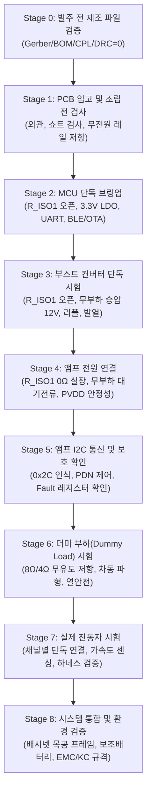

# MAJN 차기 리비전 회로 설계 검증 계획서 (DVP)
(Design Verification Plan: Pre-Fab Audit & Step-by-Step Bringup Protocol)

- **문서 버전**: v1.0
- **작성 일자**: 2026-11-02
- **대상 회로**: MAJN 스마트 배시넷 차기 리비전 하드웨어
- **문서 목적**: 거버 발주 전 DFM/설계 검증부터, 실물 기판 조립 후 고장 요인을 단계별로 물리적으로 격리하여 안전하게 점진 검증(Step-by-step Bringup)하는 표준 시험 절차를 규정함.

---

> [!CAUTION]
> **계측 안전 절대 수칙 (Mandatory Safety Rule)**
> * **BTL 접지 클립 직결 엄격 금지**: TAS5805M의 BTL 출력단(`OUT_A+`, `OUT_A-`, `OUT_B+`, `OUT_B-`)은 대지 접지(GND) 대비 약 $+6\text{ V}_{\text{DC}}$ 공통 모드 바이어스 상태이다.
> * **절대 오실로스코프 프로브의 접지 악어 클립을 출력 핀에 직결하지 않는다.** (체결 즉시 PVDD $\rightarrow$ 내부 FET $\rightarrow$ 스코프 접지선으로 이어지는 단락 전류로 인해 앰프 칩이 소손됨)
> * 반드시 **절연 차동 프로브(Differential Probe)**를 사용하거나, **2채널 싱글엔드 프로브 각각 접지 체결 후 오실로스코프 연산(Math: Ch1 - Ch2) 기능**을 적용하여 계측한다.

---

## 1. DVP 총괄 검증 단계 요약

---

## 2. 세부 검증 단계 및 판정 기준 (Verification Protocols)

### Stage 0. 발주 전 설계 파일 무결성 검증 (Pre-Fab Audit)
기판 제작 및 발주 전, 소프트웨어 툴 및 파이썬 검증기를 통해 휴먼 에러를 원천 차단한다.

| 검사 항목 | 세부 검증 내용 | 합격 기준 (Pass Criteria) |
| :--- | :--- | :--- |
| **0.1 1:1:1 정합성** | 거버(FPT) 부품 수 == BOM 부품 수 == CPL 실장 부품 수 | 불일치 0건 (`verify_mfg_package.py` PASS) |
| **0.2 풋프린트 회전** | U1(ESP32), 직각 헤더(J1/J2), 다이오드 Pin 1 방향 확인 | CPL Rotation과 실제 랜드 패턴 100% 일치 |
| **0.3 에디터 DRC** | EasyEDA Pro 내장 디자인 룰 검사 실행 | Clearances, Crossings, Overlaps = 0건 |
| **0.4 격리 점퍼 유무** | 부스트 출력과 앰프 PVDD 사이 `R_ISO1` 풋프린트 확인 | 회로도 및 PCB 배치상 물리적 분리 확인 |

---

### Stage 1. PCB 입고 및 조립 전 무전원 검사 (Pre-Assembly / Unpowered Inspection)
기판에 전원을 인가하기 전, 납땜 불량 및 패턴 단락을 검증한다.

* **시험 절차**:
  1. 현미경/확대경으로 납 브릿지, 냉납, 부품 오삽입(다이오드 극성, IC 1번 핀) 외관 검사.
  2. 디지털 멀티미터(저항 모드)로 주요 전원 레일의 대지 접지(GND) 저항 측정:
     - `TP_VBUS` $\leftrightarrow$ `GND`: 정상 시 수 $\text{k}\Omega$ 이상 (TVS 및 MLCC 충전 후 무한대 수렴)
     - `TP_3V3` $\leftrightarrow$ `GND`: 정상 시 수 $\text{k}\Omega \sim$ 수십 $\text{k}\Omega$
     - `TP_PVDD_BOOST` $\leftrightarrow$ `GND` (`R_ISO1` 오픈 상태): $\ge 100\text{ k}\Omega$
     - `TP_PVDD_AMP` $\leftrightarrow$ `GND` (`R_ISO1` 오픈 상태): $\ge 50\text{ k}\Omega$
* **판정 기준**: 어떠한 전원 레일에서도 $100\,\Omega$ 이하의 비정상 저저항 경로가 관찰되지 않아야 합격.

---

### Stage 2. MCU 단독 브링업 (Standalone MCU Bringup)
고전압(12V) 승압 및 오디오 앰프를 완전히 차단한 상태에서 디지털 제어 코어의 생존성을 검증한다.

* **시험 조건**: `R_ISO1` **미실장 (오픈 상태)**, 벤치 파워서플라이 $5.0\text{V}$ (전류 제한 $200\text{mA}$) 인가.
* **시험 절차**:
  1. `TP_3V3` 전압 계측 ($3.25\text{V} \sim 3.35\text{V}$ 확인).
  2. 6핀 UART 헤더를 통해 시리얼 부팅 로그 출력 확인.
  3. ESP32 펌웨어 플래싱 (수동 `IO0` 다운로드 모드 및 Wi-Fi/BLE OTA 동작 검증).
  4. GPIO 초기화 상태 검증: 부팅 직후 `BOOST_EN` = LOW, `AMP_PDN` = LOW 유지 확인.
* **판정 기준**: LDO 발열 없음, 시리얼 콘솔 정상 출력, 무선 신호 정상 송출.

---

### Stage 3. 부스트 컨버터 단독 시험 (Standalone Boost Converter Test)
부하(앰프)와 물리적으로 절연된 상태에서 승압 회로(MP3426)의 동작을 단독 검증한다.

* **시험 조건**: `R_ISO1` **미실장 (오픈 상태)**, 파워서플라이 $5.0\text{V}$ (전류 제한 $1.0\text{A}$) 인가.
* **시험 절차**:
  1. ESP32에서 `BOOST_EN` = HIGH 명령 인가.
  2. `TP_PVDD_BOOST` 전압 계측: $12.17\text{ V} \pm 0.2\text{ V}$ 확인.
  3. 오실로스코프로 스위칭 노드(SW) 파형 계측 (스위칭 주파수 $1.2\text{ MHz} \pm 10\%$, 이상 링잉 여부 확인).
  4. 무부하 상태에서 5분간 연속 동작 시 인덕터 L1 및 MP3426 표면 발열 모니터링 ($\le 40^\circ\text{C}$).
* **판정 기준**: 전압 안정도 $\pm 2\%$ 이내, 무부하 전류 $\le 30\text{mA}$, 비정상 발열/소음 없음.

---

### Stage 4. 앰프 전원 연결 및 무부하 대기전류 확인 (Amp Power Connection)
부스트와 앰프를 전기적으로 연결하되, 스피커/진동자 부하는 연결하지 않은 상태에서 전원 연동성을 검증한다.

* **시험 조건**:
  - `R_ISO1`에 **$0\Omega$ 저항 실장** (또는 솔더 점퍼 쇼트).
  - 진동자 커넥터(`J1`, `J2`) **미연결 (오픈 상태)**.
  - 파워서플라이 $5.0\text{V}$ (전류 제한 $1.5\text{A}$) 인가.
* **시험 절차**:
  1. 전원 인가 시 `TP_PVDD_AMP` 전압이 $12.17\text{ V}$로 부스트 출력과 정확히 동등한지 확인.
  2. `AMP_PDN` = LOW 상태에서 시스템 전체 대기 전류 계측 ($\le 60\text{mA}$).
  3. `R_ISO1` 양단 전압 강하 계측을 통한 앰프 대기 누설 전류 확인 ($< 1\text{mA}$).
* **판정 기준**: PVDD 레일 전압 강하 없음, 대기 전류 정상 범위 유지.

---

### Stage 5. 앰프 통신 및 보호 기능 확인 (Amp Communication & Protection Check)
디지털 I2C 통신과 하드웨어 보호 인터록(Fail-safe)이 정상 작동하는지 확인한다.

* **시험 절차**:
  1. I2C 주소 `0x2C` 스캔 및 ACK 응답 확인.
  2. Book 0 / Page 0 레지스터 읽기/쓰기 정상 확인.
  3. `AMP_PDN` HIGH 인가 후 Fault 레지스터 선행 읽기 (`Read-before-Clear`):
     - `CHAN_FAULT (0x70) == 0x00`
     - `GLOBAL_FAULT1 (0x71) == 0x00`
     - `GLOBAL_FAULT2 (0x72) == 0x00`
  4. 외부 수동 스위치로 `AMP_PDN`을 강제 LOW 인가 시 즉시 Mute 및 안전 정지 천이 확인.
* **판정 기준**: 레지스터 쓰기 에러 0건, Fault 플래그 정상(All Zero), 비상 정지 인터록 반응.

---

### Stage 6. 더미 부하(Dummy Load) 벤치 시험 (Dummy Load Verification)
실제 진동자를 연결하기 전, 정밀 무유도 파워 저항을 연결하여 앰프의 정현파 출력 능력과 왜곡을 검증한다.

* **시험 조건**:
  - 부하: $8\,\Omega$ (또는 $4\,\Omega$) $20\text{W}$ 무유도 권선 저항 + 알루미늄 방열판 장착.
  - 계측기: **절연 차동 프로브** 체결 (`TP_OUT_A+` $\leftrightarrow$ `TP_OUT_A-`).
* **시험 절차**:
  1. I2S를 통해 $50\text{ Hz}$ 정현파 오디오 스트림 인가.
  2. 디지털 볼륨을 단계별(10%, 30%, 50%)로 올리며 차동 출력 파형 왜곡(Clipping) 및 RMS 전압 계측.
  3. 저항 양단 실효 전력($P = V_{\text{rms}}^2 / R$) 산출.
  4. 앰프 칩 표면 온도를 적외선 열화상 카메라로 실시간 모니터링 ($\le 60^\circ\text{C}$).
* **판정 기준**: $50\text{ Hz}$ 정현파 파형 깨끗함(THD $\le 1\%$), 과도 발열 없음.

---

### Stage 7. 실제 진동자 시험 (Actual Transducer Integration)
실물 진동자(TEAX14C02)를 1채널씩 점진적으로 연결하여 물리 진동을 검증한다.

* **시험 절차**:
  1. Ch A에 진동자 하네스 연결 (Ch B는 오픈 상태 유지).
  2. $30\text{ Hz} \sim 80\text{ Hz}$ 스윕 신호 인가하여 코일 잡음(Chattering) 및 정상 진동 확인.
  3. Ch B에 진동자 연결 후 2채널 동시 구동 검증.
  4. 배시넷 매트리스 상면에 초경량 MEMS 가속도계 부착 후 실시간 진동 가속도(G) 측정.
* **판정 기준**: 이상 소음 없음, 4개 진동자 정상 동작, 소프트웨어 진폭 비례 가속도 증가.

---

### Stage 8. 시스템 통합 및 환경 검증 (System Integration & Verification)
완전한 제품 하우징, 1m 케이블, 그리고 보조배터리 전원 환경에서 시스템 무결성을 확인한다.

* **시험 항목**:
  1. **보조배터리 연동 시험**: 5V 보조배터리 인가 상태에서 30분 연속 운전 시 자동 절전(Auto-shutoff) 진입 여부 확인.
  2. **1m 하네스 전압 강하 실측**: 1m 케이블 통과 후 보드 VBUS 단의 전압 드룹($\ge 4.5\text{V}$ 유지) 확인.
  3. **밀폐 하우징 열포화 시험**: 4.5T 자작나무 밀폐 하우징 내에서 1시간 연속 가동 시 기판 최고 온도 $\le 55^\circ\text{C}$ 검증.
  4. **EMC 사전 인증 시험**: MP3426 및 TAS5805M 스위칭 고조파 방사 방출(KN 32 기준) 마진 확인.
