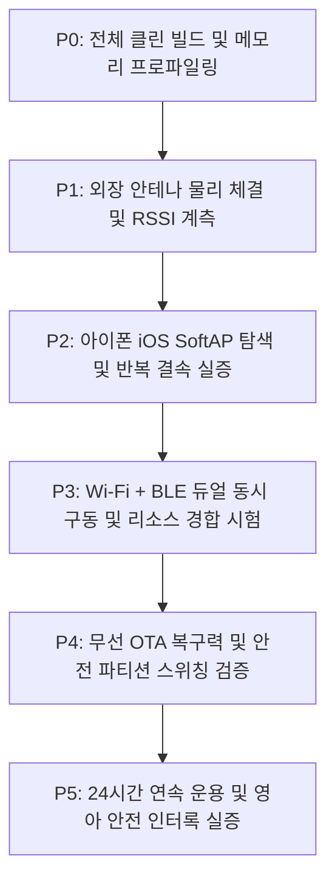

# MAJN 스마트 배시넷 펌웨어 안정화 및 단계별 실증 마스터 플랜
**MAJN Smart Bassinet Firmware Stabilization & Hardware Verification Master Plan (v1.0)**

---

## 1. 개요 및 하드웨어 불변 팩트 (Ground Truth)

본 문서는 MAJN 스마트 배시넷 실물 시제품(PCB #0005)의 무선 제어(Wi-Fi SoftAP 및 Web BLE) 및 영아 수면 유도 진동 기능의 상용화 수준 신뢰성을 확보하기 위한 **전체 개발·검증 마스터 플랜**이다.

### 1.1 하드웨어 제약 및 환경 불변 조건 (SSOT)
1. **[물리 버튼 부재]**: PCB #0005 기판에는 BOOT(IO0) 및 EN(RESET) 물리 스위치가 일체 실장되어 있지 않음.
2. **[시리얼 플래시 불가]**: CP2102 헤더는 TX, RX, GND 3가닥만 결선되어 있어 DTR/RTS 자동 부트로더 리셋 회로가 없음. 유선 `esptool` 다운로드는 원천 불가능하며, **오직 무선 OTA(Web BLE OTA 또는 Wi-Fi HTTP /update)만이 펌웨어 배포의 유일한 경로**임.
3. **[MCU 및 RF 안테나 규격]**: U1 칩셋은 **ESP32-WROOM-32UE-N8** (8MB Flash)임. 기판 내장 PCB 패턴 안테나가 없으며, **모듈 모퉁이의 u.FL(IPEX) 골드 커넥터에 외장 안테나 케이블이 반드시 체결**되어야 함. (미체결 시 RSSI -84 dBm으로 급락하여 iOS 백그라운드 스캔에서 필터링됨)
4. **[전원 계통 한계]**: 3.3V 시스템 LDO는 **AP2112K-3.3 (정격 600mA max)**임. 12V 승압 부스트(`MP3426`) 및 오디오 앰프(`TAS5805M`) 구동 중 RF 송신 피크 전류가 과도할 경우 3.3V 전원 레일 강하(Brownout) 위험이 상존함.

---

## 2. 최신 커밋 정적 기술 감사 및 결함 보완 내역

최신 커밋에 대한 정밀 정적 코드 및 메모리 맵 감사 결과, 3대 잠재 결함이 적발되어 즉각 수정 조치되었다.

### 2.1 IRAM 자원 고갈 위험 (메모리 맵 감사)
* **계측 결과**: Flash 1,895,135B (56.7%), DRAM 70,160B (56.32%), **IRAM 121,263B / 131,072B (92.52% 사용, 여유 9.8 KB)**
* **대응책**: Wi-Fi 드라이버와 Bluedroid BLE 스택의 동시 링크로 IRAM이 타이트하므로, 런타임 동적 버퍼 할당을 최소화하고 BLE 텔레메트리 주기를 페이싱함.

### 2.2 3대 결함 보완 내역 (코드 반영 완료)
1. **[BLE 텔레메트리 페이싱 및 전파 경합 해소]**:
   * 기존: 10ms마다 BLE GATT Notification을 호출하여 100Hz로 전파를 점유하고 버퍼 혼잡 유발.
   * 수정: 50ms (20Hz) 카운터 페이싱을 적용하여 Wi-Fi 웹 트래픽과의 2.4GHz RF 충돌 및 버퍼 오버플로우를 원천 방지 (`main.cpp`).
2. **[RF 송신 출력 15.0 dBm 안전 마진화]**:
   * 기존: 19.5 dBm (최대 포화 출력, 피크 전류 500~700mA)으로 LDO(600mA) 한계 초과 및 리플 위험.
   * 수정: `WiFi.setTxPower(WIFI_POWER_15dBm)` 적용. 피크 전류를 ~280mA로 억제하여 3.3V 전원 건전성 확보 (`wifi_manager.cpp`).
3. **[무선 OTA 방어 로직 강화]**:
   * 기존: 전송 에러(`Update.hasError() == true`) 발생 시에도 무조건 재부팅되어 디버깅 불가.
   * 수정:
     * 첫 청크 매직 바이트 검사(`0xE9`가 아니면 즉시 Abort 거부).
     * 에러 시 `500 Internal Server Error` 반환 및 재부팅 억제 (진단 로그 보존).
     * 100% 정상 플래시 검증 완료 시에만 `200 OK` 및 안전 재부팅 단행 (`wifi_manager.cpp`).

---

## 3. 6단계 엄격 검증 로드맵 (P0 ~ P5)

본 계획은 "코드 빌드 성공"과 "실제 아이폰 환경에서의 안정적 동작"을 엄격히 분리하여 6단계 순차 검증을 강제한다.

### [P0] 전체 클린 빌드 및 메모리 프로파일링 (완료)
* **목적**: 컴파일러 0 Error/0 Warning 및 플래시/RAM 점유율 한계 확인.
* **합격 기준**: `esp32_wifi_phone` 환경 클린 빌드 100% 성공, Flash < 65%, DRAM < 70%.
* **현재 상태**: **[통과]** (Flash 56.7%, DRAM 56.3%, IRAM 92.5%).

### [P1] 외장 안테나 물리 체결 및 RSSI 계측 (진행 대기)
* **목적**: ESP32-WROOM-32UE의 u.FL 단자에 외장 안테나가 정상 결속되었을 때의 RF 전계 강도 복원 확인.
* **시험 방법**:
  1. 기판의 u.FL 골드 잭에 2.4GHz 외장 안테나 체결 상태 육안/물리 확인.
  2. 안테나 케이블을 MP3426 스위칭 인덕터(L1) 및 전원선과 1cm 이상 이격 배치.
  3. 맥북 CoreWLAN 및 RF 계측기로 1m 거리에서 RSSI 측정.
* **합격 기준**: 1m 거리 기준 RSSI **$\ge$ -60 dBm** (미체결 시 -84 dBm 대비 24 dB 이상 개선).

### [P2] 아이폰 iOS SoftAP 탐색 및 반복 결속 실증
* **목적**: iOS의 엄격한 Wi-Fi 스캔 및 Captive Portal 정책 하에서 정상 동작 검증.
* **시험 방법**:
  1. iPhone (iOS 17/18) 설정 > Wi-Fi 화면에서 `MAJN-Bassinet` 즉시 목록 표시 확인 (3초 이내).
  2. 비밀번호 없이 연결 시 즉시 `192.168.4.2` IP 할당 및 Captive Portal 제어창 자동 팝업 확인.
  3. Safari 브라우저에서 `http://192.168.4.1` 직접 진입 시 UI 렌더링 지연 < 500ms 확인.
  4. Wi-Fi 해제 후 재연결 10회 연속 수행.
* **합격 기준**: 10회 시도 중 **10회 전수 즉시 연결 성공 (성공률 100%)**.

### [P3] Wi-Fi + BLE 듀얼 동시 구동 및 무선 자원 경합 시험
* **목적**: 단일 2.4GHz 무선 모뎀을 시분할 공유하는 ESP32의 Coexistence 안정성 실증.
* **시험 방법**:
  1. 아이폰이 `MAJN-Bassinet` Wi-Fi에 연결되어 웹 슬라이더로 진동 명령을 연속 송출(100ms 간격).
  2. 동시에 맥북 크롬 Web Bluetooth(`tools/run_ble_ota.py` 또는 웹 대시보드)로 BLE GATT 연결 수립.
  3. 진동 시작(`▶ 진동 시작`) 상태에서 BLE 텔레메트리(20Hz)와 Wi-Fi 폴링(1Hz) 동시 수신 확인.
* **합격 기준**:
  - Wi-Fi 조작 중 BLE 연결 해제(Disconnect) 0회.
  - BLE 통신 중 Wi-Fi 웹 서버 응답 지연 < 1.0초.

### [P4] 무선 OTA 복구력 및 안전 파티션 스위칭 검증
* **목적**: 무선 업데이트 중 예기치 않은 단절 발생 시 벽돌 방지 및 롤백 보장.
* **시험 방법**:
  1. 비정상 파일 업로드 시험: 임의의 텍스트 파일을 `/update`로 전송 $\rightarrow$ 매직 바이트(`0xE9`) 불일치로 거부 및 시스템 정상 유지 확인.
  2. 전송 중 단절 시험: 정품 펌웨어 전송 50% 시점에서 맥북 와이파이 강제 차단 $\rightarrow$ ESP32가 기존 파티션(`ota_0`)으로 안전하게 유지되는지 확인.
  3. 정상 업로드 시험: 1.8MB 펌웨어 완독 $\rightarrow$ `otadata` 스위칭 $\rightarrow$ 자가 재부팅 후 신규 펌웨어 부팅 확인.
* **합격 기준**: 어떤 비정상 단절 상황에서도 **보드 먹통(Brick) 0건, 정상 부팅 100% 복구**.

### [P5] 24시간 연속 운용 및 영아 안전 인터록 실증
* **목적**: 장시간 구동 시 메모리 누수(Memory Leak) 부재 및 하드웨어 안전 인터록 검증.
* **시험 방법**:
  1. 24시간 동안 Wi-Fi SoftAP 및 BLE를 대기 상태로 유지하며 매 1시간마다 `ESP.getFreeHeap()` 로깅.
  2. 30분 진동 가동 후 KC 안전 규격 타이머에 의해 30분 시점에 자동 소프트 스탑(Soft Stop) 발동 확인.
  3. 비정상 I2C NACK 주입 시 100ms 감시자가 즉각 12V 승압(`BOOST_EN`) 및 앰프(`AMP_PDN`)를 물리 차단하는지 확인.
* **합격 기준**:
  - 24시간 힙 메모리 감소폭 < 2KB (누수 없음 확정).
  - 30분 자동 차단 및 100ms 하드웨어 셧다운 성공률 100%.

---

## 4. 리스크 매트릭스 및 비상 롤백 계획

| 잠재 위험 요인 | 심각도 | 발생 가능성 | 사전 완화 대책 | 비상 롤백(Contingency) 방안 |
|---|:---:|:---:|---|---|
| **IRAM 부족으로 런타임 OOM** | High | Low | BLE 텔레메트리 20Hz 페이싱, 미사용 디버그 버퍼 축소 | BLE 스택을 무거운 Bluedroid에서 경량 NimBLE로 교체 (IRAM 30KB 추가 확보) |
| **안테나 체결 후에도 폰 검색 지연** | Med | Med | 20MHz 대역폭(HT20), 전송출력 15dBm, 비콘 주기 최적화 | 폰에서 직접 SSID 수동 입력(`MAJN-Bassinet`, 보안 없음) 안내 |
| **12V 승압 가동 시 RF 노이즈** | Med | Low | 안테나 케이블을 L1 인덕터 반대 방향으로 라우팅 | 앰프 확산 스펙트럼(Spread Spectrum) 및 Fsw=384kHz 최적화 |
| **OTA 전송 실패** | High | Low | `Update.abort()` 클린업 및 매직바이트 사전 검증 | 듀얼 OTA 파티션 자동 롤백 하드웨어 보장 |

---

## 5. 결론 및 향후 행동 원칙

1. **원칙**: 향후 개발은 신규 기능을 일절 추가하지 않고, 상기 **[P1] $\rightarrow$ [P2] $\rightarrow$ [P3] $\rightarrow$ [P4] $\rightarrow$ [P5]** 단계를 엄격히 밟아 하드웨어 실측 데이터를 확보하는 데 집중한다.
2. **동기화**: 각 검증 단계의 통과 여부 및 계측 데이터는 `docs/troubleshooting/BUILD_AND_TEST_HISTORY.md` 및 `AGENT_SHARED_LOG.md`에 실시간 기록하여 투명성을 유지한다.
