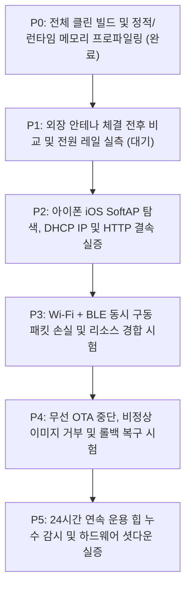

# MAJN 스마트 배시넷 펌웨어 안정화 및 단계별 실증 마스터 플랜
**MAJN Smart Bassinet Firmware Stabilization & Hardware Verification Master Plan (v1.2 - Post-2nd Peer Review Revision)**

---

## 1. 개요 및 하드웨어 불변 팩트 (Ground Truth)

본 문서는 MAJN 스마트 배시넷 실물 시제품(PCB #0005)의 무선 통신(Wi-Fi SoftAP 및 Web BLE)과 영아 수면 유도 진동 제어의 상용화 수준 신뢰성을 확보하기 위한 **전체 펌웨어 안정화 및 단계별 실증 마스터 플랜**이다.

### 1.1 하드웨어 제약 및 환경 불변 조건 (SSOT)
1. **[물리 버튼 부재]**: PCB #0005 기판에는 BOOT(IO0) 및 EN(RESET) 물리 스위치가 일체 실장되어 있지 않음. (사용자에게 버튼 누름 가이드 원천 금지)
2. **[시리얼 플래시 불가]**: CP2102 헤더는 TX, RX, GND 3가닥만 결선되어 있어 DTR/RTS 자동 부트로더 리셋 회로가 없음. 유선 `esptool` 다운로드는 하드웨어적으로 불가능하며, **오직 무선 OTA(Web BLE OTA 또는 Wi-Fi HTTP /update)만이 유일한 펌웨어 배포 경로**임.
3. **[MCU 및 RF 안테나 규격]**: U1 칩셋은 **ESP32-WROOM-32UE-N8** (8MB Flash)임. 기판 내장 PCB 안테나가 없으며, **모듈 모퉁이의 u.FL(IPEX) 커넥터에 외장 안테나 케이블이 반드시 체결**되어야 함. (미체결 시 RSSI -84 dBm으로 급락하여 모바일 OS 백그라운드 스캔에서 필터링됨)
4. **[전원 계통 특성]**: 3.3V 시스템 LDO는 **AP2112K-3.3 (정격 600mA max)**임. 600mA는 데이터시트상 절대 최대 정격이며, 실제 안전 구동을 위해서는 PCB 방열 한계와 12V 승압 부스트(`MP3426`), 오디오 앰프(`TAS5805M`) 구동 시의 전원 노이즈를 종합적으로 고려해야 함.

---

## 2. 2차 피어리뷰 지시사항 반영 및 펌웨어 방어 아키텍처 (v1.2)

### 2.1 OTA 롤백 판정 시점의 정상화 (setup() 최하단 이동 및 4중 조건문)
* **결함 시정**: 이전 커밋(`f1f5f6d`)에서는 하드웨어(Safety, Power, TAS5805M, Tasks)가 정상 기동하기도 전에 단순히 힙 메모리만 보고 펌웨어를 조기 확정하던 결함이 존재했음.
* **시정 조치 (`main.cpp`)**:
  * 부팅 시점에는 `ESP_OTA_IMG_PENDING_VERIFY` 상태를 그대로 유지.
  * 모든 주변장치 초기화, 앰프 대기 모드 진입, FreeRTOS 태스크 3종(Comm, Control, Audio) 생성 완료 후 `setup()` 최하단에서 자가 진단 실행.
  * **4중 검증 통과 조건**:
    1. 필수 FreeRTOS 태스크 정상 생성 (`commTaskHandle != NULL && controlTaskHandle != NULL && audioTaskHandle != NULL`)
    2. 시스템 안전 잠금 미작동 및 대기 상태 확인 (`!systemActive && !MajnSafety::isSafetyLockTriggered()`)
    3. 여유 힙 메모리 확보 (`ESP.getFreeHeap() >= 30000`)
    4. 파티션 상태가 `ESP_OTA_IMG_PENDING_VERIFY`임을 확인
  * 조건 통과 시 `esp_ota_mark_app_valid_cancel_rollback()` 호출 및 반환 코드 로깅.
  * 조건 불만족 시 `esp_ota_mark_app_invalid_rollback_and_reboot()`을 호출하여 이전 슬롯으로 강제 자동 롤백.
  * 부트loader 차원의 `CONFIG_BOOTLOADER_APP_ROLLBACK_ENABLE=1` 활성화 상태 확인 완료.

### 2.2 종단간(End-to-End) 웹 및 무선 보안 강화
1. **SoftAP WPA2 보안 탑재**: 개방형(Open) AP를 폐지하고 기본 WPA2 암호화(`majn-secure-2026`)를 적용하여 비인가 단말의 무단 결속 방지.
2. **모든 제어 API(`/api/command`) 인증 적용**: 토큰 파라미터(`token`) 또는 HTTP 세션 쿠키(`auth_token`)를 통한 인가 검증 추가. 미인증 요청 시 401 Unauthorized 반환.
3. **HTML 폼 내 하드웨어 하드코딩 제거**: `/update` 폼의 `value='majn2026-ota-token'`을 제거하여 브라우저 소스 보기를 통한 토큰 탈취 원천 방지.
4. **OTA 인터록**: OTA 업로드 진행 중(`sOtaInProgress == true`) 모든 진동 시작 명령 즉시 차단 (HTTP 423 Locked).

### 2.3 인증 및 규제 관련 기술 명칭 정정
1. **소프트웨어 안전 차단**: 기존 주석의 "KC 30분 규격 요건" 표현을 전면 삭제하고, **"기기 레벨 소프트웨어 런타임 안전 워치독 (30분 자동 정지)"**으로 명확히 규정.
2. **무선 국가 도메인**: "KC 전파 규격 충족"이라는 과장 표현을 삭제하고, **"한국 무선 규제 도메인(KR, 채널 1~13) 설정"**으로 기술적 사실에 맞게 한정.

### 2.4 배포 도구 안전 규칙 엄수 (`tools/run_wifi_ota.py`)
* 맥북 Wi-Fi 강제 조작(`networksetup`) 로직 완전 배제.
* 절대 경로(`--bin-path /tmp/...`) 지원 및 사용자 네트워크를 임의로 끊지 않는 순수 수동/반자동 HTTP 클라이언트로 동작.

---

## 3. 6단계 엄격 검증 로드맵 (P0 ~ P5)

> **⚠️ 필수 전제 조건**: 모든 검증 및 진동 시험은 **영아를 탑승시키지 않은 벤치(Bench) 환경에서 더미 부하를 걸고 수행**한다.
> **⚠️ 실물 플래시 보류 방침**: 코드 정적 감사 및 벤치 환경 준비가 완료될 때까지 실물 OTA 플래시는 엄격히 보류한다.

### [P0] 전체 클린 빌드 및 정적/런타임 메모리 분리 (통과)
* **검증 내용**: `esp32_wifi_phone` 환경 클린 컴파일 성공 및 정적 메모리 한계 확인.
* **결과 (2026-10-31 실측)**:
  - 컴파일 오류: **0 Error, 0 Warning**
  - Flash Code + Data: 1,898,639B (56.8% of 3.18MB slot)
  - DRAM: 70,184B (56.3% of 124KB)
  - IRAM: 121,263B (92.52%, 잔여 9,809B)
  - 바이너리 위치: `/tmp/majn_wifi_phone_firmware.bin`

### [P1] 외장 안테나 연결 및 전원 레일 실측 (진행 대기)
* **검증 내용**: 외장 안테나 체결 전후 전계 강도 비교 및 실제 동작 모드별 소비전류/전압 계측.
* **계측 항목 (5대 전원 계측)**:
  1. Wi-Fi 단독 대기 상태 전류
  2. Wi-Fi HTTP 송수신 중 피크 전류
  3. Wi-Fi + BLE 동시 활성화 시 전류
  4. Wi-Fi + BLE + 12V Boost + TAS5805M 앰프 구동 시 전류
  5. 1~4 조건에서 U2 LDO 출력(VCC_3V3) 최저 전압 및 Brownout 발생 여부 오실로스코프 계측
* **통과 기준**:
  - 외장 안테나 체결 시 미체결(-84 dBm) 대비 동일 위치에서 유의미한 RSSI 개선 확인.
  - 전원 부하 조건에서 3.3V 레일 최저 전압 > 3.0V 유지 (Brownout 리셋 0회).

### [P2] 아이폰 iOS SoftAP 검색, IP 할당 및 제어 실증
* **검증 내용**: iOS 환경에서 WPA2 SoftAP 탐색, 정상 서브넷 IP 할당, Captive Portal 및 제어 응답 검증.
* **통과 기준**:
  - 아이폰 Wi-Fi 목록에 `MAJN-Bassinet` 안정적 표시.
  - DHCP를 통해 `192.168.4.x` 정상 서브넷 IP 할당 확인.
  - 브라우저 HTTP 접속 시 UI 정상 로딩 및 10회 연속 재결속 성공률 기록.

### [P3] Wi-Fi + BLE 듀얼 동시 구동 및 무선 자원 경합 시험
* **검증 내용**: 단일 2.4GHz 모뎀 시분할 공유 시 패킷 손실, 지연 시간, 연결 유지율 계측.
* **통과 기준**:
  - 아이폰 Wi-Fi 웹 슬라이더 조작 중 맥북 Web BLE 연결 해제(Disconnect) 0회.
  - BLE 텔레메트리(20Hz) 수신 손실률 < 5%, HTTP 명령 응답 지연 < 1.0초 유지.
  - Wi-Fi/BLE 동시 트래픽 상황에서 진동 제어 파라미터 왜곡 부재.

### [P4] 무선 OTA 중단, 부팅 실패 및 롤백 복구 시험
* **검증 내용**: 비정상 파일 거부, 클라이언트 측 전송 중단, 부팅 실패 시 이전 슬롯 자동 복구 실증.
* **통과 기준**:
  - 비정상 파일(비 ESP32 바이너리) 주입 시 첫 청크(`0xE9` 매직바이트) 검사에서 즉각 Abort 거부.
  - 무인가 토큰 접근 시 401 Unauthorized 차단.
  - 전송 도중 클라이언트 소켓 강제 종료 시 기존 슬롯(`ota_0`) 무손실 보존.
  - 신규 펌웨어 플래시 후 자가 검증 통과 시 신규 슬롯(`ota_1`) 영구 확정.

### [P5] 24시간 벤치 운용 및 하드웨어 안전 인터록 실증
* **검증 내용**: 24시간 장기 운용 시 힙 메모리 파편화 및 실제 하드웨어 차단 라인 계측.
* **통과 기준**:
  - 24시간 동안 `min_free_heap` 및 `largest_free_block` 모니터링 (연속적인 힙 고갈 부재).
  - 소프트웨어 30분 타이머 발동 시 모터 출력 정상 Soft Stop.
  - 인위적 I2C 에러 발생 시 MCU가 `BOOST_EN`(GPIO4) 및 `AMP_PDN`(GPIO15)을 LOW로 떨어뜨려 12V 전원 및 앰프 출력을 물리 차단함을 실측.

---

## 4. 리스크 매트릭스 및 비상 롤백 계획

| 잠재 위험 요인 | 심각도 | 발생 가능성 | 기술적 대책 | 비상 롤백(Contingency) 방안 |
|---|:---:|:---:|---|---|
| **IRAM 9.8KB 여유로 인한 런타임 OOM** | High | Low | BLE 텔레메트리 20Hz 페이싱, 디버그 버퍼 축소 | Bluedroid 스택을 경량 NimBLE로 교체 (IRAM 30KB 이상 추가 확보) |
| **복합 부하 시 3.3V 전압 강하** | High | Med | RF 출력 15dBm 적용, 대용량 디커플링 유지 | 필요 시 RF 출력 추가 하향(13~14dBm) 또는 LDO 방열/부품 규격 상향(Rev-C) |
| **비인가 접근 및 제어** | High | Low | WPA2 암호화 기본 적용, 모든 제어/OTA API 토큰/쿠키 인증 | 하드웨어 기반 페어링 버튼 추가 (차기 Rev-C) |
| **OTA 신규 이미지 부팅 실패** | High | Low | `esp_ota_ops` setup() 최하단 자가 검증 및 롤백 인터록 | 부팅 실패 시 이전 파티션 자동 복귀 |

---

## 5. 결론 및 향후 행동 원칙

1. **원칙**: 신규 기능 추가는 전면 동결하며, 상기 **[P1] $\rightarrow$ [P2] $\rightarrow$ [P3] $\rightarrow$ [P4] $\rightarrow$ [P5]** 단계를 순차적으로 수행하고 실측 데이터를 문서에 축적한다.
2. **동기화**: 각 검증 단계의 통과 여부 및 계측 데이터는 `docs/troubleshooting/BUILD_AND_TEST_HISTORY.md` 및 `AGENT_SHARED_LOG.md`에 실시간 기록하여 투명성을 유지한다.
