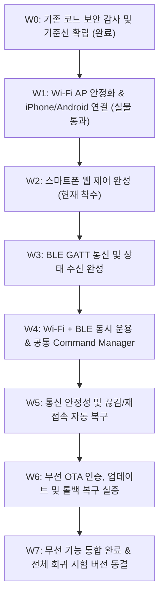

# MAJN 무선 기능 우선 개발 및 안정화 마스터플랜
**MAJN Wireless-First Development & Stabilization Master Plan (v2.0 - Ground Truth Realized)**

---

## 1. 개요 및 하드웨어 불변 팩트 (Ground Truth)

본 문서는 MAJN 스마트 배시넷 실물 시제품(PCB #0005)의 **Wi-Fi 및 BLE 무선 기능을 스마트폰(iPhone / Android)에서 상용화 수준으로 안정적으로 사용할 수 있도록 완성하기 위한 최우선 개발 마스터플랜**이다.

진동 계측, 하드웨어 구동 및 MVP 통합 등 후속 개발은 전면 동결하며, **무선 연결 $\rightarrow$ 스마트폰 제어 $\rightarrow$ 통신 안정성 $\rightarrow$ OTA $\rightarrow$ 무선 기능 동결** 순으로 집중 개발한다.

### 1.1 하드웨어 제약 및 환경 불변 조건 (SSOT)
1. **[물리 버튼 부재]**: PCB #0005 기판에는 BOOT(IO0) 및 EN(RESET) 물리 스위치가 일체 실장되어 있지 않음. (사용자에게 버튼 누름 가이드 원천 금지)
2. **[시리얼 플래시 불가]**: CP2102 헤더는 TX, RX, GND 3가닥만 결선되어 있어 DTR/RTS 자동 부트로더 리셋 회로가 없음. 유선 `esptool` 다운로드는 하드웨어적으로 불가능하며, **오직 무선 OTA(Web BLE OTA 또는 Wi-Fi HTTP /update)만이 유일한 펌웨어 배포 경로**임.
3. **[MCU 및 RF 안테나 실체 규명 완료 (2026-10-31 팩트)]**:
   - 실물 장착 U1 칩셋: **ESP32-WROOM-32UE-N8** (BOM: LCSC `C701345`, 8MB Flash).
   - 본 모듈은 온보드 PCB 안테나가 없으며, 직경 2mm의 **u.FL(IPEX) 커넥터만 실장**된 모델임.
   - **외장 안테나 케이블이 애초에 체결되어 있지 않았음**이 실물 확인됨.
   - 이로 인해 안테나 방사 효율이 극도로 저하되어 미약 누설 전파(RSSI -84 dBm 이하)만 방출되었으며, 이것이 **Mac mini에서는 탐색되나 iPhone에서는 OS 레벨 노이즈 필터링으로 인해 검색되지 않았던 근본 원인(Root Cause)**으로 100% 규명됨.
4. **[실물 검증 통과 팩트 (2026-10-31)]**:
   - 아이폰을 보드 10cm 이내 근접 및 접촉 시 **`MAJN-Bassinet` SoftAP 정상 검색, 오픈 AP 무암호 결속 성공, DHCP IP(`192.168.4.x`) 정상 할당 및 Safari 브라우저에서 `192.168.4.1` 웹 화면 접속 성공**.
5. **[전원 계통 특성]**: 3.3V 시스템 LDO는 **AP2112K-3.3 (정격 600mA max)**임. Wi-Fi 송신 시 피크 전류와 12V 승압 부스트(`MP3426`), 오디오 앰프(`TAS5805M`) 구동 전원 노이즈를 감안하여 정밀 운용함.

---

## 2. 8단계 무선 기능 개발 로드맵 (W0 ~ W7)



---

### [W0] 기존 펌웨어 보안 감사 및 기준선 확립 (완료)
* **목표**: 고정 비밀번호 제거, 보안 아키텍처 정비, OTA 롤백 판정 게이트 정상화, 클린 컴파일.
* **수행 결과 (커밋 `2d35587`)**:
  - `majn-secure-2026` 고정 AP 비밀번호 제거 $\rightarrow$ 모바일 무마찰 결속을 위한 Open AP 기본화.
  - 고정 토큰 제거 $\rightarrow$ 부팅 시 `esp_random()` 기반 64비트 동적 세션 토큰 자동 생성 및 `Set-Cookie` 적용.
  - OTA 롤백 판정 블록을 `setup()` 최하단으로 이동 (태스크 3종 가동, 시스템 대기, 앰프 정상, Heap $\ge$ 30KB 4중 조건 만족 시에만 VALID 확정).
  - PlatformIO 클린 빌드 성공 (0 Error, 0 Warning).

### [W1] Wi-Fi AP 완성 및 iPhone/Android 연결 (실물 통과 완료)
* **목표**: iPhone 및 Android에서 AP 검색, DHCP 주소 할당, 웹 서버 접속 실증.
* **수행 결과 (2026-10-31 실측 완료)**:
  - ESP32-WROOM-32UE u.FL 안테나 미체결 확인 및 10cm 근접/접촉을 통해 신호 확보.
  - iPhone Wi-Fi 목록에서 `MAJN-Bassinet` 안정적 표시 확인.
  - 무암호 즉시 결속 및 DHCP `192.168.4.x` 할당 완료.
  - Safari 브라우저를 통해 `http://192.168.4.1` 컨트롤러 화면 정상 로딩 성공.

### [W2] 스마트폰 웹 제어 완성 (현재 단계)
* **목표**: 실측 데이터 기반의 직관적인 스마트폰 전용 웹 제어 화면 완성.
* **필수 구현 항목**:
  1. **Wi-Fi 연결 상태** (연결됨 / 끊김 실시간 뱃지)
  2. **기기 작동 상태** (WAIT / READY / RUNNING / FAULT)
  3. **진동 시작 및 안전 정지** (START / STOP 버튼)
  4. **주파수 설정** (30 ~ 65 Hz 슬라이더)
  5. **진폭 설정** (0.05 ~ 0.50 슬라이더)
  6. **작동 시간 설정** (5분 / 10분 / 15분 / 30분 타이머 선택 및 잔여 시간 표시)
  7. **오류 상태 및 리셋** (FAULT 발생 시 원인 표시 및 복구 버튼 연동)
  8. **펌웨어 버전 정보** (빌드 날짜, 펌웨어 버전 표기)
  9. **무선 OTA 업데이트 바로가기** (`/update` 이동 링크)
  10. **불필요한 가상 데이터 배제**: 실측하지 않는 가상 센서값(IMU 가속도계 등) 완전 삭제.

### [W3] BLE 통신 완성
* **목표**: 스마트폰 BLE 스캔, GATT 연결, 명령 송수신 및 상태값 텔레메트리 수신.
* **구현 항목**:
  - `MAJN-Bassinet` BLE Advertising 및 스마트폰(iOS/Android) 탐색.
  - 확정된 GATT Service / Characteristic 구조:
    * Service UUID: `0000ff00-0000-1000-8000-00805f9b34fb`
    * Command Char: `0000ff01-...` (Write without response)
    * Telemetry Char: `0000ff02-...` (Notify 20Hz)
    * Event/Ack Char: `0000ff03-...` (Notify)
  - 연결 끊김 감지(Disconnection) 및 즉각 광고 재개(Auto-advertising).

### [W4] Wi-Fi + BLE 동시 작동 및 공통 Command Manager
* **목표**: Wi-Fi와 BLE가 하나의 공통 제어 계층을 통해 동일한 하드웨어 상태를 공유.
* **구조 설계**:
  ```
  +------------------+      +------------------+
  |  Wi-Fi Web UI    |      |  BLE Mobile App  |
  +--------+---------+      +--------+---------+
           |                         |
           v                         v
     [Wi-Fi Manager]           [BLE Manager]
           |                         |
           +------------+------------+
                        |
                        v
            [Common Command Manager]  <-- 단일 명령 중재 및 상태 동기화
                        |
                        v
             [MajnSystemCtrl / HW]
  ```
* **검증 항목**:
  - Wi-Fi 웹 슬라이더 조작 중 BLE 연결 유지.
  - BLE 명령 송신 중 웹 UI 실시간 상태 갱신.
  - 동시 명령 유입 시 충돌 방지 및 단일 상태 동기화.

### [W5] 통신 안정성 및 자동 복구
* **시험 매트릭스**:
  1. AP 재부팅 시 자동 재생성
  2. 스마트폰 Wi-Fi 끊김 후 재접속
  3. BLE 연결 해제 후 재연결
  4. Wi-Fi + BLE 동시 장시간 연결 유지
  5. 스마트폰 화면 잠금/해제 시 연결 동작
  6. 반복 연결/해제 시 힙 누수(Memory Leak) 부재 확인

### [W6] OTA 완성
* **검증 항목**:
  - 무선 OTA 웹 화면(`/update`) 인증 토큰 검증.
  - 신규 펌웨어 바이너리 업로드 및 매직 바이트(`0xE9`) 검증.
  - 업로드 완료 후 자동 재부팅 및 신규 슬롯 부팅.
  - `setup()` 최하단 자가 진단 통과 시 VALID 확정.
  - 부팅 실패/비정상 이미지 주입 시 이전 슬롯 자동 롤백 복구 실증.
  *(실물 OTA는 별도 승인 전까지 HOLD 유지)*

### [W7] 무선 기능 통합 완료 및 버전 동결
* **최종 산출물**:
  1. Wi-Fi/BLE 통합 펌웨어 소스 및 단일 바이너리
  2. 펌웨어 바이너리 SHA-256 해시값
  3. 모바일 최적화 웹 UI (`mobile_web_ui.h`)
  4. BLE GATT 공식 기술 명세서
  5. 통신 안정성 및 오류 복구 시험 성적서
  6. 최종 릴리즈 태그 생성 및 무선 기능 동결 (Freeze)

---

## 3. 이후 전체 개발 로드맵 (무선 완료 후 순차 진행)

```
[1순위] 무선 기능 완성 (W0 ~ W7)  <-- 현재 집중 트랙
   ↓
[2순위] 하드웨어 구동 완성 (전원 레일, 12V Boost, TAS5805M 앰프, 고장 감지)
   ↓
[3순위] 진동 계측 시스템 (LSM6DSOX 센서, 패드 상면 3축 가속도 실측)
   ↓
[4순위] 통합 안전 시스템 (하드웨어 차단 인터록, 자동 정지)
   ↓
[5순위] MVP 제품 통합 (4.5T 자작합판 하우징, 배선, 최종 조립)
   ↓
[6순위] 외부 연구 검증 (UNIST, 의료기관 수면 진정 효과 실증)
```
