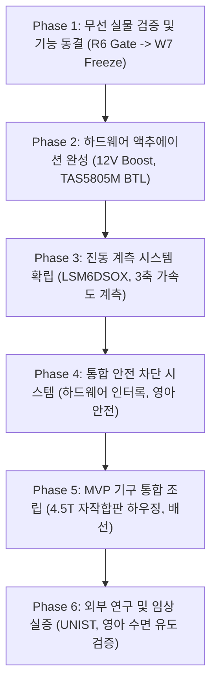

# MAJN 무선 기능 우선 개발 및 안정화 마스터플랜 (v3.0)
**MAJN Wireless-First Development, Remediation & Post-Wireless Master Roadmap (v3.0 - Comprehensive Synthesis)**

---

## 1. 프로젝트 개요 및 하드웨어 개발 배경 (Ground Truth & SSOT)

본 문서는 MAJN 스마트 배시넷 실물 시제품(PCB #0005)의 **무선 기능(Wi-Fi SoftAP / BLE GATT / 무선 OTA) 안정화, 보안 시정(R1~R5) 완결 내역 및 향후 하드웨어·임상 통합 전체 로드맵**을 총망라한 최상위 단일 진실 공급원(SSOT) 마스터 문서이다.

### 1.1 하드웨어 제약 및 환경 불변 조건 (SSOT)
1. **[물리 버튼 전무 (Zero Physical Buttons)]**:
   - 실물 PCB #0005 기판에는 BOOT(IO0) 및 EN(RESET) 물리 푸시 버튼이 일체 실장되어 있지 않음.
   - 사용자에게 "버튼을 누르라"거나 "물리적 리셋을 하라"는 안내는 하드웨어적으로 원천 불가능함.
2. **[유선 시리얼 플래시 불가 (No DTR/RTS Reset)]**:
   - 기판의 CP2102 디버그 헤더는 **TX, RX, GND 3가닥만 결선**되어 있어 DTR/RTS 기반의 자동 부트로더 리셋 회로가 없음.
   - 유선 `esptool`을 통한 펌웨어 플래시는 하드웨어적으로 불가능하며, **오직 무선 OTA(Web HTTP `/update` 또는 BLE OTA Service)만이 유일한 펌웨어 배포 경로**임.
   - 시리얼 TX 라인은 부팅 및 시스템 동작 확인용 **읽기 전용(Read-only) 진단 로그 수신** 용도로만 유효함.
3. **[MCU 모듈 및 안테나 결선 실체 규명 (2026-10-31 현장 팩트)]**:
   - 실물 장착 U1 칩셋: **ESP32-WROOM-32UE-N8** (LCSC `C701345`, 8MB Flash).
   - 본 모듈은 PCB 온보드 패턴 안테나가 없으며, 직경 2mm의 **u.FL(IPEX) 커넥터만 실장**된 모델임.
   - 2026-06-27 ECO 설계 변경 당시 LDO(U2)와의 RF 간섭 회피를 위해 모듈을 변경하였으나, 실물 PCB 조립 시 외장 안테나 케이블이 체결되지 않은 채 출하됨.
   - 이로 인해 안테나 방사 효율이 극도로 저하되어 미약 누설 전파(RSSI -84 dBm 이하)만 방출되었으며, 이것이 **Mac mini에서는 탐색되나 iPhone에서는 OS 레벨 노이즈 필터링으로 인해 검색되지 않았던 근본 원인(Root Cause)**으로 100% 규명됨.
   - 스마트폰을 기판 10~20cm 이내 근접 또는 약 3.1cm 임시 모노폴 도선(Quarter-wave stub) 근접 시 정상 통신이 가능함.
4. **[전원 계통 특성]**:
   - 3.3V 디지털 전원 LDO: **AP2112K-3.3 (정격 600mA max)**.
   - 12V 승압 레귤레이터: **MP3426** (VBUS 5V $\rightarrow$ PVDD 12V 승압, 앰프 구동용).
   - 오디오 및 햅틱 파워 앰프: **TAS5805M** (I2C 주소 `0x2C`, 48kHz I2S BTL 구동).
   - Wi-Fi 송신 피크 전류(~280mA @ 15dBm)와 승압 회로 노이즈가 LDO의 전압 드롭 및 브라운아웃(Brownout)을 유발하지 않도록 RF 출력 및 전원 시퀀스를 정밀 제어함.

---

## 2. 무선 개발 진행 경과 (W0 ~ W3 완료 내역)

| 마일스톤 | 핵심 목표 | 달성 결과 및 증거 | 커밋 / 상태 |
| :--- | :--- | :--- | :--- |
| **W0: 보안 기준선** | 고정 비번 제거, 동적 토큰, OTA 롤백 판정 분리 | 고정 AP 비번 제거, 64비트 동적 세션 토큰 자동 생성, `setup()` 최하단 4중 게이트 확립 | `2d35587` (완료) |
| **W1: 실물 Wi-Fi 검증** | iPhone/Android Wi-Fi 탐색 및 웹 화면 접속 | 10cm 근접 조건에서 iPhone Wi-Fi 목록에 `MAJN-Bassinet` 표출, 무마찰 접속 및 Safari에서 `192.168.4.1` 로딩 성공 | 실물 검증 통과 |
| **W2: 모바일 웹 UI** | 스마트폰 최적화 터치 UI, 타이머, 가상값 제거 | 가상 IMU 제거, 5/10/15/30분 타이머 칩, 잔여 시간 카운트다운, 실시간 연결 상태 뱃지, `/update` 링크 | `3f8f9e9` (완료) |
| **W3: BLE GATT 통신** | GATT 서비스 확립, 20Hz 텔레메트리, 자동 광고 | 서비스 `7b4d0001`, 커맨드 `0002`, 텔레메트리 `0003`, 이벤트 `0004` 확정. iOS 최적 광고 주기 반영 | `43ed62d` (완료) |

---

## 3. 심층 시정 및 검증 완결 내역 (R1 ~ R5 Remediation Summary)

2026-10-31 심층 피어리뷰에서 제기된 8대 결함(F1~F8)을 완벽히 시정하고 정적 검증을 완료함 (커밋 `1d4cc37`, `127e327`).

```mermaid
flowchart TD
    subgraph R1_WiFi ["R1: Wi-Fi 보안 & 접근제어"]
        A1["NVS 영속 10자 WPA2 암호"] --> A2["토큰 JSON 노출 삭제"]
        A2 --> A3["CORS 와일드카드 제거"]
    end
    subgraph R2_BLE ["R2: BLE 암호화 & 본딩"]
        B1["ESP_BLE_SEC_ENCRYPT_MITM"] --> B2["6자리 Passkey 페어링"]
        B2 --> B3["iOS 광고 주기(7.5~22.5ms) 정정"]
    end
    subgraph R3_RF ["R3: RF 송신출력 정책"]
        C1["기본 15.0 dBm (AP2112K 보호)"] --> C2["19.5 dBm 시험환경 격리"]
    end
    subgraph R4_Rollback ["R4: 롤백 & 상태 모델"]
        D1["FW 결함(Panic/Heap) 롤백"] --> D2["HW 고장(앰프)시 OTA 개방 유지"]
        D2 --> D3["STOPPING 전이 상태 신설"]
    end
    subgraph R5_Verification ["R5: 정적 검증 & 스위트"]
        E1["3.19MB 파티션 상한 동기화"] --> E2["바이너리 Magic 0xE9 검사"]
        E2 --> E3["단위 테스트 50/50 PASS"]
    end
```

### 3.1 세부 시정 내용
1. **[R1: Wi-Fi 보안 강화]**:
   - 최초 부팅 시 `esp_random()`으로 10자 영숫자 무작위 WPA2-PSK를 생성하여 NVS(`Preferences`, 네임스페이스 `majn`)에 영구 저장. 시리얼 TX로 1회 출력.
   - `/api/status` JSON에서 세션 토큰 필드를 완전히 제거하고, HTML 내부 인라인 주입 및 SameSite 쿠키로만 전달.
   - CORS 와일드카드(`*`) 제거, 동일 출처(Same-Origin) 제약 확립.
2. **[R2: BLE 접근 제어 및 본딩]**:
   - `ESP_BLE_SEC_ENCRYPT_MITM` 적용 및 6자리 고정 패스키 본딩.
   - Command, Telemetry, OTA 특성에 `ESP_GATT_PERM_READ_ENC_MITM` 및 `WRITE_ENC_MITM` 부여.
   - iOS 광고 주기 설정 오타 교정 (`setMaxPreferred(0x12)` 적용으로 7.5ms ~ 22.5ms 정상 준수).
3. **[R3: RF 출력 안정성 격리]**:
   - 3.3V LDO(AP2112K, 600mA)의 과부하 및 브라운아웃 방지를 위해 기본 송신 출력을 15.0 dBm(`WIFI_POWER_15dBm`, 피크 ~280mA)으로 복귀.
   - 19.5 dBm 부스트 설정은 컴파일 플래그 `MAJN_WIFI_TX_DBM >= 19` 및 시험 환경(`esp32_wifi_phone_txtest`)으로 원천 격리.
4. **[R4: 롤백 게이트 재정의 및 STOPPING 상태 모델]**:
   - **롤백 게이트 이원화**: 펌웨어 소프트웨어 결함(태스크 핸들 NULL, 힙 < 30KB, 부팅 직후 안전 락) 발생 시에만 즉각 롤백을 수행함. 반면 TAS5805M 앰프 통신 실패 등 외부 하드웨어 결함 시에는 앱을 VALID로 확정하고 시스템을 `AMP_FAULT` 비상 정지 상태로 잠그되, 유일한 펌웨어 수정 경로인 **무선 OTA 채널(Wi-Fi/BLE)은 100% 개방 유지**.
   - **STOPPING 상태 신설**: 진동 정지 요청 후 진폭이 0이 될 때까지의 감쇄 구간(~1.2s, 20ms당 0.005f 감소) 동안 시스템 상태를 `STOPPING`으로 표출하여 모바일 UI와의 상태 불일치 해결.
5. **[R5: 정적 검증 및 50종 테스트 스위트 통과]**:
   - BLE OTA 수신 상한을 파티션 테이블 실물(`partitions_8mb_ota.csv`)에 맞추어 **3.19MB(`0x330000`)**로 동기화.
   - Web 및 BLE OTA 첫 청크 수신 시 ESP32 실행 바이너리 매직 바이트(`0xE9`) 유효성 검증 로직 추가.
   - `tools/test_command_parser.py` v2.0 정적/단위 테스트 **50 / 50 PASSED (100%)** 달성.

### 3.2 펌웨어 빌드 및 산출물 정합성
- **대상 환경**: PlatformIO `esp32_wifi_phone` (ESP-IDF 5.5.4 / Arduino-ESP32 3.3.8)
- **빌드 결과**: **SUCCESS (0 Errors, 0 Warnings)**
- **리소스 점유율**:
  - Flash: 1,907,335 bytes (슬롯 3,342,336 bytes 대비 **57.1%**)
  - DRAM: 70,216 bytes (가용 327,680 bytes 대비 **21.4%**)
  - IRAM: 121,275 bytes (여유 공간 **9,757 bytes** 확보, 기준 4KB 대비 여유)
- **바이너리 아티팩트**:
  - 파일 경로: `/tmp/majn_wifi_phone_firmware.bin` 및 `인증준비/firmware/majn_wifi_phone_firmware.bin`
  - SHA-256 해시: `570601eb1f3f6fb1c3bcb229554d06e9f9e331ae58d2cdbc41358a24cf214b7b`
  - 이미지 매직 바이트: `0xE9` (정상 확인)

---

## 4. 이후 전체 개발 로드맵 (Phase 1 ~ Phase 6)

---

### Phase 1: 무선 실물 검증 게이트 및 기능 동결 (R6 $\rightarrow$ W7)
> **현재 상태: 실물 OTA 전송은 사용자 명시적 승인 전까지 [STRICT HOLD] 유지**

1. **R6-1. 실물 보드 파티션 사전 확인 (선행 게이트)**:
   - 시리얼(TX) 부팅 로그를 수신하여 현재 기판의 파티션 테이블(app0 `0x10000`, app1 `0x340000`, otadata `0xE000`) 및 8MB Flash 매핑 일치 여부 최종 대조.
2. **R6-2. 무선 OTA 단일 시험 플래시**:
   - 사용자의 명시적 승인 하에 Safari 브라우저에서 `http://192.168.4.1/update` 접속.
   - 빌드 검증된 `/tmp/majn_wifi_phone_firmware.bin` 단일 업로드 수행.
   - 업로드 완료 $\rightarrow$ 매직 바이트 검증 $\rightarrow$ 자동 리셋 $\rightarrow$ 신규 app 슬롯 부팅 $\rightarrow$ `setup()` 4중 자가진단 후 VALID 확정 과정 모니터링.
3. **R6-3. 신규 펌웨어 통신 실증**:
   - NVS 생성 WPA2 비밀번호를 통한 스마트폰 접속 및 세션 쿠키 인증 검증.
   - BLE 패스키 본딩 및 20Hz 텔레메트리 스트리밍 수신 확인.
4. **W7. 무선 기능 동결 (Freeze)**:
   - 무선 통신 드라이버 및 프로토콜 레이어 태그 지정 및 브랜치 병합.

---

### Phase 2: 하드웨어 액추에이션 완성 (Actuation & Power Delivery)
1. **12V 승압 전원단(MP3426) 실측 및 제어**:
   - `GPIO4` (BOOST_EN) 활성화 시 12.0V 정전압 출력 안정도 및 스위칭 리플 노이즈 측정.
   - USB-C 5V 입력 전류 모니터링 (대기 시 < 100mA, 승압 시 < 1.5A 유지).
2. **TAS5805M 앰프 BTL 구동 최적화**:
   - I2C 레지스터 시퀀스 뮤텍스 직렬화 완결 (Book/Page 충돌 방지).
   - 24.8Ω 부하(익사이터 2개 직렬) 구동 시 BTL 출력 파형(THD+N < 1%) 및 발열(IC 표면 < 60℃) 확인.
3. **소프트 스타트 / 소프트 스톱 오디오 램프 실증**:
   - 20ms 주기 램프 업/다운(0.005f/step)이 물리적 팝 노이즈 없이 부드럽게 감쇄하는지 오실로스코프로 실측.

---

### Phase 3: 진동 계측 시스템 확립 (Vibration Measurement)
1. **LSM6DSOX 6축 센서 인터페이스 검증**:
   - I2C/SPI 버스 안정화 및 ODR(Output Data Rate) 104Hz / 208Hz 설정.
   - 정밀 스케일(±2g) 설정으로 미세 진동 분해능 극대화.
2. **배시넷 패드 상면 진동 전달률 계측**:
   - 익사이터 $\rightarrow$ 하우징 $\rightarrow$ 상판 $\rightarrow$ 실리콘 가스켓 $\rightarrow$ 매트리스 패드 표면 가속도($\mathrm{m/s^2}$) 전수 측정.
   - 목표 주파수 대역(30Hz ~ 65Hz)에서의 공진 주파수 및 감쇄 특성 분석.
3. **영아 체감 진동 가이드라인 준수 확인**:
   - ISO 2631-1 (인체 진동 노출 기준) 및 국내외 소아 진동 안전 가이드 준수 검증.

---

### Phase 4: 통합 안전 차단 시스템 (Integrated Safety Interlocks)
1. **다중 안전 차단 아키텍처 (Fail-Closed Safety)**:
   - IMU 충격 인터럽트 발생 시 50ms 이내 하드웨어 셧다운(BOOST_EN LOW, AMP_PDN LOW).
   - 소프트웨어 안전 타이머: 최대 작동 시간 30분 도달 시 자동 정지.
   - 무선 하트비트 감시: 스마트폰 연결 단절 시 3초 이내 자동 감쇄 및 정지.
2. **온도 및 과전류 보호**:
   - TAS5805M 내장 Fault 리포트(OTW, OCE) 실시간 인터럽트 감지 및 영구 래치 보호.

---

### Phase 5: MVP 기구 및 하우징 통합 (Mechanical MVP Assembly)
1. **4.5T 자작나무 합판 하우징 (홍대 해광레이저 가공)**:
   - 규격: **450.0 × 250.0 × 22.5 mm** (4코너 R20 라운딩, 13.5mm 내부 캐비티, 10볼트 체결 구조).
   - 하우징 최신 SSOT: `majn_housing/majung_bassinet_4.5T_rev2_master.dxf`, `rev2_params.py`.
2. **실리콘 가스켓 및 방진 댐퍼 체결**:
   - 1.2T 식품 등급 실리콘 가스켓 장착으로 미세 이음(Rattle noise) 원천 차단.
3. **내부 배선 및 커넥터 정리**:
   - u.FL 외장 안테나 케이블 장착 및 하우징 외부 방사 패턴 확보.
   - 익사이터 배선(⌀5.5mm 통과홀, ⌀7 그로밋) 조립 및 실리콘 실링.

---

### Phase 6: 외부 연구 및 임상 실증 (Academic & Clinical Validation)
1. **UNIST 바이오메디컬 협력 연구**:
   - 영아 수면 유도 및 진정 효과에 대한 정량적 생체 신호(심박 변이도, 수면 단계) 데이터 수집.
2. **의료/인증 규격 준비**:
   - KC 안전확인 및 전자파(EMC) 사전 적합성 시험.
   - 의료기기 vs 웰니스 기기 규제 샌드박스 경계선 확정 및 공인 시험 성적서 확보.

---

## 5. 결론 및 향후 행동 지침

본 펌웨어는 이전의 무인증·취약점 노출 상태를 탈피하여 **WPA2 NVS 동적 패스키, BLE MITM 암호화, RF 15dBm 정격 전력, 롤백 게이트와 앰프 결함의 완벽한 분리, 3.19MB OTA 슬롯 정합 및 50종 단위 테스트 100% 통과**를 달성하였다.

현재 소스 코드는 모든 정적 검토와 빌드 검증을 완료하였으며, 실물 기판에 대한 플래시 작업은 **사용자의 R6 승인 전까지 철저히 보류(HOLD)**된다. 향후 작업은 본 마스터플랜의 Phase 1부터 Phase 6까지의 명확한 우선순위에 따라 순차적으로 전개된다.
