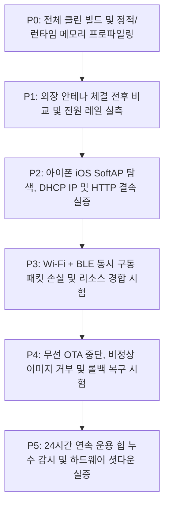

# MAJN 스마트 배시넷 펌웨어 안정화 및 단계별 실증 마스터 플랜
**MAJN Smart Bassinet Firmware Stabilization & Hardware Verification Master Plan (v1.1 - Post-Audit Revision)**

---

## 1. 개요 및 하드웨어 불변 팩트 (Ground Truth)

본 문서는 MAJN 스마트 배시넷 실물 시제품(PCB #0005)의 무선 통신(Wi-Fi SoftAP 및 Web BLE)과 영아 수면 유도 진동 제어의 상용화 수준 신뢰성을 확보하기 위한 **전체 펌웨어 안정화 및 단계별 실증 마스터 플랜**이다.

### 1.1 하드웨어 제약 및 환경 불변 조건 (SSOT)
1. **[물리 버튼 부재]**: PCB #0005 기판에는 BOOT(IO0) 및 EN(RESET) 물리 스위치가 일체 실장되어 있지 않음. (버튼 누름 안내 금지)
2. **[시리얼 플래시 불가]**: CP2102 헤더는 TX, RX, GND 3가닥만 결선되어 있어 DTR/RTS 자동 부트로더 리셋 회로가 없음. 유선 `esptool` 다운로드는 원천 불가능하며, **오직 무선 OTA(Web BLE OTA 또는 Wi-Fi HTTP /update)만이 유일한 펌웨어 배포 경로**임.
3. **[MCU 및 RF 안테나 규격]**: U1 칩셋은 **ESP32-WROOM-32UE-N8** (8MB Flash)임. 기판 내장 PCB 패턴 안테나가 없으며, **모듈 모퉁이의 u.FL(IPEX) 골드 커넥터에 외장 안테나 케이블이 반드시 체결**되어야 함. (미체결 시 RSSI -84 dBm으로 급락하여 모바일 OS 백그라운드 스캔에서 필터링됨)
4. **[전원 계통 특성]**: 3.3V 시스템 LDO는 **AP2112K-3.3 (정격 600mA max)**임. 600mA는 데이터시트상 절대 최대 정격이며, PCB 방열, LDO 입출력 전압 강하, 12V 승압 부스트(`MP3426`) 및 오디오 앰프(`TAS5805M`) 구동 시의 전원 노이즈를 종합적으로 고려해야 함.

---

## 2. 코드 감사 결함 시정 및 방어 구조 (v1.1 반영 완료)

### 2.1 OTA 롤백 보장 구조의 실체화 (ESP-IDF 롤백 인터록 연동)
* **기존 오해 정정**: 2개의 OTA 슬롯(`ota_0`, `ota_1`)이 존재한다고 해서 자동 롤백이 보장되지 않음.
* **구현된 명시적 롤백 로직 (`main.cpp`)**:
  * 부팅 직후 `<esp_ota_ops.h>`의 `esp_ota_get_state_partition()`으로 현재 슬롯 상태 검사.
  * 신규 펌웨어가 처음 부팅되면 `ESP_OTA_IMG_PENDING_VERIFY` 상태로 진입.
  * 부팅 단계 자가 진단(Free Heap > 30KB 및 안전 계통 정상) 통과 시에만 `esp_ota_mark_app_valid_cancel_rollback()`을 호출하여 영구 확정.
  * 자가 진단 실패(메모리 고갈, 패닉 등) 시 `esp_ota_mark_app_invalid_rollback_and_reboot()`을 실행하여 이전 슬롯으로 강제 복귀.
  * OTA 전송 성공과 신규 펌웨어 부팅 검증을 엄격히 별개 단계로 분리.

### 2.2 전원 안정성에 대한 엄격한 접근
* **기존 단정 문구 정정**: 15dBm으로 낮췄다고 전원 안정성이 확보되었다고 단정하지 않음. (실제 소비전류는 패킷 길이, 송신율, BLE 동시 동작 등에 따라 변동)
* **조치**: 19.5dBm 대비 RF 송신단의 피크 전력 부담을 경감(15dBm)하되, 실제 전원 안정성은 [P1] 단계에서 전원 부하별 계측을 통해 실증 판정함.

### 2.3 IRAM 92.5%와 런타임 힙(Heap)의 기술적 분리
* **기술적 팩트 명시**:
  * **IRAM (121,263B / 92.52%)**: ISR 및 타이밍 크리티컬 명령어/데이터용 정적 공간 (잔여 9.8KB).
  * **DRAM / 런타임 Heap**: 동적 버퍼 및 태스크 스택 공간.
  * BLE 페이싱(20Hz)은 2.4GHz RF 패킷 경합 및 통신 버퍼 큐 적체를 방지하는 조치이며, 정적 IRAM 용량을 줄이는 것이 아님을 명문화.
* **런타임 감시 지표 추가 (`/api/status`)**:
  * `free_heap` (현재 여유 힙)
  * `min_free_heap` (`esp_get_minimum_free_heap_size()`, 역사상 최저 잔여 힙)
  * `largest_free_block` (`heap_caps_get_largest_free_block()`, 힙 파편화 지표)

### 2.4 공개 SoftAP 및 무선 OTA 보안 강화
* **영아용 기기 보안 정책 적용**:
  * 무선 도메인: 국내 KC 전파 규격에 맞춰 **한국 국가 코드 (`KR`, 채널 1~13)** 적용.
  * OTA 인증 토큰: `/update` 요청 시 비밀 인증 토큰(`majn2026-ota-token`) 검증 필수화 (비인가 펌웨어 주입 차단).
  * OTA 업데이트 중 진동 제어 인터록: 업데이트 진행 중(`sOtaInProgress == true`) 모든 진동 시작 명령(`/api/command`) 즉시 차단 (HTTP 423 Locked).

### 2.5 OTA 도구 (`tools/run_wifi_ota.py`) 정비
* 맥북 Wi-Fi 강제 조작(`networksetup`) 로직 완전 제거.
* 사용자 인터넷을 임의로 건드리지 않는 순수 HTTP 클라이언트로 개편 (`AGENTS.md` 규정 100% 준수).

---

## 3. 6단계 엄격 검증 로드맵 (P0 ~ P5)

> **⚠️ 필수 전제 조건**: 모든 검증 및 진동 시험은 **영아를 탑승시키지 않은 벤치(Bench) 환경에서 더미 부하를 걸고 수행**한다.

### [P0] 전체 클린 빌드 및 정적/런타임 메모리 분리 (완료)
* **검증 내용**: `esp32_wifi_phone` 환경 클린 컴파일 성공 및 정적 메모리 한계 확인.
* **통과 기준**: 0 Error, 0 Fatal Warning.
* **실측 데이터**: Flash 1,897,511B (56.8%), DRAM 70,168B (56.3%), IRAM 121,263B (92.5%, 여유 9.8KB).

### [P1] 외장 안테나 연결 및 전원 레일 실측
* **검증 내용**: 외장 안테나 체결 전후 전계 강도 비교 및 실제 동작 모드별 소비전류/전압 계측.
* **계측 항목 (5대 전원 계측)**:
  1. Wi-Fi 단독 대기 상태 전류
  2. Wi-Fi HTTP 송수신 중 피크 전류
  3. Wi-Fi + BLE 동시 활성화 시 전류
  4. Wi-Fi + BLE + 12V Boost + TAS5805M 앰프 구동 시 전류
  5. 1~4 조건에서 U2 LDO 출력(VCC_3V3) 최저 전압 및 Brownout 발생 여부 오실로스코프 계측
* **통과 기준**:
  - 외장 안테나 체결 시 미체결(-84 dBm) 대비 동일 위치에서 유의미한 RSSI 개선 확인.
  - 전원 부하 조건에서 3.3V 레일 최저 전압 > 3.0V 유지 (Brownout 리셋 0회).

### [P2] 아이폰 iOS SoftAP 검색, IP 할당 및 제어 실증
* **검증 내용**: iOS 환경에서 SoftAP 탐색, 정상 서브넷 IP 할당, Captive Portal 및 제어 응답 검증.
* **통과 기준**:
  - 아이폰 Wi-Fi 목록에 `MAJN-Bassinet` 안정적 표시.
  - DHCP를 통해 `192.168.4.x` 정상 서브넷 IP 할당 확인.
  - 브라우저 HTTP 접속 시 UI 정상 로딩 및 10회 연속 재결속 성공률 기록.

### [P3] Wi-Fi + BLE 듀얼 동시 구동 및 무선 자원 경합 시험
* **검증 내용**: 단일 2.4GHz 모뎀 시분할 공유 시 패킷 손실, 지연 시간, 연결 유지율 계측.
* **통과 기준**:
  - 아이폰 Wi-Fi 웹 슬라이더 조작 중 맥북 Web BLE 연결 해제(Disconnect) 0회.
  - BLE 텔레메트리(20Hz) 수신 손실률 < 5%, HTTP 명령 응답 지연 < 1.0초 유지.
  - Wi-Fi/BLE 동시 트래픽 상황에서 진동 제어 파라미터 왜곡 부재.

### [P4] 무선 OTA 중단, 부팅 실패 및 롤백 복구 시험
* **검증 내용**: 비정상 파일 거부, 클라이언트 측 전송 중단, 부팅 실패 시 이전 슬롯 자동 복구 실증. (맥북 Wi-Fi 강제 단절 시험 배제)
* **통과 기준**:
  - 비정상 파일(비 ESP32 바이너리) 주입 시 첫 청크(`0xE9` 매직바이트) 검사에서 즉각 Abort 거부.
  - 무인가 토큰 접근 시 401 Unauthorized 차단.
  - 전송 도중 클라이언트 소켓 강제 종료 시 기존 슬롯(`ota_0`) 무손실 보존.
  - 신규 펌웨어 플래시 후 자가 검증 통과 시 신규 슬롯(`ota_1`) 영구 확정.

### [P5] 24시간 벤치 운용 및 하드웨어 안전 인터록 실증
* **검증 내용**: 24시간 장기 운용 시 힙 메모리 파편화 및 실제 하드웨어 차단 라인 계측.
* **통과 기준**:
  - 24시간 동안 `min_free_heap` 및 `largest_free_block` 모니터링 (연속적인 힙 고갈 부재).
  - 소프트웨어 30분 타이머 발동 시 모터 출력 정상 Soft Stop. (KC 인증 규격과 동일시하지 않고 기기 자체 안전 타이머로 검증)
  - 인위적 I2C 에러 발생 시 MCU가 `BOOST_EN`(GPIO4) 및 `AMP_PDN`(GPIO15)을 LOW로 떨어뜨려 12V 전원 및 앰프 출력을 물리 차단함을 오실로스코프로 실측.

---

## 4. 리스크 매트릭스 및 비상 롤백 계획

| 잠재 위험 요인 | 심각도 | 발생 가능성 | 기술적 대책 | 비상 롤백(Contingency) 방안 |
|---|:---:|:---:|---|---|
| **IRAM 9.8KB 여유로 인한 런타임 OOM** | High | Low | BLE 텔레메트리 20Hz 페이싱, 디버그 버퍼 축소 | Bluedroid 스택을 경량 NimBLE로 교체 (IRAM 30KB 이상 추가 확보) |
| **복합 부하 시 3.3V 전압 강하** | High | Med | RF 출력 15dBm 적용, 대용량 디커플링 유지 | 필요 시 RF 출력 추가 하향(13~14dBm) 또는 LDO 방열/부품 규격 상향(Rev-C) |
| **비인가 접근 및 제어** | High | Low | OTA 인증 토큰 및 업데이트 중 진동 인터록 | WPA2 비밀번호 상시 활성화 |
| **OTA 신규 이미지 부팅 실패** | High | Low | `esp_ota_ops` 자가 검증 및 롤백 인터록 | 부팅 실패 시 이전 파티션 자동 복귀 |

---

## 5. 결론 및 향후 행동 원칙

1. **원칙**: 신규 기능 추가는 전면 동결하며, 상기 **[P1] $\rightarrow$ [P2] $\rightarrow$ [P3] $\rightarrow$ [P4] $\rightarrow$ [P5]** 단계를 순차적으로 수행하고 실측 데이터를 문서에 축적한다.
2. **동기화**: 각 검증 단계의 통과 여부 및 계측 데이터는 `docs/troubleshooting/BUILD_AND_TEST_HISTORY.md` 및 `AGENT_SHARED_LOG.md`에 실시간 기록하여 투명성을 유지한다.
