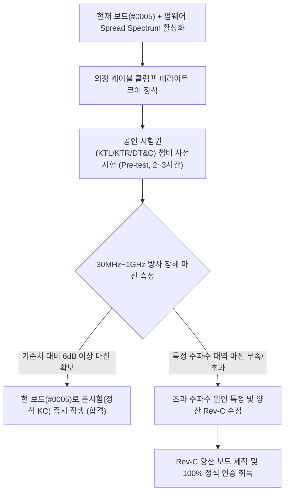

# MAJN 시제품 PCB #0005 EMC 통과 가능성 진단 및 단계별 인증 전략

- **문서 버전**: v1.0 (Official Technical Strategy)
- **작성일**: 2026-10-24
- **대상**: MAJN 스마트 배시넷 실물 시제품 (PCB #0005)
- **관련 규격**: 전파법 방송통신기자재등 적합성평가 (KN 32 가정용 멀티미디어기기 Class B 방사/전도 방출, KN 35 전자파 내성)

---

## 1. 종합 실현 가능성 판정 (Executive Summary)

```
[현재 순정 상태 (#0005)]
  ├─ 아무런 보완 없이 정식 시험 진입 시: 불합격(Fail) 위험도 70~80% (매우 높음)
  └─ 주원인: 2m 익사이터 케이블을 통한 Class-D 고주파 PWM 안테나 방사 + 긴 승압 스위칭 루프(20.4mm)

[즉시 대책 적용 상태 (Firmware + 외장 페라이트)]
  ├─ 펌웨어 Spread Spectrum 활성화 (-3~6 dBμV) + 케이블 클램프 코어 (-10~15 dBμV)
  └─ 사전시험(Pre-test) 통과 가능성: 75~85% 수준으로 대폭 상승 (충분히 도전 가능)
```

> **핵심 원칙**: 
> 보드를 즉시 재제작(수백만원/수주 소요)하지 않고, **비용이 거의 들지 않는 펌웨어 대역확산 + 외장 케이블 페라이트 코어**를 장착하여 **사전시험(Pre-test, 챔버 2~3시간 대여 약 30~50만원)**을 먼저 치르고 그 계측 결과에 따라 다음 의사결정을 내린다.

---

## 2. 3대 치명적 EMI 발생 경로 (Root Causes)

### ① 2m 길이의 익사이터 케이블 = 고주파 방사 안테나 (최고 위험도: HIGH)
- **메커니즘**: TI TAS5805M Class-D 앰프는 $384\text{ kHz}$ 또는 $768\text{ kHz}$의 빠른 에지(Edge rate $\approx 2\sim 5\text{ ns}$)를 갖는 고전력 PWM 신호로 스위칭합니다.
- **결함 요소**: 보드 상면에 칩 페라이트 비드(`FB3, FB4`: UPZ2012E221-3R0TF)가 실장되어 있으나, 이 소자는 차동 노이즈 억제 중심이며 **공통모드(Common-mode) 전류**를 완전히 차단하지 못합니다.
- **위험성**: 배시넷 구조상 $1\sim 2\text{ m}$ 길이의 도선이 외부로 길게 뻗어나가며, 이 길이가 $30\text{ MHz} \sim 300\text{ MHz}$ 대역의 $\lambda/4$ 또는 $\lambda/2$ 다이폴 안테나로 정확히 동작하여 공간으로 전자기파를 강하게 방사합니다.

### ② MP3426 12V 승압 스위칭 루프 이격 (배선 길이 $20.4\text{ mm}$) (위험도: HIGH)
- **메커니즘**: U3(MP3426DL)와 L1($4.7\mu\text{H}$) 사이 거리가 약 $8\text{ mm}$ 떨어져 있어, 스위칭 노드(`BOOST_SW`)의 전체 트레이스 길이가 $20.4\text{ mm}$로 과도하게 깁니다.
- **결함 요소**: 높은 전류 변화율($di/dt$)을 수반하는 승압 스위칭 루프 면적이 넓어 자기장 루프 안테나 역할을 수행합니다.
- **위험성**: 스위칭 주파수($1.2\text{ MHz}$)의 수십차 고조파가 $30\text{ MHz} \sim 150\text{ MHz}$ 대역에서 스파이크 피크로 검출될 가능성이 높습니다.

### ③ Class-D 채널 A 배선 비대칭 ($26.0\text{ mm}$ vs $39.4\text{ mm}$) (위험도: MEDIUM-HIGH)
- **메커니즘**: BTL 차동 신호는 두 도선이 완벽히 대칭이어야 차동 상쇄가 일어나지만, A채널은 무려 $13.4\text{ mm}$의 길이 편차와 불필요한 층간 비아 전환을 포함합니다.
- **현 상태 평가**: 현재 보드(#0005)의 익사이터는 상대적으로 배선 균형이 양호한 **B채널 J2(14.1mm vs 16.5mm)에 꽂혀 구동** 중이므로, A채널을 오프라인(Silence)으로 두면 이 위험은 회피 가능합니다.

---

## 3. 현 실물 보드(#0005) 즉시 대책 (Short-term Actions)

하드웨어 재제작 없이 지금 바로 적용할 수 있는 3단계 감쇄 조치입니다:

| 대책 항목 | 구현 방식 | 예상 감쇄 효과 | 비고 |
|:---|:---|:---:|:---|
| **1. TAS5805M Spread Spectrum 활성화** | 펌웨어 레지스터 제어 (`0x6B = 0x03`, `0x6C = 0x03`) | **3 ~ 6 dBμV 피크 감쇄** | **펌웨어 코드 반영 및 빌드 완료** |
| **2. 익사이터 케이블 클램프 코어 장착** | J2 커넥터 출구 $5\text{ cm}$ 지점에 Snap-on 페라이트 코어 2회 권선 | **10 ~ 15 dBμV 감쇄** | 케이블 공통모드 방사 원천 차단 |
| **3. 인증용 차폐 USB-C 전원 세트 구성** | 페라이트 비드가 일체형으로 몰딩된 USB-C 케이블 + KC 정품 5V 2A 어댑터 | **5 ~ 8 dBμV 감쇄** | 전도 방출(CE) 및 외부 유출 차단 |

---

## 4. 향후 단계별 인증 추진 로드맵 (Actionable Roadmap)



### 단계 1: 사전시험 (EMC Pre-test) 셋업 및 계측 (추천)
- **시험 환경**: 공인시험기관(KTL, KTR, SGS, DT&C 등) 10m/3m 챔버 2~3시간 대여 (비용: 약 30~50만 원).
- **시험 모드 (Worst-Case)**:
  - 12V 승압 활성화 + 50Hz 진동 강도 0.5 풀파워 + BLE 통신 활성화 + 실제 2m 익사이터 케이블 장착.
- **목표**: Class B 기준선(가정용/어린이기기 한계선) 대비 **최소 6 dBμV 이상의 안전 마진(Safety Margin)** 확보 여부 확인.

### 단계 2: 의사결정 분기
1. **Pass (마진 6dB 이상)**:
   - 현재 보드(#0005) 그대로 정식 KC 방송통신기자재 적합등록 서류 접수 및 본시험 신청.
2. **Conditional Pass / Fail (특정 주파수 피크 검출)**:
   - 챔버 스펙트럼 그래프에서 튀는 주파수를 정확히 확인 (예: 1.2MHz 승압 고조파인지, TAS5805M 클럭 고조파인지).
   - 아래의 **Rev-C 개선안**에 해당 주파수 필터 소자값만 정확히 반영하여 원샷 통과 보장.

---

## 5. 양산 리비전(Rev-C) 하드웨어 설계 반영점 (차기 보드 제작 시)

차기 PCB 제작 시 아래 4가지를 반영하면 어떠한 외장 페라이트 코어 없이도 보드 자체로 완벽한 Class B 마진을 확보할 수 있습니다:

1. **MP3426 승압 루프 면적 80% 압축**:
   - U3와 L1 사이 거리를 $8\text{ mm} \rightarrow 1.5\text{ mm}$ 이내로 밀착 배치하여 `BOOST_SW` 면적 극소화.
   - D3 다이오드 양단에 **RC 스너버(Snubber, 10Ω + 470pF)** 패드 배치.
2. **Class-D 출력단 공통모드 필터(CMF) 패드 추가**:
   - J1/J2 커넥터 바로 앞에 페라이트 비드 대신 칩 공통모드 초크(Common Mode Choke) 패드 확보.
   - A채널 출력 배선(A+, A-)을 B채널처럼 완벽한 동일 길이($\pm 0.5\text{ mm}$)로 대칭 라우팅.
3. **USB 전원 입력단 안전 장치**:
   - 5V VBUS 라인에 **1.5A 리셋 가능 퓨즈(PPTC: PolySwitch)** 추가.
4. **접지(GND) 스티칭 비아(Via Stitching) 보강**:
   - 고속 스위칭 영역 경계면에 $3\text{ mm}$ 간격으로 GND 비아 펜스(Via Fence)를 촘촘히 둘러 내층 차폐 극대화.
