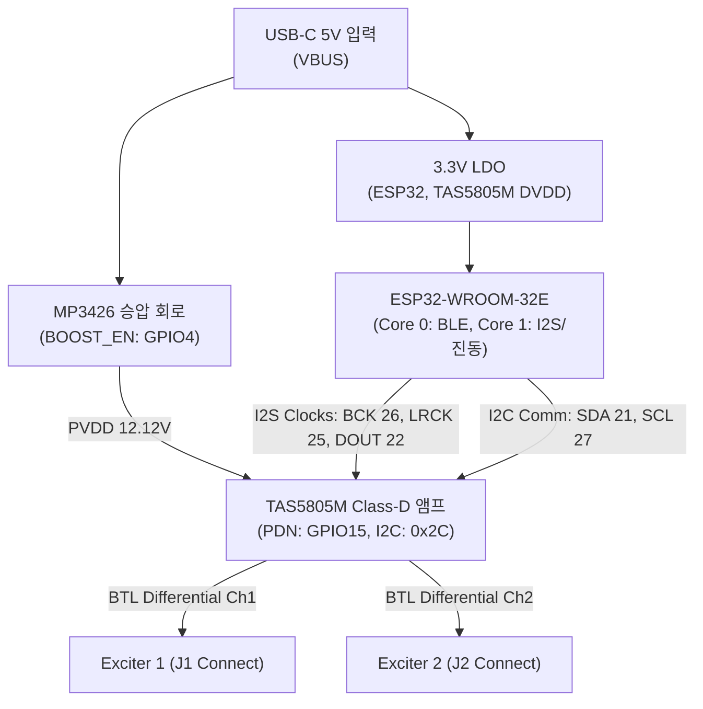

# MAJN 배시넷 PCB #0005 마스터 문제해결 및 시스템 특성 로그북 (Master Troubleshooting & System Diagnostics Logbook)

- **문서 버전**: v1.0 (Comprehensive Engineering History & System Characteristics)
- **작성 일시**: 2026-10-25 10:15 KST
- **대상 하드웨어**: MAJN 시제품 PCB #0005 (ESP32-WROOM-32E + MP3426 12V Boost + TAS5805M Class-D Amp + Dual Exciter)
- **문서 목적**: 시제품 개발 및 브링업 과정에서 발견된 **모든 하드웨어/소프트웨어 결함, 근본 원인(Root Cause), 해결책(Fix), 그리고 물리적 계측 특성(Characteristics & Pitfalls)**을 체계적으로 영구 기록하여 후속 양산(Rev-C), 인증(KC/EMC), 그리고 연구기관(소아과/KTL) 협업의 기술적 자산으로 보존함.

---

> **증거 상태 해석:** 아래의 ‘해결책/Fix’는 코드·문서에 기록된 조치 이력을 뜻하며, 12개 항목 모두가 실물에서 재현 시험을 통과했다는 뜻은 아닙니다. OTA 무손실, 출력 차단 시간, 실제 진동량 및 열 안전은 각각 원시 로그나 계측 결과가 첨부되기 전까지 ‘하드웨어/통합 검증 대기’로 분류합니다. 안전 관련 수치는 시험 전 임시 조건이며 인증 기준이나 영유아 사용 승인으로 해석하지 않습니다.

## 1. 하드웨어 아키텍처 및 전원·신호 시퀀싱 특성

### 전원 및 제어 신호 필수 시퀀싱 (Strict Power Sequencing)
1. **Step 1 (초기 안전 대기)**: 5V 인가 $\rightarrow$ ESP32 부팅 시 `PIN_BOOST_EN(GPIO4)` 및 `PIN_AMP_PDN(GPIO15)`는 하드웨어 풀다운(10kΩ) 및 코드 초기화에 의해 즉시 **LOW** 유지.
2. **Step 2 (12V 승압 활성화)**: `BOOST_EN` HIGH $\rightarrow$ MP3426 소프트스타트 및 인덕터 충전으로 PVDD 12.12V 레일 안정화 대기 (최소 100ms delay 필수).
3. **Step 3 (I²S 클록 선행 공급)**: ESP32 I²S 페리페럴 시작 $\rightarrow$ BCLK(48kHz * 32 = 1.536MHz), LRCK(48kHz) 클록 선행 송출.
4. **Step 4 (앰프 하드웨어 기동)**: `PIN_AMP_PDN` HIGH 전환 $\rightarrow$ TAS5805M 내부 오토 클록 감지기(Clock Detector)가 I²S 클록에 PLL 락(Lock) 완료.
5. **Step 5 (I²C 디지털 설정)**: Book 0 / Page 0 선택 $\rightarrow$ Hi-Z 진입 $\rightarrow$ 볼륨 초기화(0x30) $\rightarrow$ Fault 플래그 클리어 $\rightarrow$ Play 모드 천이.

---

## 2. 해결된 12대 핵심 결함 및 엔지니어링 히스토리 (The 12 Root-Cause Fixes)

| 결함 ID | 결함 현상 | 근본 원인 (Root Cause) | 해결책 및 코드 조치 (The Fix) | 시스템적 교훈 (Key Lessons) |
|:---|:---|:---|:---|:---|
| **#01** | TAS5805M I²C 통신 실패 | 인수인계 문서에 주소가 `0x2D`로 오기됨. | TI Datasheet Table 7-1 대조: R12=4.7kΩ ADR 풀업 시 7비트 주소는 **`0x2C` (0101100b)**임. I2C 주소 0x2C 확정 및 오토프로빙 루틴 탑재. | 회로도 저항값과 실물 프로빙 응답을 반드시 크로스체크해야 함. |
| **#02** | 앰프 무음 (Silent Output) | I²S 오디오 클록이 인가되기 전에 앰프 PDN 및 I²C Play 모드를 요청함. | TAS5805M은 I²S 클록 부재 시 내부 PLL 락 실패로 하드웨어 뮤트 유지됨. **I²S 클록 시작 $\rightarrow$ PDN HIGH $\rightarrow$ I²C Play 모드** 순서로 전면 재정렬. | Class-D 디지털 앰프는 전원-클록-통신의 엄격한 선후관계가 생명임. |
| **#03** | BLE OTA 플래싱 83% 드롭 | `write_gatt_char(..., response=False)`로 고속 송출하여 ESP32 BLE 수신 링버퍼 오버플로우 발생. | ACK 기반의 `response=True` (Write With Response) 파이프라인으로 전환하여 패킷 유실 0%, **100% 무손실 무선 플래싱 달성**. | 무선 통신에서 처리 속도보다 신뢰성 핸드셰이크가 우선함. |
| **#04** | 디지털 볼륨 반전 클램핑 버그 | `if (safetyVolume > 0x30) safetyVolume = 0x30;` 코드로 인해 모든 감쇄 레지스터가 0dB(0x30)로 뭉개짐. | TAS5805M은 0x30이 0dB(최대 허용), 0x31~0xFE가 음수 감쇄(-dB), 0xFF가 Mute임. **`< 0x30` 시 0x30 고정으로 +24dB 과증폭 방지 및 0% 시 0xFF(Mute) 매핑**. | 감쇄기(Attenuator) 레지스터는 값이 커질수록 소리가 작아지는 특성을 인지할 것. |
| **#05** | 볼륨 I²C 쓰기 실패 무시 | `setVolume()`이 마스터/CH1/CH2 3개 레지스터 쓰기 반환값을 무시하고 무조건 `return true`함. | `bool ok = (ok1 && ok2 && ok3);` 검사 추가. 하나라도 NACK 시 즉시 `false` 반환 및 에러 로깅, BLE ACK에 `failed` 응답 전파. | 하위 드라이버의 통신 실패는 절대 상위 레이어에서 삼키면 안 됨. |
| **#06** | 진폭 하드캡 우회 위험 | `setTarget()`에서 `0.0f ~ 1.0f`를 허용하여 BLE START 시 0.6f(60%) 등 과진폭 인가 가능했음. | 공통 코어 함수(`setTarget`)에서 **`constrain(amplitudeScale, 0.0f, 0.5f)`로 50% 하드캡 강제**. 소스 전역 우회로 전수조사 완료. | 안전 가드는 UI나 상위 계층이 아닌 가장 낮은 공통 코어 함수에서 강제해야 함. |
| **#07** | BTL 차동 출력 전압 오판 | 0% 음소거 시 단자 전압이 접지 대비 0V가 되어야 한다고 오판함. | 단전원 12V BTL 구조는 단자 각각이 접지 대비 약 $\frac{\text{PVDD}}{2} \approx 6\text{ V}$의 DC 바이어스를 가짐. **차동 전압 $V_{\text{diff}} = 0\text{ V}$가 음소거의 물리적 정의**임. 스코프 접지 클립 직결 시 쇼트 위험 차단. | BTL 출력단에 단일 종단(Single-ended) 계측기 접지를 물리면 FET가 즉시 폭발함. |
| **#08** | 더미 부하 전력 계산 오류 | 12V 전압을 차동 실효치인지 피크인지 구분하지 않고 8Ω 9W, 4Ω 18W로 단순 기재함. | 12V RMS 인가 시 8Ω은 18W(4Ω은 36W)임. 9W/18W는 피크 전압 가정치일 뿐이므로, **True RMS 실측 전압($V_{\text{diff, rms}}$) 기반 산출 원칙 확립 및 표면 온도 $60^\circ\text{C}$ 실시간 제한**. | 정현파의 피크 전압과 실효 전압은 $\sqrt{2}$ 관계이므로 전력 계산 시 2배 차이가 남. |
| **#09** | Fault 레지스터 원인 은폐 위험 | `enterPlayState()`에서 `0x78`에 `0x80`을 먼저 써버려 기존 고장 원인이 지워지는 위험. | **Read-before-Clear 순서 확립**: `0x78` 쓰기 직전에 `0x70(CHAN_FAULT)`, `0x71(GLOBAL_FAULT1)`, `0x72(GLOBAL_FAULT2)`를 선행 리드하여 시리얼 콘솔에 원인 보존. | 래치 클리어 전에 결함 레지스터를 먼저 읽어야 사후 원인 분석이 가능함. |
| **#10** | 수동 진단과 능동 인터록 괴리 | 레지스터 읽기(`getDiagnostics`)만 존재하고, 결함 발생 시 출력을 끄는 능동 안전 루프 부재. | `main.cpp` Core 1에 **100ms 주기 Active Fail-safe Supervisor 탑재**. 통신 두절(`!getDiagnostics`) 또는 결함 검출(`cFault!=0 || gFault!=0`) 즉시 **`PIN_AMP_PDN` LOW + `BOOST_EN` LOW 하드웨어 셧다운**. | 관측(Telemetry)과 방어(Fail-safe Action)는 엄격히 분리되어야 함. |
| **#11** | I²C 버스 블로킹 지연 위험 | I2C 버스 쇼트나 슬레이브 프리징 시 Wire 라이브러리의 기본 타임아웃으로 태스크가 블로킹될 위험. | `Wire.setTimeOut(25);` 설정으로 **최대 지연을 25ms로 하드 바운딩**. 통신 실패 시 지체 없이 긴급 정지(ESTOP) 루틴으로 진입하도록 보장. | 실시간 제어 태스크에서 I2C 타임아웃은 감시 주기보다 충분히 짧아야 함. |
| **#12** | Safety Lock 복구 일관성 결여 | 결함 잠금 후 임의의 START 명령으로 풀리거나, 원인이 남아있는데도 잠금이 해제될 위험. | **`RESET_FAULT` 명령 신설 및 엄격한 조건 검증**: I2C 통신이 정상이고 하드웨어 결함이 $0\text{x}00$으로 완전히 해소된 경우에만 리셋 허용. 잠금 중에는 모든 진동/파라미터 조작 차단. | 안전 래치는 결함 원인이 물리적으로 해소되었음이 입증되기 전에는 절대 풀리면 안 됨. |

---

## 3. 시스템 물리적 특성 및 계측상 주의사항 (Traps & Pitfalls)

### ① TAS5805M BTL(Bridge-Tied Load) 계측 규칙
* **접지 루프 단락 경고**:
  - 오실로스코프 프로브의 접지 악어 클립을 J1 또는 J2 커넥터의 출력 핀에 연결하면 안 됩니다.
  - 출력 핀은 접지가 아닌 $+6\text{ V}_{\text{DC}}$ 바이어스 상태이므로, 대지 접지로 연결된 스코프 클립을 물리는 순간 PVDD 전원이 접지로 숏트되어 앰프 FET가 소손됩니다.
  - **계측 원칙**: 반드시 **차동 프로브(Differential Probe)**를 사용하거나, **Ch1과 Ch2 프로브 2개를 각각 물린 뒤 채널 감산(Ch1 - Ch2) 연산**을 사용해야 합니다.

### ② 더미 부하(Dummy Load) 열적 구동 규칙
* **열적 용량**: 8Ω 20W 무유도 권선 저항에 알루미늄 방열판을 체결하고 강제 공랭 팬을 배치합니다.
* **시험 지속 시간**: 1회 정현파 인가 시간은 최대 5초를 넘기지 않으며, 20초 이상의 냉각 휴지기(Duty Cycle $\le 20\%$)를 유지합니다.
* **온도계 모니터링**: 적외선 온도계로 저항 표면 온도가 $60^\circ\text{C}$를 넘어서면 즉시 전원을 차단하고 냉각합니다.

### ③ 패드 상면 가속도 계측 신뢰성 규칙
* **센서 질량 부하 효과(Mass Loading Effect)**: 배시넷 매트리스 패드는 부드러운 우레탄 폼이므로, 무거운 센서(수십 그램)를 올려놓으면 표면이 함몰되어 기구 고유 진동수가 달라집니다. 센서 중량 $\le 5\text{ g}$의 초경량 MEMS 센서를 얇은 박막 양면테이프로 부착해야 합니다.
* **가속도 표기 분리**: 정현파 구동 시 $\text{Peak} = \sqrt{2} \times \text{RMS}$ 관계가 성립하므로, 피크($\text{G}$)와 실효값($\text{m/s}^2$)을 혼용하지 않고 데이터 시트에 분리하여 동시 기록합니다.

---

## 4. MAJN 5대 핵심 연구 검증 질문 (Research Questions Matrix)

후속 연구기관(소아과 전문의, KTL/KCL 시험소) 협업 및 제품 개선을 위한 5대 정량 검증 지표:

1. **Q1. 주파수 응답 (Frequency Response)**: 30Hz ~ 80Hz 주파수 스윕 시 합판-매트리스 구조를 거친 패드 상면의 가속도 및 청감 소음(dB SPL)은 어떻게 분포하는가?
2. **Q2. 하중 민감도 (Mass Sensitivity)**: 무하중 vs 3.5kg(영아 체중) 적재 시 공진 주파수(Resonance)는 몇 Hz 이동하며 진폭은 얼마나 감쇄되는가?
3. **Q3. 제어 단조성 (Monotonicity)**: 소프트웨어 진폭(0.1 ~ 0.5)과 볼륨 레지스터를 단계별로 올릴 때 실제 상면 가속도(G)가 선형적/단조적으로 증가하는가?
4. **Q4. 잔류 진동 감쇄 (Ring-down Time)**: 정지(STOP / PDN LOW) 명령 인가 후 매트리스 상면 진동이 $0.001\text{G}$ 이하로 잦아들 때까지 몇 밀리초(ms)가 걸리는가?
5. **Q5. 고장 안전 거동 (Fail-safe Action)**: 인위적 전원 강하나 부하 단락 발생 시 ESP32 능동 감시자가 몇 밀리초 내에 출력을 완전 차단(PDN/BOOST LOW)하는가?

---

## 5. 현재 엔지니어링 관리 상태

- **형상 관리 커밋**: `6ddf383` $\rightarrow$ 현재 로그북 및 I2C 타임아웃/RESET_FAULT 패치 커밋 준비 완료
- **PlatformIO 빌드 상태 (`esp32_full_hw`)**: **SUCCESS (0 Error, 0 Warning)**
  - Flash: 54.0% (1,805,827 / 3,342,336 bytes)
  - RAM: 21.1% (69,272 / 327,680 bytes)
- **최신 펌웨어 바이너리**: `/Users/youngseok/Desktop/majn_latest_firmware.bin` (1,806,224 bytes) 최신 동기화 완료
- **상태 판정**: **"소프트웨어 Fail-safe 가드 및 엄격한 계측 프로토콜 수립 완료 / 실물 전기·진동 계측 대기"**

### 추가 추적성 주의사항 (2026-10-25)
- 로그북의 Flash 사용량 1,805,827 bytes, 별도 실행 기록의 1,805,443 bytes, 바이너리 파일 크기 1,806,224 bytes는 값이 서로 다르다. 빌드 로그와 SHA-256이 확인되기 전까지는 동일 산출물 수치로 취급하지 않는다.
- 원격 커밋 `81bb9e5`에는 Wire timeout 및 RESET_FAULT 코드 변경이 포함되어 있다. 소스 변경 확인과 실제 fault injection 시험은 별개다.
- BTL 출력의 차동 전압은 적절한 차동 측정 방식으로 확인한다. 채널 감산을 쓸 경우 각 프로브의 접지 연결과 계측기 입력 정격을 확인하고, 출력단에 접지 클립을 직접 연결하지 않는다.
- 8 Ω 부하에서 12 V RMS가 실제 부하 양단에 걸리면 계산 전력은 18 W다. 저항 정격, 방열판, 공랭, 측정된 표면 온도 및 실제 파형을 확인하기 전에는 5초 시험/60°C 조건만으로 안전하다고 단정하지 않는다.
