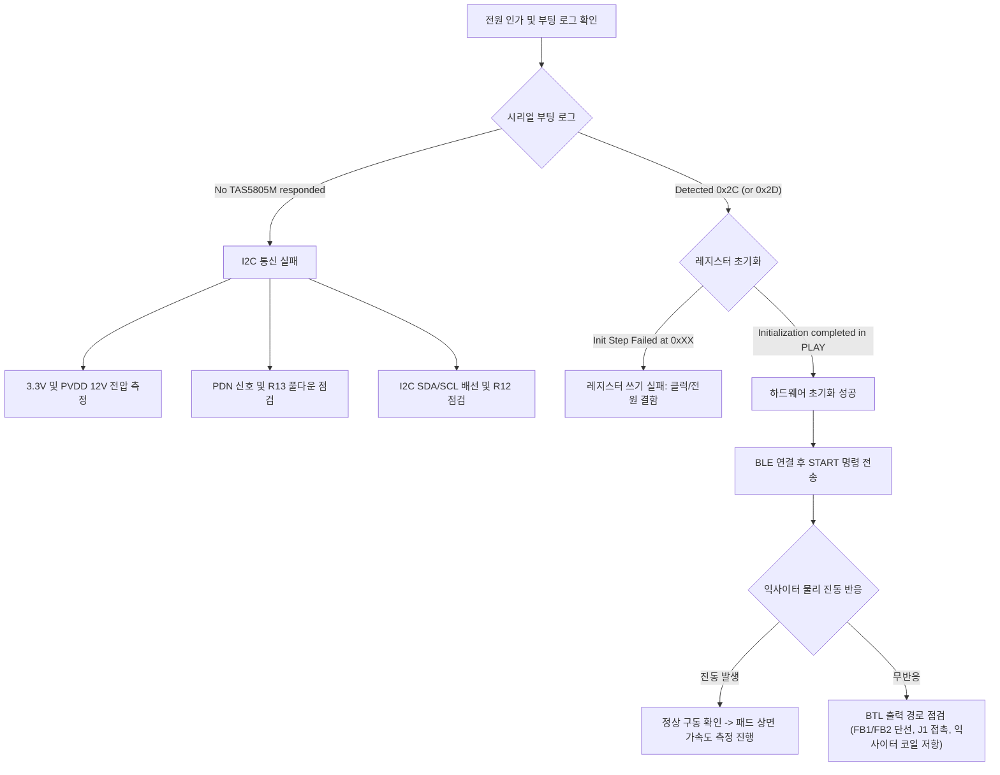

# MAJN 시제품 PCB #0005 생산 기준 회로·BOM 및 실측 기준표

- 작성일: 2026-10-22
- 대상: 실물 생산 보드 **MAJN PCB #0005**
- 근거 자료: EasyEDA Pro 공정 데이터, `pcb_comps.json` (총 56개 부품 전수 분석), 실장 네트리스트
- 원칙: 저장소의 이전 문서나 미래 설계 제안을 배제하고, **실제 조립·생산된 PCB #0005의 하드웨어 실체**만을 기록한다.

---

## 1. 생산 보드(#0005) 실장 컴포넌트 총괄

PCB #0005에는 총 56개의 컴포넌트가 실장되어 있습니다.

| 구분 | 수량 | 주요 부품 | 비고 |
|:---|:---:|:---|:---|
| **핵심 IC** | 5 | ESP32-WROOM-32E-N8, AP2112K-3.3, MP3426DL, TAS5805M, LSM6DSOX | 실물 실장 확인 |
| **커넥터** | 4 | USB-C 16핀, 6핀 UART/PROG 헤더, 2핀 스피커 커넥터 2개(J1, J2) | 2.0mm 피치 커넥터 |
| **인덕터/다이오드**| 3 | L1 (4.7uH, 6x6mm), D3 (SS34 쇼트키), D1 (SMAJ5.0A TVS) | 승압 및 보호 회로 |
| **페라이트 비드**| 4 | FB1, FB2, FB3, FB4 (UPZ2012E221-3R0TF) | 앰프 출력 필터 |
| **저항** | 14 | R1 ~ R14 (0603 정밀급) | 승압 FB, I2C ADR, 풀업/풀다운 |
| **커패시터** | 26 | C1 ~ C27 (0603/0805 적층 세라믹) | 전원 디커플링, 부트스트랩, LC 필터 |

---

## 2. 핵심 IC 5종의 실체 및 핀 매핑

### ① U1: 메인 컨트롤러 (ESP32-WROOM-32E-N8)
* **LCSC Part Number**: `C701345` (8MB SPI Flash 내장, 온보드 PCB 안테나)
* **주요 핀 연결 (실측 네트)**:
  - **Pin 10 (GPIO25)**: `I2S_LRCLK` (Word Select / 프레임 동기)
  - **Pin 11 (GPIO26)**: `I2S_BCLK` (Bit Clock)
  - **Pin 12 (GPIO27)**: `AMP_I2C_SCL` (앰프 제어 I2C 클럭)
  - **Pin 23 (GPIO15)**: `AMP_PDN` (앰프 파워다운 제어)
  - **Pin 26 (GPIO4)**: `BOOST_EN` (12V 승압 활성화 제어)
  - **Pin 29 (GPIO5)**: `SPI_CS` (LSM6DSOX IMU 칩셀렉트)
  - **Pin 30 (GPIO18)**: `SPI_SCLK` (LSM6DSOX IMU SPI 클럭)
  - **Pin 31 (GPIO19)**: `SPI_MISO` (LSM6DSOX IMU SPI 수신)
  - **Pin 33 (GPIO21)**: `AMP_I2C_SDA` (앰프 제어 I2C 데이터)
  - **Pin 36 (GPIO22)**: `I2S_DIN` (I2S 오디오 데이터 스트림)
  - **Pin 37 (GPIO23)**: `SPI_MOSI` (LSM6DSOX IMU SPI 송신)
  - **Pin 6 (GPIO34)**: `SENSOR_INT1` (LSM6DSOX 인터럽트 1, 입력 전용 핀)

### ② U2: 3.3V 시스템 전원 LDO (AP2112K-3.3TRG1)
* **LCSC Part Number**: `C51118` (SOT-23-5 패키지, 600mA Low-Dropout 레귤레이터)
* **입력**: `VBUS_5V` (USB-C 5V 전원)
* **출력**: `VCC_3V3` (ESP32, TAS5805M DVDD, LSM6DSOX 전원)
* **정상 전압**: **3.30V (허용범위: 3.25V ~ 3.35V)**

### ③ U3: 12V 앰프 메인 전원 승압 레귤레이터 (MP3426DL)
* **LCSC Part Number**: `C2909511` (QFN-14 패키지, 45V 6A High-Efficiency Boost Converter)
  > **주의**: 이전 문서에서 TI TPS61088로 언급된 적이 있으나, **실제 생산 PCB #0005에 실장된 칩은 MPS사의 MP3426DL**입니다.
* **승압 회로 파라미터**:
  - 인덕터: L1 = `4.7uH` (SWPA6045S4R7MT, LCSC `C78804`)
  - 정류 다이오드: D3 = `SS34` (3A 40V 쇼트키 다이오드, LCSC `C8678`)
  - 피드백 상단 저항: R1 = `143kΩ` (0603 1%)
  - 피드백 하단 저항: R2 = `16kΩ` (0603 1%)
  - 피드백 기준전압: $V_{FB} = 1.225\text{ V}$
  - **이론적 출력 전압**:
    $$V_{OUT} = 1.225\text{ V} \times \left(1 + \frac{143\text{ k}\Omega}{16\text{ k}\Omega}\right) = 1.225 \times 9.9375 = \mathbf{12.17\text{ V}}$$
* **정상 전압**: **약 12.2V (허용범위: 11.9V ~ 12.4V)**
* **제어 신호**: Pin 2 `BOOST_EN` (ESP32 GPIO4로 제어. HIGH 인가 시 승압 동작 시작)

### ④ U4: 디지털 오디오/진동 앰프 (TAS5805MPWPR)
* **LCSC Part Number**: `C478472` (TSSOP-28 패키지, 23W 디지털 입력 Class-D)
* **전원 공급**:
  - `DVDD` (Pin 2): `VCC_3V3` (3.3V 디지털 코어 전원)
  - `PVDD` (Pin 15, 16, 27, 28): `PVDD_12V` (12.17V 승압 전원)
* **주소 설정 (ADR, Pin 3)**:
  - 저항 R12 (`4.7kΩ`)를 통해 `VCC_3V3`로 풀업 연결됨.
  - **TI TAS5805M 공식 데이터시트(Table 7-1) 기준**:
    - 4.7kΩ 풀업: `0101100b` $\rightarrow$ **`0x2C` (기본 I²C 주소)**
    - (참고: 15kΩ 풀업인 경우 `0x2D`)
* **제어 핀**:
  - `PDN` (Pin 12): ESP32 GPIO15 연결. R13(`10kΩ`)으로 GND 풀다운. HIGH 인가 시 활성화.
* **오디오 출력**:
  - 채널 A (BTL): `AMP_OUT_A+` (Pin 26), `AMP_OUT_A-` (Pin 23) $\rightarrow$ 필터(FB1, FB2) 거쳐 `J1` 커넥터로 연결
  - 채널 B (BTL): `AMP_OUT_B+` (Pin 17), `AMP_OUT_B-` (Pin 20) $\rightarrow$ 필터(FB3, FB4) 거쳐 `J2` 커넥터로 연결

### ⑤ U5: 6축 가속도/자이로 센서 (LSM6DSOXTR)
* **LCSC Part Number**: `C481766` (LGA-14 패키지)
* **실장 여부**: **PCB #0005에 물리적 패드 및 부품 실장 확인** (SPI 모드로 ESP32와 연결)
* **현재 방침**: 진동 구동 검증 단계에서는 실물 패드 진동 측정을 외부 가속도계로 수행하므로, 온보드 IMU는 구동 안정화 후 단계적으로 검증함.

---

## 3. 센서 실장 현황 전수 대조표

| 센서 항목 | PCB #0005 실장 여부 | 근거 자료 | 판정 결과 |
|:---|:---:|:---|:---|
| **온보드 6축 IMU (LSM6DSOX)** | **실장됨 (U5)** | `pcb_comps.json` U5 부품 및 SPI 배선 존재 | 실장 확인 (구동 복구 후 활성화) |
| **I2S 디지털 마이크** | **미실장 (없음)** | 회로도 및 BOM에 해당 부품/패드 부재 | 1차 시제품 미포함 |
| **BCG 호흡/심박 센서 (PVDF)** | **미실장 (없음)** | 회로도 및 BOM에 아날로그 AFE 부재 | 1차 시제품 미포함 |
| **온습도 센서 (SHT40 등)** | **미실장 (없음)** | 회로도 및 BOM에 해당 I2C 센서 부재 | 1차 시제품 미포함 |
| **비접촉 레이더 센서** | **미실장 (없음)** | 회로도 및 BOM에 레이더 커넥터 부재 | 1차 시제품 미포함 |

> **결론**: PCB #0005에는 **ESP32, 전원부, TAS5805M 앰프, 그리고 LSM6DSOX IMU**만 실장되어 있습니다. 마이크, 호흡, 온습도 센서는 하드웨어 자체가 없으므로 BLE 제어 화면에서 일체 표시하지 않는 것이 맞습니다.

---

## 4. 하드웨어 계측 포인트 가이드

보드 진단 시 멀티미터 탐침(Probe)을 댈 수 있는 가장 안전하고 접근하기 쉬운 측정 포인트입니다.

```text
       [ USB-C ]
           │
       [ U2: AP2112K ] ──> 3.3V 측정 포인트 (U2 Pin 5 또는 C1 양단)
           │
       [ U3: MP3426 ]  ──> PVDD 12V 측정 포인트 (D3 캐소드 또는 C20 양단)
           │
       [ U4: TAS5805M ] ──> PDN 측정 (R13 상단 / U4 Pin 12)
           │           ──> ADR 측정 (R12 상단 / U4 Pin 3)
           ├── [ J1: SPK_A ] ──> 익사이터 채널 A (BTL: 차동 측정만 허용)
           └── [ J2: SPK_B ] ──> 익사이터 채널 B (BTL: 차동 측정만 허용)
```

| 측정 항목 | 목표 전압 | 권장 측정 지점 | 판정 기준 |
|:---|:---:|:---|:---|
| **VBUS (입력 전원)** | 5.0 V | USB-C VBUS 패드 또는 U2 Pin 1 | 4.75V ~ 5.25V 정상 |
| **3.3V 레일 (VCC_3V3)** | 3.3 V | U2 Pin 5, C1 양단, 또는 UART_HDR Pin 1 | 3.25V ~ 3.35V 정상. 3.0V 미만 시 LDO 과열/단락 |
| **PVDD 레일 (앰프 전원)** | 12.17 V | 다이오드 D3(SS34) 캐소드 또는 C20 양단 | • BOOST_EN OFF: 약 4.6V (VBUS에서 쇼트키 1개 강하)<br>• BOOST_EN ON: **12.0V ~ 12.3V** 정상 |
| **AMP_PDN** | 3.3 V (동작 시)<br>0 V (셧다운) | R13 저항 상단 패드 또는 U4 Pin 12 | 부팅 시퀀스에서 초기화 시도 중 HIGH(~3.3V) 후, 실패 시 LOW(0V) 안전 격리 |
| **AMP_ADR** | 약 3.3 V | R12 저항 양단 또는 U4 Pin 3 | 4.7kΩ 풀업 저항 정상 확인 (I2C 주소 0x2C) |
| **익사이터 단자** | BTL 출력 | 커넥터 J1 (Pin 1: SPK_A+, Pin 2: SPK_A-) | **절대 일반 스코프 접지 클립 직결 금지** |

---

## 5. 진동자 무반응 원인 분리 흐름도


