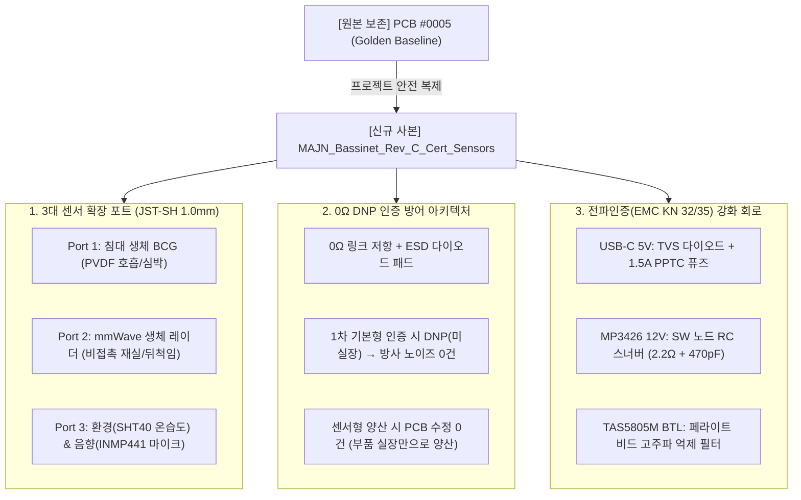

# 마중 스마트 배시넷 PCB Rev-C: 전파인증(EMC) 및 센서 확장 설계 마스터 플랜

* **작성일자:** 2026-10-28
* **적용 리비전:** PCB Rev-C (`MAJN_Bassinet_Rev_C_Cert_Sensors`)
* **목적:** 기존 검증 회로(PCB #0005)를 기준 원본(Golden Baseline)으로 동결하고, 제품 출시를 위한 KC/FCC 전파인증(EMC) 1차 통과 및 3대 핵심 센서 확장을 위한 회로 사양을 확정함.

---

## 1. 개요 및 설계 전략



---

## 2. 3대 센서 포트 회로 설계 및 ESP32 핀맵 할당

ESP32-WROOM-32E의 잔여 핀 중 **Wi-Fi/BLE 통신과 전혀 충돌하지 않는 전용 핀**만을 선별하여 포트를 구성했습니다.

| 커넥터 지정자 | 센서 기능 | 인터페이스 규격 | 할당 핀 (ESP32) | 커넥터 핀맵 (JST-SH 4P/5P 1.0mm) | 회로적 안전 설계 |
| :--- | :--- | :--- | :--- | :--- | :--- |
| **`J_BCG`** | **침대 매트리스 생체 BCG**<br>(PVDF 압전 필름 호흡/심박) | **ADC1 차동 아날로그** | **GPIO 36 (`SENSOR_VP`)**<br>**GPIO 39 (`SENSOR_VN`)** | 1: VCC_3V3<br>2: BCG_IN+ (GPIO36)<br>3: BCG_IN- (GPIO39)<br>4: GND | · Wi-Fi/BT 구동 중에도 ADC 오동작 없는 **ADC1 전용 핀**<br>· 차동 입력으로 전원 노이즈 상쇄 |
| **`J_RADAR`** | **비접촉 생체 레이더**<br>(60GHz/24GHz mmWave) | **독립 UART2 통신** | **GPIO 16 (`RXD2`)**<br>**GPIO 17 (`TXD2`)** | 1: VBUS_5V (또는 3V3)<br>2: RADAR_TX (GPIO16)<br>3: RADAR_RX (GPIO17)<br>4: GND | · USB 시리얼(UART0)과 분리된 하드웨어 고속 직렬 포트<br>· 5V/3.3V 점퍼 셀렉터 제공 |
| **`J_ENV_MIC`** | **온습도 & 울음 감지**<br>(SHT40 온습도 + I2S 마이크) | **I2C 버스 + I2S_DIN** | **GPIO 21 (`SDA`)**<br>**GPIO 27 (`SCL`)**<br>**GPIO 32 (`I2S_DIN`)** | 1: VCC_3V3<br>2: I2C_SDA (GPIO21)<br>3: I2C_SCL (GPIO27)<br>4: I2S_DIN (GPIO32)<br>5: GND | · 기존 TAS5805M I2C 버스(`0x2C`)와 공유 (SHT40 `0x44` 충돌 없음)<br>· GPIO32로 디지털 오디오 스트림 수신 |

---

## 3. 전파인증(KC/FCC) 대비 "0Ω DNP 인증 방어" 설계

센서 커넥터와 외부 배선(케이블)이 기판에 직접 결선되어 있으면, 기판 내부의 900kHz 승압 스위칭 노이즈 및 디지털 클럭 노이즈가 외부 케이블을 타고 안테나처럼 공중으로 방출되어 **전파인증 방사 방출(RE: Radiated Emission 30MHz ~ 1GHz) 부적합**의 주원인이 됩니다.

### 회로 구성 (0Ω 링크 저항 + DNP)
```
[ESP32 MCU 핀] ── [ R_LINK (0Ω 0402/0603) ] ──┬── [ 초저용량 ESD 다이오드 ] ── [ JST 센서 커넥터 ]
                                               └── [ 500mA PTC 리셋터블 퓨즈 ]
```
* **기본 모델 인증 단계**:
  - `R_LINK` 저항(0Ω)과 JST 커넥터를 **DNP (Do Not Populate: 미실장)** 처리.
  - 패턴이 끊겨 있어 노이즈 방사가 원천 차단되므로 **KC/FCC 전자파 1차 패스**.
* **센서 탑재 모델 출시 단계**:
  - **PCB 기판 재설계(동판 수정) 0건**. 부품만 실장하여 즉시 양산.
  - 회로 변경이 없으므로 수백만 원의 인증 재시험 없이 **단순 파생모델 신고**만으로 합법적 시장 진입.

---

## 4. 전파인증(EMC KN 32/35) 1차 통과를 위한 4대 회로 강화

1. **USB-C 5V 입력부**: `ESD5641D` 초고속 TVS 다이오드(8kV/15kV 정전기 차단) + 1.5A 리셋터블 PPTC 퓨즈 + 고주파 10pF 킬러 캡
2. **MP3426 12V 승압 스위칭부**: 900kHz 스위칭 주파수의 고조파 링잉 스파이크를 흡수하는 **RC 스너버 패드 (`R=2.2Ω + C=470pF`)** 예비 배치
3. **TAS5805M BTL 오디오 출력부**: 스피커 라인에 고주파 페라이트 비드 필터(`BLM18HE152`) 실장
4. **4층 PCB GND 쉴드**: 2층 전체를 무파편 **Solid GND Plane**으로 유지하고 센서 커넥터 외곽 360도 접지 비아 펜싱 적용
