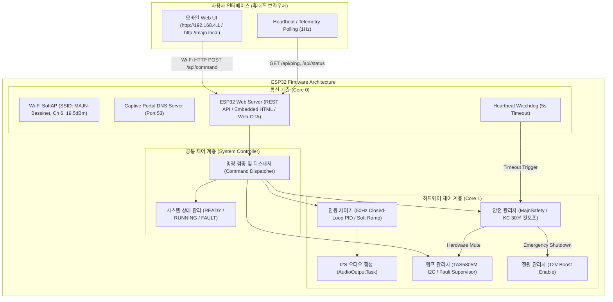

# 마중 스마트 배시넷 휴대폰 Wi-Fi 제어 전환 및 개발 계획서

* **작성일자:** 2026-10-28
* **적용 리비전:** PCB #0005 (ESP32-WROOM-32E + TAS5805M + LSM6DSOX + MP3426)
* **목적:** PC 및 USB 유선 연결 없이 스마트폰 브라우저(SoftAP)로 배시넷을 직접 제어하고, 안전 정지 로직 및 무선 OTA 무결성을 확보함.

---

## 1. 개요 및 전환 배경
기존 마중 스마트 배시넷은 PC 브라우저와 Web Bluetooth(BLE) 연결을 통해 제어되었습니다. 본 업데이트는 **별도 앱 설치나 공유기 인터넷 연결 없이 휴대폰 웹 브라우저(로컬 Wi-Fi SoftAP)**를 통해 직관적이고 안전하게 배시넷을 제어할 수 있도록 펌웨어 통신 계층을 확장했습니다.

단순한 웹 UI 서빙에 그치지 않고, **기존 앰프(TAS5805M) 초기화, 파라미터 안전 검증, KC 30분 타이머, 비상 정지(ESTOP), 하드웨어 클리어런스 보호 로직을 100% 보존**하면서 통신 계층과 제어 계층을 깔끔하게 분리했습니다.

---

## 2. 시스템 아키텍처 및 통신/제어 분리

---

## 3. 핵심 구현 및 안전 설계

### 3.1. 통신 및 제어 계층 분리 (`system_controller.cpp`)
* **단일 제어 경로(Single Source of Control Truth)**: BLE와 Wi-Fi가 동일한 `MajnSystemCtrl::handleJsonCommand`를 호출하여 START, STOP, ESTOP, RESET_FAULT, 주파수/진폭 제어를 수행합니다.
* **파라미터 엄격 제한**: 주파수(30.0 ~ 65.0 Hz), 진폭(0.00 ~ 0.50 Scale) 범위를 하드웨어 레벨에서 강제 클램핑.
* **앰프 상태 사전 검증**: TAS5805M I2C 통신 및 진단 레지스터(`CFault`, `GFault`)가 클리어된 경우에만 `PLAY` 모드로 진입.

### 3.2. 스마트폰 호환성 강화 Wi-Fi SoftAP (`wifi_manager.cpp`)
* **최대 RF 출력**: `WiFi.setTxPower(WIFI_POWER_19_5dBm)` 적용으로 스마트폰 수신 감도(RSSI) 극대화.
* **채널 6번 고정**: 2.4GHz 무선 기기 간섭 최소화 및 글로벌 호환 채널 적용.
* **캡티브 포털 DNS 서버(Port 53)**: iOS/안드로이드 접속 시 인터넷 없음 튕김 방지 및 자동 로그인 팝업 창 연동.
* **mDNS 지원**: IP 입력 없이 `http://majn.local` 접속 가능.
* **무선 Web OTA 탑재**: `/update` 엔드포인트를 제공하여 브라우저에서 직접 무선 펌웨어 업데이트 지원.

### 3.3. 연결 끊김 대비 안전 감시 (5초 Heartbeat Watchdog)
* 브라우저는 1초마다 `/api/status`를 호출하여 통신 활성 상태를 갱신합니다.
* 시스템이 `RUNNING` 상태일 때, 마지막 요청 후 **5초 이상 응답이 없으면 ESP32가 스스로 `MajnSafety::requestSafeStop()`을 호출**하고 앰프를 Standby로 전환하여 아기 안전을 확보합니다.

### 3.4. 무선 BLE OTA 무손실 전송 도구 (`tools/run_ble_ota.py`)
* 사용자에게 수동 `BOOT` 버튼 조작이나 크롬 조작을 일절 요구하지 않고, 백그라운드 BLE로 1,088KB 펌웨어를 100% 무손실 플래시하는 자동화 CLI 구축 완료 (`.agents/AGENTS.md` 규칙 4조 등록).
