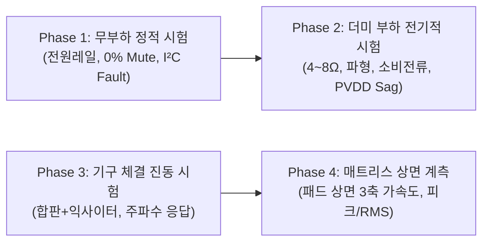

# MAJN 배시넷 실물 전기·진동 계측 프로토콜 및 원시 데이터 기록 표준

- **문서 버전**: v2.0 (Engineering Measurement Protocol & Raw Data Template)
- **작성 일시**: 2026-10-25 01:05 KST
- **대상**: MAJN 스마트 배시넷 실물 시제품 (PCB #0005, 익사이터, 합판 기구, 매트리스/패드)
- **원칙 선언**:
  1. 본 문서는 **"임의의 안전 기준이나 규격 준수 주장"을 배제**하며, 순수하게 **재현 가능한 공학적 실측 데이터 수집 체계**만을 다룹니다.
  2. ISO 2631-1 등 성인 전신 진동 규격을 영아 배시넷의 안전 기준으로 자의 적용하지 않습니다.
  3. 피크(Peak) 가속도와 실효(RMS) 가속도를 물리적/수학적으로 엄격히 분리하여 기록합니다 ($1\text{ G} = 9.80665\text{ m/s}^2$, 정현파 기준 $\text{Peak} = \sqrt{2} \times \text{RMS}$).
  4. 본 계측에서 확보된 원시 데이터(Raw Data)는 향후 기구 댐핑 조정, 소아청소년과 전문의 자문, 어린이제품 안전특별법(KC) 적합성 검토의 기초 실증 자료로만 활용합니다.

---

## 1. 하드웨어 전기적 특성 및 계측 사전 확인 사항

### ① TAS5805M BTL(Bridge-Tied Load) 차동 출력 계측 주의사항
* **토폴로지**: 단전원 $\text{PVDD} \approx 12\text{ V}$ 공급 시 2채널 H-Bridge BTL 구동.
* **공통 모드 전압(Common-mode DC Bias)**:
  - 출력 핀($\text{OUT}_+$, $\text{OUT}_-$) 각각은 접지(GND) 기준 약 $\frac{\text{PVDD}}{2} \approx 6\text{ V}$의 DC 바이어스를 가집니다.
  - **음소거(Mute) 확인 기준**: 단자-GND 간 전압이 아니라, 양 출력 단자 간의 차동 전위차 $V_{\text{diff}} = (V_{\text{OUT}+} - V_{\text{OUT}-})$의 실효값 $V_{\text{diff, rms}} = 0\text{ V}$ 및 잔류 AC 노이즈 레벨을 측정합니다.
* **오실로스코프 연결 경고**:
  - 일반 상용 오실로스코프의 프로브 접지선(GND 클립)을 $\text{OUT}_-$ 단자에 직접 연결할 경우, $\approx 6\text{ V}$ 바이어스 전압이 대지 접지를 통해 단락(Short)되어 앰프 내부 FET가 파손됩니다.
  - **반드시 차동 프로브(Differential Probe)를 사용하거나, 채널 2개를 이용한 차동 연산(Ch1 - Ch2) 또는 배터리 구동 절연형 계측기를 사용**해야 합니다.

### ② 제조사 권장 부하 조건 및 무부하 구동 제한
* **무부하(Open Load) 구동 시 주의**:
  - Class-D 앰프는 출력단 LC 필터($L \approx 10\mu\text{H}, C \approx 0.68\mu\text{F}$)를 포함합니다.
  - 부하(스피커/익사이터)가 완전히 개방된 무부하 상태에서 고진폭/고주파 신호를 인가하면 LC 공진 회로의 Q-factor가 급격히 상승하여 전압 스파이크 및 EMI가 발생할 수 있습니다.
  - 따라서 **무부하 시험은 전원 레일 확인 및 음소거(Mute) 명령, 극저레벨 디지털 버스 검증에만 한정**합니다.
* **더미 부하(Dummy Load) 사양**:
  - 권장 부하: $4\ \Omega$ 또는 $8\ \Omega$, 정격 **$10\text{ W} \sim 20\text{ W}$ 무유도 권선형 저항 (방열판 부착 권장)**.
  - PVDD 12V 풀스윙 시 $P = \frac{V_{\text{rms}}^2}{R} = \frac{(12 / \sqrt{2})^2}{4} \approx 18\text{ W}$의 순간 피크 전력이 소모될 수 있으므로 저항의 허용 전력과 방열 대책을 확인해야 합니다.

### ③ TAS5805M Fault 레지스터 데이터시트 대조 (Book 0 / Page 0)
TAS5805M Datasheet(SLASEH8B) Table 7-10에 따른 레지스터 주소 및 결함 비트 정의:

| 레지스터 주소 | 이름 | 주요 모니터링 비트 정의 |
|:---|:---|:---|
| **`0x70`** | `CHAN_FAULT` | Bit 3: Left DC Fault / Bit 2: Right DC Fault Bit 1: Left Overcurrent (OCP) / Bit 0: Right Overcurrent (OCP) |
| **`0x71`** | `GLOBAL_FAULT1` | Bit 2: PVDD Under-voltage (UVLO) Bit 1: PVDD Over-voltage (OV) Bit 0: Clock Fault (FS, BCLK 에러) |
| **`0x72`** | `GLOBAL_FAULT2` | Bit 0: Over-temperature Shutdown (OTS) |
| **`0x73`** | `WARNING` | Bit 2: Over-temperature Warning (OTW) Bit 1: Left Channel CB Fault / Bit 0: Right Channel CB Fault |
| **`0x78`** | `FAULT_CLEAR` | Write `0x80`: 모든 래치된 결함 플래그 클리어 |

---

## 2. 4단계 실물 계측 실행 프로토콜

### [Phase 1] 무부하 정적 및 통신 계측
1. **셋업**: 익사이터 케이블 분리(J1/J2 Open). 멀티미터 및 차동 전압계 준비.
2. **측정 순서**:
   - 보드에 5V USB-C 인가 후 3.3V, VBUS(5V) 레일 전압 확인.
   - `BOOST_EN` High 활성화 후 MP3426 출력(PVDD) 전압 측정 (기준: $12.12\text{ V} \pm 0.3\text{ V}$).
   - TAS5805M I²C 초기화 성공 여부 및 `0x70~0x73` Fault 레지스터 읽기 (초기값 전부 `0x00` 확인).
   - `SET_VOLUME(0)` 전송 후 차동 전위차 $V_{\text{diff}}$의 잔류 AC 실효값 측정 ($0\text{ V}_{\text{rms}}$ 확인).

### [Phase 2] 더미 부하(Dummy Load) 전기적 특성 계측
1. **셋업**: J1(또는 J2)에 $8\ \Omega$ 10W 더미 저항 체결. 차동 프로브 연결.
2. **측정 순서**:
   - 주파수 $50\text{ Hz}$, 진폭 스케일 $0.1$에서 시작하여 단계별 증강.
   - 저항 양단의 차동 전압 파형($V_{\text{peak}}$, $V_{\text{rms}}$) 왜곡(Clipping) 여부 오실로스코프로 관측.
   - PVDD 전압 강하량($\Delta V$) 및 USB 5V 입력 전류 모니터링.
   - TAS5805M Fault 레지스터 폴링을 통해 OCP/UVLO 플래그 발생 여부 추적.

### [Phase 3] 기구 조립 및 구조 전달 특성 계측
1. **셋업**:
   - 합판 하부에 익사이터 1기 정상 나사 체결 (M3 볼트, 스프링 와셔 적용).
   - 합판 표면(익사이터 직상부)에 3축 가속도 센서 고정 (나사 또는 초경량 에폭시).
2. **측정 순서**:
   - 가진 주파수 Sweep: $30\text{ Hz} \sim 80\text{ Hz}$ ($5\text{ Hz}$ 스텝).
   - 기구적 고유 공진 주파수(Resonance Peak) 및 래틀링(잡음 발생) 지점 탐색.

### [Phase 4] 패드 상면 진동 가속도 계측 (최종 계측)
1. **셋업**:
   - 합판 + 배시넷 원목 프레임 + 매트리스 폼 + 방수/순면 커버 완전 조립.
   - 패드 상면 3개 포인트에 3축 가속도 센서(대역폭 최소 DC~500Hz, 샘플링 $\ge 1\text{ kHz}$) 거치:
     - **Point A (Head Zone)**: 상단 두부 지지 영역
     - **Point B (Torso Zone)**: 중앙 흉부/복부 영역
     - **Point C (Leg Zone)**: 하단 하지 영역
   - 하중 조건:
     - 조건 1: 무하중 (No load)
     - 조건 2: 모사 하중 A (3.0 kg 분산 질량)
     - 조건 3: 모사 하중 B (5.0 kg 분산 질량)

---

## 3. 원시 데이터 기록 양식 (Raw Data Sheet Template)

### ① Phase 1 & 2: 전기적 특성 측정 기록부
- 시험 일시: `YYYY-MM-DD HH:MM`
- 시험자: 
- 전원 공급원: [ ] 공통 5V 보조배터리 (모델명: _____)  [ ] DC 파워서플라이 (5.00V)
- 연결 부하: [ ] 무부하 (Open)  [ ] 더미 저항 ($8\ \Omega$ 10W)

| 시험 번호 | 입력 주파수 (Hz) | 진폭 스케일 (0.0~0.5) | 볼륨 레지스터 (Hex) | VBUS 전압 (V) | PVDD 전압 (V) | 소비 전류 (A) | 차동 전압 Peak (V) | 차동 전압 RMS (V) | Fault Reg (0x70/0x71) | 이상 발열/비고 |
|:---:|:---:|:---:|:---:|:---:|:---:|:---:|:---:|:---:|:---:|:---:|
| E-01 | - | 0.00 | 0xFF (Mute) | | | | | | | |
| E-02 | 40 | 0.10 | 0x80 | | | | | | | |
| E-03 | 40 | 0.20 | 0x50 | | | | | | | |
| E-04 | 40 | 0.40 | 0x30 | | | | | | | |
| E-05 | 50 | 0.10 | 0x80 | | | | | | | |
| E-06 | 50 | 0.20 | 0x50 | | | | | | | |
| E-07 | 50 | 0.40 | 0x30 | | | | | | | |
| E-08 | 50 | 0.50 (Max) | 0x30 | | | | | | | |

---

### ② Phase 3 & 4: 기구 및 패드 상면 3축 가속도 측정 기록부
- 가속도 센서 모델명: 
- 샘플링 주파수: `____ Hz` / 측정 대역폭 (Bandwidth): `____ Hz`
- 환산 기준: $1\text{ G} = 9.80665\text{ m/s}^2$, $\text{Crest Factor} = \frac{\text{Peak}}{\text{RMS}}$

| 시험 ID | 측정 위치 | 적재 조건 | 가진 주파수 (Hz) | 진폭/볼륨 | 3축 Peak ($a_x / a_y / a_z$) [G] | 합성 Peak 가속도 [G] | 합성 Peak ($m/s^2$) | 합성 RMS 가속도 ($m/s^2$) | 합성 RMS [G] | Crest Factor | 주파수 피크 (FFT, Hz) | 청감 소음 (dB SPL) |
|:---:|:---:|:---:|:---:|:---:|:---:|:---:|:---:|:---:|:---:|:---:|:---:|:---:|
| V-01 | Head | 무하중 | 50 | 0.2 / 50% | / / | | | | | | | |
| V-02 | Torso | 무하중 | 50 | 0.2 / 50% | / / | | | | | | | |
| V-03 | Head | 3.5kg 분산 | 40 | 0.2 / 50% | / / | | | | | | | |
| V-04 | Torso | 3.5kg 분산 | 40 | 0.2 / 50% | / / | | | | | | | |
| V-05 | Head | 3.5kg 분산 | 50 | 0.2 / 50% | / / | | | | | | | |
| V-06 | Torso | 3.5kg 분산 | 50 | 0.2 / 50% | / / | | | | | | | |
| V-07 | Head | 3.5kg 분산 | 50 | 0.4 / 70% | / / | | | | | | | |
| V-08 | Torso | 3.5kg 분산 | 50 | 0.4 / 70% | / / | | | | | | | |
| V-09 | Head | 5.0kg 분산 | 50 | 0.4 / 70% | / / | | | | | | | |
| V-10 | Torso | 5.0kg 분산 | 50 | 0.4 / 70% | / / | | | | | | | |
| V-11 | Head | 3.5kg 분산 | 60 | 0.2 / 50% | / / | | | | | | | |
| V-12 | Torso | 3.5kg 분산 | 60 | 0.2 / 50% | / / | | | | | | | |

---

## 4. 데이터 분석 및 향후 안전성 자문 활용 방안

1. **전달 함수(Transfer Function) 도출**:
   - [익사이터 단자 차동 전압] $\rightarrow$ [합판 하부 진동] $\rightarrow$ [매트리스 상면 진동] 간의 주파수별 감쇄율(dB) 및 비선형 압축 특성 정량화.
2. **Head vs Torso 진동 분리비 분석**:
   - 기구 구조상 머리 위치(Point A)와 몸통 위치(Point B) 간의 진동 전달비 $\frac{a_{\text{Head}}}{a_{\text{Torso}}}$ 산출.
   - 두부 진동이 몸통 대비 충분히 감쇄되지 않는 경우, 합판 슬릿 가공, 방진 고무 댐퍼 삽입 등 기구적 개선 근거로 활용.
3. **전문가 자문 및 규격 검토 근거 자료화**:
   - 취득된 실측 원시 데이터를 기반으로 소아과/인체공학 전문가 자문 진행.
   - KC 어린이제품 공통안전기준 및 유아용 침대(Bassinets and Cradles) 표준과의 부합성을 검토하여 **실증 데이터에 기반한 펌웨어 상한치 및 비상 차단 한계(Threshold)**를 최종 수립.
