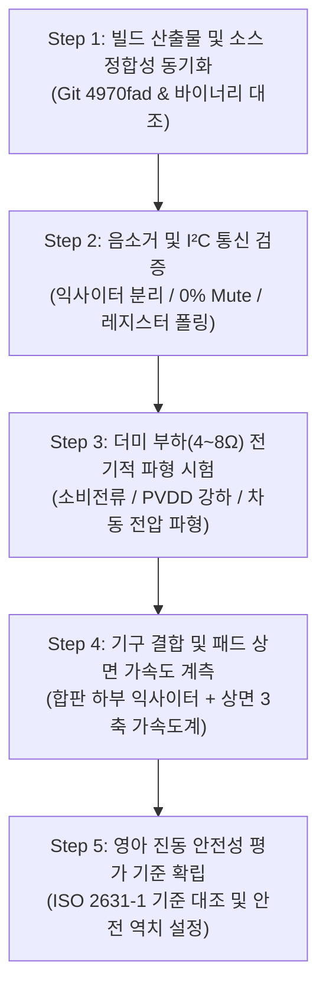

# MAJN 배시넷 실물 계측 및 영아 안전성 평가 체계 가이드

- **문서 버전**: v1.0 (Physical Verification & Measurement Protocol)
- **작성 일시**: 2026-10-25 01:00 KST
- **대상**: MAJN 스마트 배시넷 실물 하드웨어 (PCB #0005, 합판, 익사이터, 매트리스/패드)
- **핵심 원칙**: **"소프트웨어 가드(50% 하드캡, I²C ACK)는 디지털 입력 제한일 뿐, 제품의 물리적 안전성과 동일시할 수 없다. 최종 판단은 패드 상면 실측 가속도(G)와 물리적 계측값으로만 결정한다."**

---

## 1. 하드웨어적 물리 특성 및 시험 주의사항

### ① TAS5805M BTL(Bridge-Tied Load) 출력의 전기적 특성
* **차동 구조와 공통 모드 전압**:
  - TAS5805M은 단전원 $\text{PVDD} \approx 12\text{ V}$로 구동되는 H-Bridge BTL 앰프입니다.
  - 무신호 및 음소거(Mute) 상태에서도 출력 핀($\text{OUT}_+$, $\text{OUT}_-$) 각각은 접지(GND) 기준 약 $\frac{\text{PVDD}}{2} \approx 6\text{ V}$의 DC 바이어스 전압을 유지합니다.
  - **음소거의 물리적 정의**:
    $$V_{\text{diff}} = V_{\text{OUT}+} - V_{\text{OUT}-} = 0\text{ V}_{\text{DC}}, \quad V_{\text{AC, rms}} = 0\text{ V}$$
  - **오측정 방지 주의**: 단자 1개와 GND 사이의 전압을 재고 "6V가 나오니 음소거가 안 되었다"고 오판하지 않아야 합니다. 반드시 차동 전압($V_+ - V_-$)을 측정해야 합니다.
  - **장비 소손 방지**: 일반 접지형 오실로스코프의 악어 클립(GND)을 BTL 출력 단자 중 하나에 직접 물리면 PVDD/2가 오실로스코프 접지를 통해 숏트되어 앰프 FET가 즉시 파손됩니다. **반드시 차동 프로브(Differential Probe)를 사용하거나, 배터리 구동 절연 스코프(Isolated Scope)를 사용**해야 합니다.

### ② 소프트웨어 진폭(50%)과 디지털 볼륨(100%)의 분리
* **디지털 연산 체계**:
  $$\text{Audio Signal} = \text{LUT}[\theta] \times \text{Amplitude Scale}(0.0 \sim 0.5) \times \text{Digital Volume Gain}(0x30 = 0\text{ dB})$$
* **물리적 위험성**:
  - 소프트웨어 진폭 50% 제한은 DAC 입력 버퍼의 디지털 풀 스케일(FS) 대비 절반 클램핑을 의미할 뿐이며, 이것이 실제 매트리스 상면 진동 가속도의 50%를 보증하지 않습니다.
  - 100% 디지털 볼륨($0\text{ dB}$) 상태에서는 승압 전원(12V)의 풀 스윙 출력이 가능하므로, 낮은 주파수(30~50Hz)에서 익사이터 코일에 상당한 전류가 흘러 발열 및 구조적 충격을 유발할 수 있습니다.
  - **초기 시험 규칙**: 익사이터를 직접 체결하지 않고, **4Ω~8Ω 10W 권선 저항(Dummy Load)**을 연결하여 전기적 신호와 소비 전류를 먼저 계측한 후 실물 익사이터로 넘어갑니다.

### ③ I²C ACK와 실제 하드웨어 상태의 괴리
* **I²C ACK의 한계**: I²C 버스의 ACK는 레지스터 버퍼에 바이트가 성공적으로 기록되었음을 나타낼 뿐이며, 아래 하드웨어 결함은 I²C 쓰기 성공 여부와 무관하게 발생할 수 있습니다:
  - 12V 승압 전원(MP3426)의 부하 시 전압 강하 (Voltage Sag)
  - 앰프 하드웨어 과전류 차단 (OCP) 및 과열 차단 (OTP)
  - 익사이터 코일 단선 또는 리드선 접촉 불량
  - 출력 LC 필터 인덕터의 자기 포화 및 왜곡
* **보완 조치**: 레지스터 쓰기 확인에 그치지 않고, TAS5805M의 Fault 레지스터(`0x70`, `0x71`, `0x72`) 텔레메트리를 주기적으로 폴링하고, 물리적 전류/전압계를 동시 모니터링해야 합니다.

---

## 2. 실물 검증 및 계측 5단계 작업 순서

### [Step 1] 최종 커밋과 빌드 산출물 대조
1. Git 저장소 상태 확인: 최신 커밋 `4970fad` 및 `origin/main` 동기화 확인 완료.
2. 바이너리 해시 및 타임스탬프 대조: `인증준비/firmware/.pio/build/esp32_full_hw/firmware.bin` (1,805,264 바이트)가 해당 소스 트리에서 생성된 최신 바이너리임을 확인.

### [Step 2] 무부하 음소거 및 오류 처리 시험
1. **조건**: J1/J2 커넥터에서 익사이터 케이블 분리 (Open load).
2. **0% 볼륨 시험**:
   - BLE `SET_VOLUME(0)` 명령 전송.
   - 레지스터 `0x4C` = `0xFF` 쓰기 확인.
   - 차동 전압계로 J1/J2 양단 전위차 측정 $\rightarrow$ $0.0\text{ V}_{\text{rms}}$ 확인.
   - Fault 레지스터(`0x70`) 읽기 $\rightarrow$ No Fault 확인.
3. **오류 주입/복구 시험**:
   - 통신 선로 이상 또는 NACK 상황 시 상위 계층(`amplifier_manager`, `ble_manager`)이 실패 ACK(`"failed"`)를 정상 반환하는지 로그 검증.

### [Step 3] 더미 부하(Dummy Load) 전기적 특성 시험
1. **조건**: J1/J2 출력에 8Ω (또는 4Ω) 10W 권선 저항 연결.
2. **측정 항목**:
   - **VBUS (5V)**: 보조배터리/USB 입력 전압 강하 모니터링 (4.75V 이상 유지 여부).
   - **PVDD (12V)**: 50Hz 정현파 출력 시 12V 레일 강하 폭 측정 ($\Delta V \le 0.5\text{ V}$).
   - **소비 전류**: 총 전류 소모량 계측 (보조배터리 5V 기준 1.5A 이하 안전 마진 확인).
   - **차동 출력 파형**: 차동 프로브를 통해 30Hz ~ 100Hz 정현파 왜곡(Clipping) 및 노이즈 측정.

### [Step 4] 패드 상면 진동 가속도 계측 (Ground Truth Measurement)
MAJN 제품의 물리적 구조는 **[익사이터 체결판(합판 하부)] $\rightarrow$ [목재 프레임] $\rightarrow$ [매트리스 폼] $\rightarrow$ [상면 방수/순면 패드]**로 이어지는 다중 감쇄 기구입니다. 따라서 앰프 볼륨 숫자가 아니라 아기의 신체가 닿는 표면의 가속도가 핵심입니다.

* **측정 셋업**:
  - 합판 하부에 실제 익사이터 나사 체결 (정격 토크).
  - 매트리스 및 패드 실장.
  - 패드 상면에 3축 디지털 가속도 센서(MEMS Sensor) 거치 (더미 인형 무게 약 3~5kg 적재 상태).
* **측정 포인트**:
  - 포인트 A: 머리 위치 (Head zone) - 충격/흔들림 절대 최소화 영역
  - 포인트 B: 흉부/복부 위치 (Chest zone) - 심박/호흡 유도 진동 영역
  - 포인트 C: 다리 위치 (Leg zone)
* **시험 매트릭스**:
  | 주파수 | 펌웨어 진폭 | 볼륨 설정 | 패드 상면 가속도 (Peak G) | RMS 가속도 ($m/s^2$) | 프레임 잡음 (dB SPL) |
  |:---:|:---:|:---:|:---:|:---:|:---:|
  | 40 Hz | 0.2 (20%) | 30% | 실측 기록 | 실측 기록 | 실측 기록 |
  | 40 Hz | 0.4 (40%) | 70% | 실측 기록 | 실측 기록 | 실측 기록 |
  | 50 Hz | 0.2 (20%) | 30% | 실측 기록 | 실측 기록 | 실측 기록 |
  | 50 Hz | 0.4 (40%) | 70% | 실측 기록 | 실측 기록 | 실측 기록 |
  | 50 Hz | 0.5 (50%) | 100% | 실측 기록 | 실측 기록 | 실측 기록 |

### [Step 5] 영아 안전성 평가 및 셧다운 기준 설정
1. **국제 인체 진동 노출 기준 (ISO 2631-1 / ISO 5349-1)** 대조:
   - 영아의 뇌 및 경추 보호를 위해 패드 상면 피크 가속도는 통상적인 요람 바운서 기준인 **$0.05\text{G} \sim 0.15\text{G}$ 이내**로 제한되어야 함.
   - $0.3\text{G}$ 초과 시 급격한 진동으로 분류하여 소프트웨어/하드웨어 인터록 트리거.
2. **동적 인터록 및 비상 정지 기준**:
   - 실측 결과를 바탕으로 펌웨어의 진폭 상한을 0.5f에서 더 낮은 안전 영역(예: 실측치 기반 0.25f 등)으로 보정 확정.
   - 통신 두절(Heartbeat Timeout > 3초) 시 즉시 `AMP_PDN` LOW 하드웨어 셧다운.
