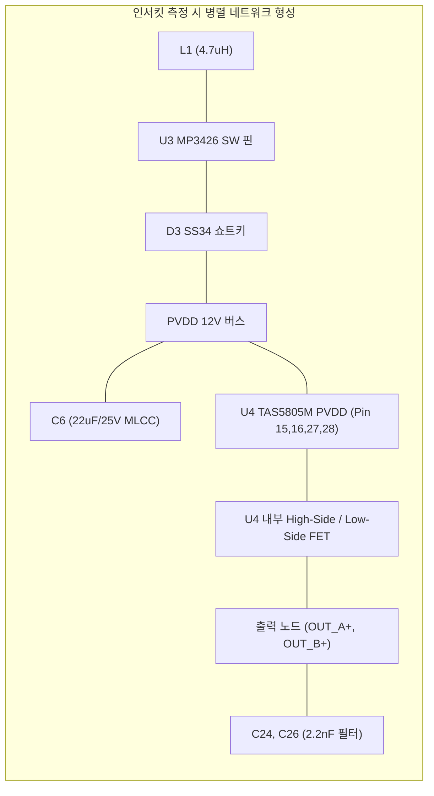

# MAJN 시제품 PCB #0005 실측 관찰 사실 및 미확인 사항 보고서
(PCB #0005 Observations & Unresolved In-Circuit Items)

- **문서 버전**: v1.0
- **작성 일자**: 2026-11-02
- **대상 기기**: MAJN 시제품 PCB #0005 실물 보드 (ESP32-WROOM-32E + MP3426DL 12V Boost + TAS5805M Class-D Amp + LSM6DSOX)
- **문서 목적**: 시제품 PCB #0005의 전기적 실측 관찰값, 계측 당시의 회로 연결 상태, 그리고 물리적으로 미확인된 영역을 엄격히 분리 기록하여, 후속 리비전 회로 설계(Next Revision)의 오류 없는 입력 데이터로 승계함.

---

> [!IMPORTANT]
> **핵심 기록 및 해석 원칙 (Core Principles)**
> 1. **측정 조건 병기**: 모든 측정값은 측정 당시의 보드 전원 상태(Unpowered / Powered), 외부 부하 연결 여부, 계측기 설정 모드를 함께 기록한다.
> 2. **부품 단위 고장 판정 금지**: QFN/TSSOP(Power Thermal Pad 장착) 패키지 특성상 부품을 보드에서 완전히 디솔더링(Desoldering)하여 분리 검증하지 않는 한, 부품 자체의 파괴/불량 여부를 확정하지 않는다.
> 3. **병렬 회로 합성 임피던스 해석**: 인덕터, 변환기, 디커플링 커패시터, 내부 보호 다이오드 등 회로 내 병렬 경로가 존재하는 노드의 측정값을 특정 개별 부품의 내부 저항이나 단락으로 해석하지 않는다.
> 4. **관찰 사실과 추정 가설의 격리**: ‘계측기에 표시된 물리량(Observation)’과 ‘엔지니어링 추정 가설(Hypothesis)’을 동일 항목에 혼합하지 않는다.

---

## 1. 하드웨어 계보 및 실물 보드(#0005) 위치

| 계보 항목 | 내용 | 비고 |
| :--- | :--- | :--- |
| **보드 식별자** | MAJN 시제품 PCB #0005 | 실물 보유 시제품 1점 |
| **설계 베이스라인** | Rev-B 계열 4층 PCB (`260708` 아카이브 원본) | 단면 SMD 이전의 구형 레이아웃 |
| **주요 실장 IC** | • U1: ESP32-WROOM-32E-N8 (`C701345`) • U2: AP2112K-3.3TRG1 (`C51118`) • U3: MP3426DL (`C2909511`) • U4: TAS5805MPWPR (`C478472`) • U5: LSM6DSOXTR (`C481766`) | 총 56개 부품 실장 확인 |
| **계보 격리 원칙** | 본 문서의 실측 데이터는 **실물 시제품(#0005)**에 국한되며, 신규 제조 패키지(`Rev_C_mfg`) 및 차기 70부품 논리 명세(`PCB_Rev_C`)와 혼용하지 않음. | SSOT 계보 분리 준수 |

---

## 2. 노드별 인서킷(In-Circuit) 실측 관찰 사실

아래 측정값은 보드 무전원(Unpowered, USB 비연결) 상태에서 디지털 멀티미터를 사용하여 인서킷 상태로 측정한 원시 기록입니다.

### 2.1 인덕터 L1 노드 관찰
* **측정 지점**: L1(4.7µH SWPA6045) 양단 단자 $\leftrightarrow$ USB 접지(GND)
* **측정 조건**: 보드 무전원, 2선 저항 측정 모드
* **실측 관찰값**: 약 $100\,\Omega \sim 150\,\Omega$ 관찰
* **회로 분석**:
  - L1은 입력 5V VBUS 라인과 MP3426 스위칭 핀(SW) 사이에 직렬 배치되어 있음.
  - L1 노드에는 MP3426 내부 파워 스위치 FET, SS34 쇼트키 다이오드(D3), 그리고 5V 측 TVS 다이오드(D1) 및 입력 커패시터(C1, C2)가 연결되어 있음.
* **미확인 사항**:
  - $100\sim 150\,\Omega$ 저항값이 L1 권선의 변형인지, 쇼트키 다이오드 D3의 역방향 누설인지, MP3426 내부 회로 경로인지는 소자 디솔더링 분리 전까지 확정할 수 없음.
  - **결론**: L1 소자의 고장 판정 근거로 사용하지 않음.

### 2.2 부스트 출력 커패시터 C6 및 PVDD 버스 관찰
* **측정 지점**: C6(22µF/25V MLCC) 양단 (PVDD_12V $\leftrightarrow$ GND)
* **측정 조건**: 보드 무전원, 저항 및 도통 모드
* **실측 관찰값**: 저저항성 경로(Low-resistance path) 관찰
* **회로 분석**:
  - PVDD_12V 버스는 MP3426 부스트 출력 커패시터군(C6, C7, C8, C20) 및 TAS5805M의 PVDD 전원 핀(Pin 15, 16, 27, 28)과 굵은 구리 패턴으로 직접 직결되어 있음.
  - 별도의 분리 저항이나 점퍼가 존재하지 않아 전원부와 앰프부가 단일 전원 평면으로 묶여 있음.
* **미확인 사항**:
  - 관찰된 저저항 경로가 C6 등 적층 세라믹 캡의 유전체 파괴인지, TAS5805M 내부 파워단 FET 단락인지, 혹은 부스트단 D3/MP3426의 파괴인지는 전원 레일 분리 전까지 확정 불가.
  - **결론**: 'PVDD-GND 단락'으로 부품 고장을 지목하지 않고, '전원 레일 내 저저항 경로 형성(원인 미확정)'으로 기록함.

### 2.3 앰프 출력 필터 C24, C26 노드 관찰
* **측정 지점**:
  - C24 양단: `SPK_A+` 필터 노드 $\leftrightarrow$ GND
  - C26 양단: `SPK_B+` 필터 노드 $\leftrightarrow$ GND
* **측정 조건**: 보드 무전원, 멀티미터 도통(Buzzer) 모드
* **실측 관찰값**: 도통 비프음(Continuity beep) 관찰
* **회로 분석**:
  - C24와 C26은 Class-D 스위칭 에지 억제를 위해 BTL 출력 라인과 GND 사이에 배치된 2.2nF 0603 필터 커패시터임.
  - 이 노드는 페라이트 비드(FB1~FB4)를 통해 TAS5805M 내부 하프 브리지 FET(Low-side 및 High-side)와 직결되어 있음.
* **미확인 사항**:
  - 멀티미터 도통 모드는 계측기 내부 임계 저항(통상 $\le 50\,\Omega$) 이하에서 비프음을 출력함.
  - 관찰된 비프음은 출력 노드와 접지 사이에 직류 또는 저주파 폐루프 경로가 형성되어 있음을 의미할 뿐, TAS5805M 내부 FET 소손, C24/C26 소자 파괴, 또는 외부 결선 쇼트 여부를 분리 확정할 수 없음.
  - **결론**: '출력단 파괴'로 결론 내리지 않고, '출력단-GND 간 저저항성 폐루프 도통 관찰(원인 미확정)'으로 기록함.

### 2.4 U4 (TAS5805M) I2C 통신 및 초기화 상태
* **실측 관찰 사실**:
  - 정상 구동 펌웨어 동작 시 I2C 주소 `0x2C` 오토프로빙 응답 확인 이력 존재.
  - 이후 전원 이상 의심 시점에서 통신 불안정 또는 앰프 무음 현상 관찰.
* **미확인 사항**:
  - TAS5805M은 I2S 클록(BCLK, LRCK) 부재, PVDD 전압 미달, 또는 PDN 제어 타이밍 결함 시 내부 로직이 자동으로 Mute 또는 Hi-Z 상태를 유지함.
  - 물리적 칩 손상과 외부 전원/클록 결함의 구분이 완료되지 않음.

### 2.5 진동자(TEAX14C02) 연결부 임피던스
* **규격 스펙**: 공칭 임피던스 $8\,\Omega \pm 15\%$, 정격 $0.8\text{W RMS}$ (최대 $1.5\text{W}$)
* **실측 관찰 사실**:
  - 보드 단자 연결 상태 및 하네스 분리 상태에서 일부 진동자의 직류 저항(DCR) 측정 편차 관찰.
* **미확인 사항**:
  - 하네스 압착 불량, 2개 직렬/병렬 결선 상태에서의 합성 저항 오차, 코일 손상 여부가 개별 분리 계측되지 않음.
  - **결론**: 진동자 4개 일괄 불량으로 판정하지 않음.

---

## 3. 관찰 사실 기반 요약표 및 차기 설계 전달 표현

| 항목 | 실측 관찰 사실 (Confirmed Observation) | 미확인 영역 (Unresolved) | 차기 버전 설계 전달 공식 표현 |
| :--- | :--- | :--- | :--- |
| **U4 (TAS5805M)** | 앰프 장착 상태에서 출력 무반응 및 이상 동작 관찰 | 칩 내부 실리콘 파괴 vs 주변 전원/보호 결함 미분리 | **고장 의심, 원인 미확정 (격리 검증 구조 필요)** |
| **U3 (MP3426)** | 승압 PVDD 레일의 전압 불안정 관찰 | 부스트 컨버터 자체 결함 vs 부하단 저저항 경로 영향 미분리 | **전원부 이상 가능성, 검증 미완료** |
| **PVDD-GND 버스** | C6 양단에서 낮은 저항치 관찰 | 앰프 파워단 vs 디커플링 MLCC vs 부스트 다이오드 쇼트 미분리 | **회로 내 저저항 경로 관찰, 원인 미확정** |
| **C24, C26 (출력단)** | 출력 필터 패드 $\leftrightarrow$ GND 간 도통 비프음 관찰 | 앰프 Low-side FET 파괴 vs 필터 캡 쇼트 vs 외부 결선 루프 미분리 | **도통 관찰, 출력단 파괴 미확정** |
| **진동자 4개** | 결선 상태에서 저항 측정값 편차 관찰 | 하네스 접촉 저항 vs 직렬/병렬 결선 혼선 vs 개별 보이스코일 손상 미분리 | **일부 측정값 이상 관찰, 개별 판정 미완료** |
| **구동 전압** | 초기 테스트에서 12V~14V 영역 구동 | 14V 초과 시 파괴 한계 실측 데이터 없음 (데이터시트 상 TAS5805M PVDD Max 30V) | **기존 권장 시험 조건 (절대 최대 정격 아님)** |

---

## 4. PCB #0005 추가 수리 중단 결정 및 보존 방침

1. **추가 디솔더링/수리 시도 중단**:
   - 4층 기판 내부 접지 평면의 높은 열용량으로 인해, 추가적인 납땜/인두기 접촉은 기판 패턴 박리 및 2차 물리적 손상을 유발할 위험이 높음.
   - 단일 보유 보드인 `#0005`의 현 상태를 고정된 기준선(Baseline Artifact)으로 보존함.
2. **차기 리비전으로의 이관**:
   - `#0005`에서 확인된 불확실성은 부품을 교체하여 해결할 문제가 아니며, **원인을 회로적으로 분리하여 계측할 수 있는 아키텍처(DFT/DFI)**를 차기 설계에 반영하여 해결함.
