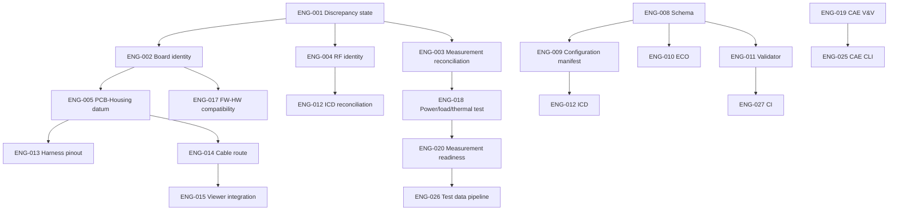

# MAJN 엔지니어링 통합 시스템 Work Package 실행 백로그

- 문서 ID: MAJN-ENG-BACKLOG-001
- 상태: Proposed; estimates are relative planning estimates
- 추정 단위: 1인 작업일(person-day), 외부기관 대기/부품 납기 제외
- WIP 정책: 동시 진행은 최대 2개 작업 패키지. P0/P1 충돌이 있는 설계 변경은 선행 검토 전 시작하지 않는다.

## 1. 우선순위별 작업

| ID | 우선 | 작업 패키지 | 예상 노력 | 선행 | 산출물 | 완료 기준 |
|---|---|---|---:|---|---|---|
| ENG-001 | P0 | 감사 충돌/상태 체계 정리 | 0.5~1 | 없음 | discrepancy register v2 | 모든 이슈에 owner/evidence/status |
| ENG-002 | P0 | PCB #0005/Rev-C/70-part identity audit | 1~2 | 원본 PCB 자료 | board identity matrix | 층수/외형/홀/커넥터/구성 확인 |
| ENG-003 | P0 | 21.6Ω/24.8Ω 측정 차이 해소 | 0.5~1 | 원시 측정자료 | measurement reconciliation | 시료/배선/계측 조건 비교 완료 |
| ENG-004 | P0 | RF 안테나 모델/인증조건 확인 | 0.5~1 | 안테나 실물/사양 | RF part record + lab query | 3dBi/2.33dBi 충돌 해소 또는 BLOCKED |
| ENG-005 | P0 | PCB-housing datum/홀 overlay | 1~2 | ENG-002, DXF | mounting interface report | 좌표/공차/keepout/공구 접근 확인 |
| ENG-006 | P0 | 제품 variant 경계 정의 | 1 | 요구사항/시장 가설 | variant charter | HOME/HOSPITAL 후보의 요구사항 분리 |
| ENG-007 | P1 | 자산 대장 메타데이터 보강 | 1 | ENG-001 | inventory v2 | source hash/commit/config ID 필드 |
| ENG-008 | P1 | ID/status/schema v1 | 1~2 | domain register | JSON schema + dictionaries | 샘플 데이터 validation |
| ENG-009 | P1 | configuration manifest | 1~2 | ENG-002~006 | CFG manifest template | #0005 재구성 가능 |
| ENG-010 | P1 | ECO workflow and impact matrix | 1 | ENG-008 | ECO template | dry-run change impact complete |
| ENG-011 | P1 | registry validator v1 | 1~2 | ENG-008 | Python validator/tests | duplicate/broken refs/status fail |
| ENG-012 | P1 | interface registry reconcile | 1~2 | ENG-002~005 | ICD register v2 | verified 상태에 evidence/config link |
| ENG-013 | P1 | harness connector/pinout audit | 1~2 | 실물/connector datasheets | wire list | connector face/pin mapping 확인 |
| ENG-014 | P1 | cable route 3D/physical mockup | 2~4 | ENG-005,013 | route drawing + mockup | clearance/strain/service loop 검토 |
| ENG-015 | P1 | Three.js node-to-PART mapping | 2~3 | CAD datum baseline | viewer mapping | known-point test 통과 |
| ENG-016 | P1 | drawing/DFM/assembly checklist | 1~2 | CAD/harness baseline | review checklist | sample build review 수행 |
| ENG-017 | P1 | firmware-HW compatibility matrix | 1~2 | board identity | compatibility manifest | build artifact와 보드 식별 연결 |
| ENG-018 | P1 | power/load/thermal test plan | 1~2 | load/board identity | approved test protocol | 측정기/조건/합격 기준 승인 |
| ENG-019 | P1 | CAE benchmark and validation scope | 2~4 | solver/input baseline | CAE V&V report | benchmark/mesh/BC review |
| ENG-020 | P1 | accelerometer measurement readiness | 1~3 | test protocol/equipment | sensor/equipment plan | calibration/mount/sample rate 확보 |
| ENG-021 | P1 | hazard/FMEA workshop | 2~3 | system architecture | reviewed hazard log | control/evidence/owner 지정 |
| ENG-022 | P1 | regulatory applicability review | 1~2 + lab wait | variant/intended use | regulatory memo | 시험기관/전문가 검토 기록 |
| ENG-023 | P2 | CAD export pipeline | 2~4 | approved geometry baseline | STEP/GLB export scripts | units/hash/geometry checks |
| ENG-024 | P2 | harness BOM/inspection automation | 2~3 | ENG-013/014 | harness package | BOM/wirelist/inspection links |
| ENG-025 | P2 | CAE CLI bridge | 2~5 | ENG-019 | reproducible runner | controlled input/output and logs |
| ENG-026 | P2 | test data ingestion/plots | 2~4 | ENG-020 | analysis pipeline | raw data immutable, reproducible plots |
| ENG-027 | P2 | GitHub Actions governance CI | 1~3 | ENG-008/011 | CI workflow | schema/link/unit checks with least privilege |
| ENG-028 | P2 | pilot build and quality package | 3~6 | G2/G3 | M-BOM/SOP/inspection | one build traceable end-to-end |
| ENG-029 | P2 | usability/research preparation | 2~4 + partner | intended use | protocol draft | partner/ethics review before human study |
| ENG-030 | P3 | lifecycle/field feedback package | 2~4 | pilot | service/complaint/repair flow | responsibilities and records defined |

## 2. 의존 관계

## 3. 첫 2주 권장 실행

**1주차**
- ENG-001 discrepancy 상태와 증거 필드 정리
- ENG-002 PCB 세대/층수/실물 identity 확인
- ENG-003 저항 측정 원본 대조
- ENG-004 안테나 part number와 인증 질의 준비
- ENG-006 제품 variant의 intended use/규격 후보 분리

**2주차**
- ENG-005 PCB-housing 좌표 중첩 및 공차 검토
- ENG-008 ID/status/schema v1
- ENG-009 #0005 configuration manifest
- ENG-010 ECO 템플릿과 영향평가
- ENG-011 validator의 작은 첫 버전

2주 종료 시점에 자동화 기능을 늘리기보다, #0005 시제품의 기구/PCB/케이블/펌웨어/시험 이력을 하나의 manifest로 재구성할 수 있는지 데모한다.

## 4. 중단 조건과 재계획 조건

- ENG-002에서 PCB 실물과 원본 프로젝트 연결이 불가능하면 PCB 관련 설계 통합은 BLOCKED로 두고 추가 식별 작업을 수행한다.
- ENG-003에서 원시 계측 파일을 찾지 못하면 21.6Ω과 24.8Ω을 별개 기록으로 보존하고 동일 조건 비교를 주장하지 않는다.
- ENG-004에서 안테나 모델/승인 조건이 확인되지 않으면 RF 인터페이스는 UNRESOLVED로 유지하고 제품 규제 주장/발주 결정을 보류한다.
- ENG-005에서 좌표/홀/공차가 불명확하면 하판 가공/PCB 발주를 진행하지 않는다.
- 시험 장비가 없으면 시험 자동화 개발보다 장비 확보/외부 시험기관/대체 측정 방법 검토를 우선한다.
- 팀 용량을 초과하면 P2/P3 자동화는 연기하고 P0/P1의 추적성과 검증을 완료한다.

## 5. 백로그 운영

각 티켓은 다음을 가진다.
- owner / reviewer / estimate / priority / dependencies
- source refs / target artifacts / acceptance criteria
- test plan / risk IDs / configuration ID
- PR / commit / validation evidence
- blocked reason / next action

티켓 완료는 커밋 생성이 아니라 산출물과 수락 기준 검증으로 판단한다.
