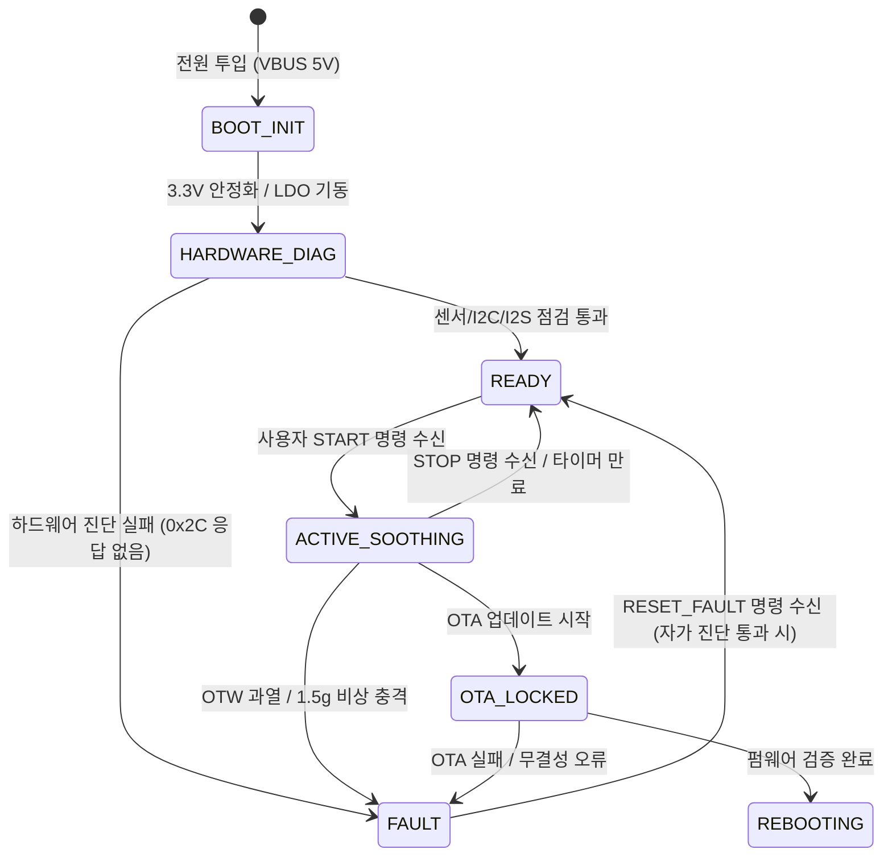

# [시스템 아키텍처] MAJN 차기 제어기 (PCB #0006) 시스템 아키텍처 총괄 명세서
(MAJN PCB #0006 Comprehensive System Architecture Specification)

- **문서 식별자**: `MAJN_SYSTEM_ARCHITECTURE`
- **리비전**: v2.0 (통합 마스터 아키텍처)
- **작성 일자**: 2026-11-05
- **책임 주체**: Antigravity (시스템 엔지니어링 에이전트)
- **승인 권한**: Human Chief Authority
- **상위 기준선**: [MAJN_SYSTEM_REQUIREMENTS_MASTER.md](file:///Users/youngseok/Desktop/majn/docs/engineering/master_audit/MAJN_SYSTEM_REQUIREMENTS_MASTER.md)

---

## 1. 시스템 아키텍처 개요 및 블록 다이어그램

MAJN 차기 제어 보드(PCB #0006)는 **5V USB-C 단일 전원 입력으로부터 저잡음 3.3V 디지털/아날로그 전원과 고출력 12V 앰프 전원을 동기화하여 공급**하고, ESP32 기반의 무선 제어 및 실시간 가속도 계측을 수행하며, 고성능 디지털 클래스-D 증폭기를 통해 엑사이터 진동을 정밀 제어하는 고신뢰성 복합 시스템입니다.

```mermaid
flowchart TD
    USBC["USB Type-C Connector<br/>(5V VBUS / Dual CC 5.1k)"] -->|VBUS 5.0V| LDO["U2: 3.3V LDO<br/>(AP2112K-3.3 + 22uF)"]
    USBC -->|VBUS 5.0V| SHUNT1["R_SHUNT1: 50mR<br/>(VBUS Sense)"]
    SHUNT1 --> BOOST["U3: MP3426 Boost<br/>(5V -> 12V / 1.0MHz)"]
    BOOST --> ISO["R_ISO1: 0R 2512<br/>(Boost Isolation)"]
    ISO --> PVDD["PVDD 12V Bus<br/>(R_BLEED 1.5k + 4x 10uF 35V)"]
    PVDD --> SHUNT2["R_SHUNT2: 20mR<br/>(Amp Sense)"]
    SHUNT2 --> AMP["U4: TAS5805M Class-D Amp<br/>(Stereo BTL / 12V)"]

    LDO -->|3.3V Digital| MCU["U1: ESP32-WROOM-32UE<br/>(Wi-Fi / BLE 5.0 / SoC)"]
    LDO -->|3.3V Analog via Bead| IMU["U5: LSM6DSOX IMU<br/>(6-Axis Accel/Gyro)"]

    MCU -->|I2S Audio (BCLK/LRCLK/DOUT)| AMP
    MCU -->|I2C Control (SCL/SDA 0x2C)| AMP
    MCU -->|GPIO4 (BOOST_EN)| BOOST
    MCU -->|GPIO13 (AMP_PDN Candidate)| AMP
    MCU -->|SPI Bus (MOSI/MISO/SCLK/CS)| IMU
    IMU -->|INT1 (1.5g Impact IRQ)| MCU

    AMP -->|BTL Out ChA/ChB| HARNESS["Branching Harness (16R)"]
    HARNESS --> EXCITERS["4x Exciter Array<br/>(Rhythmic Vibration 45-60Hz)"]
```

---

## 2. 서브시스템별 상세 구조 및 인터페이스

### 2.1 전원 트리 및 시퀀싱 아키텍처 (Power Tree & Staged Architecture)
- **1단계: VBUS 5.0V 입력**:
  - USB-C 16핀 리셉터클을 통해 $5.0\text{V} \pm 5\%$ 전원 입력.
  - 독립된 $5.1\text{k}\Omega$ 풀다운 저항 2개(`R_CC1`, `R_CC2`)를 통해 표준 C-to-C 케이블 연결 지원.
  - 입력 전류 계측용 $50\text{m}\Omega$ 켈빈 션트 저항(`R_SHUNT1`) 배치.
- **2단계: 3.3V 시스템 전원 레일**:
  - 초저잡음 LDO `AP2112K-3.3` (최대 600mA)을 통해 3.3V 강압.
  - 출력단에 $22\mu\text{F}$ 벌크 커패시터(`C3`)를 배치하여 ESP32 RF 송출 펄스 시 전압 강하를 $100\text{mV}$ 이내로 억제.
  - 페라이트 비드(`BLM18HE152SN1D`)를 통해 디지털 전원과 센서용 아날로그 전원(`VCC_3V3_ANA`)을 물리적으로 분리.
- **3단계: 12V 오디오 PVDD 승압 레일**:
  - `MP3426` 전류 모드 승압 컨버터($1.0\text{MHz}$)를 통해 $5.0\text{V} \rightarrow 12.09\text{V}$ 변환.
  - 파워 인덕터 `Sunlord MWPA7070S4R7MT` ($4.7\mu\text{H}, I_{sat} = 7.5\text{A}$) 적용.
  - 쇼트키 다이오드 `SS34` ($40\text{V}, 3\text{A}$) 적용.
  - 디버깅용 물리 분리 점퍼 `R_ISO1` ($0\Omega, 2512$) 및 무부하 오버슈트 방지 블리더 `R_BLEED` ($1.5\text{k}\Omega, 1206$) 구비.
  - 출력단에 $10\mu\text{F}$ 35V 1210 X7R MLCC 4개 병렬 실장 (12V 인가 시 유효 용량 $28.8\mu\text{F}$ 확보).
- **하드웨어 전원 투입 시퀀스 (Power-on Sequence)**:
  1. USB-C 5V 체결 $\rightarrow$ 3.3V LDO 즉시 기동 $\rightarrow$ ESP32 하드웨어 리셋 지연(10k+1µF) 후 부팅.
  2. 부팅 과도기 동안 `GPIO4 (BOOST_EN)`은 외장 10k 풀다운에 의해 Low 유지 (12V 부스트 정지 상태).
  3. 부팅 과도기 동안 `GPIO13 (AMP_PDN)`은 외장 10k 풀다운에 의해 Low 유지 (TAS5805M 완전 셧다운).
  4. 펌웨어 안정화 후 `GPIO4` High 구동 $\rightarrow$ MP3426 소프트스타트(6ms) 기동으로 12V 완만 상승.
  5. I2S 오디오 클록(BCLK, LRCLK) 송출 시작 후 `GPIO13` High 구동 $\rightarrow$ TAS5805M Standby/Play 진입.

---

### 2.2 오디오 신호 체인 및 음향/진동 변환 아키텍처
- **신호원 (Signal Generation)**:
  - ESP32 내부 고정밀 32-bit I2S 하드웨어 엔진을 통해 $48.0\text{kHz}$ 샘플레이트의 16-bit PCM 정현파 및 핑크 노이즈 합성.
  - 비트 클록: $BCLK = 48000 \times 32 \times 2 = 3.072\,\text{MHz}$ (또는 16-bit 슬롯 시 $1.536\,\text{MHz}$).
- **디지털 증폭기 (TAS5805M)**:
  - 스테레오 BTL(Bridge-Tied Load) 모드로 구성.
  - I2C 제어 버스 (기본 주소 `0x2C`, 4.7k 풀업).
  - 내부 DSP를 통한 소프트 볼륨 램프(Soft Volume Ramp) 및 클리핑 방지 리미터 동작.
- **부하 구조 (4-Exciter Array)**:
  - 4개의 코인형/원통형 저주파 엑사이터(각 4Ω)를 2채널에 각각 직렬 2개씩 분기 연결:
    $$R_{load} = 4\,\Omega + 4\,\Omega = 8\,\Omega \quad (\text{채널당 합성 저항})$$
  - 12V PVDD 공급 시 채널당 이론적 최대 피크 전력:
    $$P_{peak,ch} = \frac{(12.0\,\text{V} - 2 \times V_{drop})^2}{2 \times 8\,\Omega} \approx \frac{11.0^2}{16} = 7.56\,\text{W}$$
  - 양 채널 합산 최대 출력 피크는 약 $15.1\,\text{W} \sim 16.5\,\text{W}$이며, 이는 연속 출력이 아닌 순간 음향 다이내믹 피크로 제한됨.

---

### 2.3 제어기 및 텔레메트리 (MCU & Sensors)
- **ESP32-WROOM-32UE-N8**:
  - 240MHz 듀얼코어 Xtensa LX6 MCU, 8MB SPI Flash, 외장 u.FL RF 커넥터.
  - Core 0: FreeRTOS 통신 스택 (BLE 5.0, Wi-Fi SoftAP/STA, 웹 서버, OTA 수신).
  - Core 1: 실시간 제어 루프 (I2S 오디오 버퍼링, IMU 센서 폴링, 100ms 액티브 안전 가드).
- **LSM6DSOX 6축 IMU 센서**:
  - SPI 인터페이스 점유: `GPIO5 (CS)`, `GPIO18 (SCLK)`, `GPIO19 (MISO)`, `GPIO23 (MOSI)`.
  - 측정 범위: $\pm 2g$, 출력 데이터 레이트(ODR): $104\,\text{Hz} \sim 6.6\,\text{kHz}$.
  - 하드웨어 인터럽트: `INT1 (GPIO34)`에 $1.5g$ 임계치 초과 시 즉각 인터럽트 트리거 라우팅.

---

### 2.4 접지 및 PCB 4층 스택업 아키텍처
- **Layer 1 (Top Copper)**: 고속 신호, 부품 실장, 전원 인덕터 로컬 루프.
- **Layer 2 (Inner 1 - Solid GND)**: 단절 없는 기준 접지면 (RF 및 고속 버스의 반사전류 귀환 경로).
- **Layer 3 (Inner 2 - Power Plane)**: VCC_3V3 및 PVDD_12V 전원 분배 평면.
- **Layer 4 (Bottom Copper)**: 보조 제어 신호 및 방열 보강 동박.

---

## 3. 소프트웨어 상태 머신 및 안전 연동 구조



1. **BOOT_INIT**: MCU 초기화 중 앰프 PDN 및 부스트 EN은 하드웨어 풀다운에 의해 완전 정지 유지.
2. **ACTIVE_SOOTHING**: 100ms 주기로 실행되는 감독자(Supervisor) 태스크가 I2C를 통해 TAS5805M의 결함 레지스터를 감시하며, OTW(135°C) 발생 시 출력을 50% 강제 디레이팅함.
3. **FAULT (Active Safety Lock)**: 가속도 센서에서 1.5g 이상의 충격 감지 시 즉시 H-Bridge를 고임피던스(Hi-Z)로 전환하고 앰프 PDN을 Low로 인하하여 100ms 이내에 기구 진동을 완전 제로화함.
