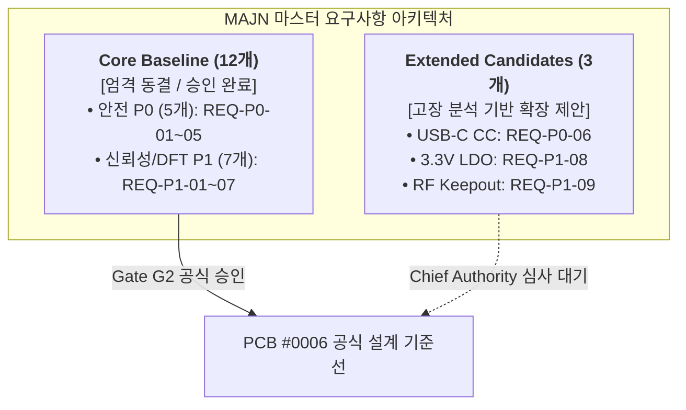

# [마스터 사양서] MAJN 스마트 배시넷 시스템 설계 요구사항 총괄 정의서
(MAJN Smart Bassinet Master System Requirements Specification)

- **문서 식별자**: `MAJN_SYSTEM_REQUIREMENTS_MASTER`
- **리비전**: v2.0 (통합 마스터 기준선)
- **작성 일자**: 2026-11-05
- **책임 주체**: Antigravity (시스템 엔지니어링 에이전트)
- **승인 권한**: Human Chief Authority (최종 승인)
- **상위 기준선**: [DOC03_PCB0006_ELECTRICAL_DESIGN_REQUIREMENTS.md](file:///Users/youngseok/Desktop/majn/docs/engineering/pcb_0006/DOC03_PCB0006_ELECTRICAL_DESIGN_REQUIREMENTS.md)

---

## 1. 프로젝트 비전 및 시스템 엔지니어링 개요

MAJN 스마트 배시넷은 **신생아 및 영아의 수면을 유도하고 안정시키는 지능형 수면 케어 하드웨어 플랫폼**입니다. 본 플랫폼은 아기의 수면 상태를 실시간 센싱하고, 저주파 엑사이터(Exciter) 배열을 통해 어머니의 심박 및 양수 음향을 모사하는 미세 진동과 소리를 전달합니다.

### 시스템 엔지니어링 4대 핵심 축
1. **영아 생명 안전 (Infant Safety First)**: 과도한 진동, 유해 음압, 비정상 발열, 전원 단락 위험의 100% 원천 차단.
2. **엄격한 전력 예산 (Strict Power Budgeting)**: USB-C 5V 2A (최대 10W) 입력 범위 내에서 연속 동작 보장.
3. **신뢰성 있는 센싱 및 통신 (Robust Telemetry & RF)**: 영아 체위 모니터링 센서의 무간섭 신호 무결성 및 벽면 통과 무선 연결성 확보.
4. **단계적 검증 및 형상 동결 (Staged Baseline Discipline)**: 요구사항과 회로 구현의 엄격한 분리 및 Gate 승인 기반 통제.

---

## 2. 시스템 레벨 핵심 정량 사양 (System Quantified Limits)

| 파라미터 영역 | 설계 기준치 (Nominal) | 절대 안전 한계 (Absolute Max/Min) | 검증 기준 및 표준 규격 |
| :--- | :---: | :---: | :--- |
| **시스템 연속 소비전력** | $\le 8.5\,\text{W}$ | **$\le 10.0\,\text{W}$ ($V_{BUS} \le 2.0\,\text{A}$ at $5.0\,\text{V}$)** | USB-C 10W 표준 충전기 호환 (REQ-P0-05) |
| **음향 과도 피크 전력** | $\le 12.0\,\text{W}$ | **$\le 16.5\,\text{W}$ (지속시간 $< 20\,\text{ms}$)** | 순간 음향 다이내믹 피크 (입력 벌크 MLCC 흡수) |
| **영아 수면 음압 레벨** | $50 \sim 60\,\text{dBA}$ | **$< 75.0\,\text{dBA}$ (측정 거리 $10\,\text{cm}$)** | 영아 수면기기 소음 한계 (AAP / WHO 권고치) |
| **기구 상면 진동 가속도** | $0.15 \sim 0.35\,g$ | **$< 0.50\,g$ (정상 운전 시)** | 영아 뇌 흔들림 방지 안전 한계 |
| **비상 충격 감지 차단** | - | **$\ge 1.50\,g$ 충격 시 $< 100\,\text{ms}$ 내 셧다운** | 외력 충격/낙상 위험 시 즉시 진동 모터 정지 |
| **외부 하우징 표면 온도** | $32 \sim 38^\circ\text{C}$ | **$< 45.0^\circ\text{C}$ (영아 접촉부)** | 어린이제품 안전특별법 완구 안전기준 ($< 60^\circ\text{C}$) |
| **PCB 내부 소자 표면 온도** | $< 55.0^\circ\text{C}$ | **$< 85.0^\circ\text{C}$ (밀폐 함체 내부)** | 부품 신뢰성 수명 (MTBF $> 50,000$ 시간) |
| **무선 통신 수신 감도** | $\ge -65\,\text{dBm}$ | **$\ge -75\,\text{dBm}$ (실내 $10\,\text{m}$ 통과)** | BLE 5.0 / 2.4GHz Wi-Fi 안테나 방사 성능 |

---

## 3. 15대 요구사항 통합 분류 체계 (Core 12 vs Extended 3)

본 마스터 사양서는 DOC03 v1.1의 동결된 12개 기준선과 고장 모드(FMEA)로부터 도출된 3개의 확장 후보를 투명하게 분리하여 관리합니다.

### 3.1 Core Baseline 요구사항 상세 정의 (12건)

#### [REQ-P0-01] TAS5805M PDN 하드웨어 기본 LOW 및 안전 배정
- **분류**: P0 (Safety)
- **정의**: TAS5805M 12번 핀(PDN)은 전원 투입, 리셋, 펌웨어 부팅 과도기 동안 외장 $10\text{k}\Omega$ 풀다운 저항을 통해 항상 Low($\le 0.8\text{V}$)를 유지해야 하며, 부트 스트래핑 간섭이 없는 Free GPIO에 의해 제어되어야 함.
- **수용 기준**: 부팅 시 $V_{PDN} = 0\text{V}$ 확인, 기동 퍽 노이즈 전무, 펌웨어 초기화 실패 시 영구 셧다운 상태 유지.

#### [REQ-P0-02] Boost-to-PVDD 전원 분리 점퍼 (R_ISO1 2512 0R)
- **분류**: P0 (Safety)
- **정의**: MP3426 12V 승압단과 TAS5805M PVDD 전원 레일 사이에 2512 패키지의 0Ω 저항 패드(R_ISO1)를 배치하여, 디버깅 시 승압단과 앰프를 물리적으로 완전 격리할 수 있어야 함.
- **수용 기준**: R_ISO1 오픈 시 PVDD 직류 단락 및 과전압 위험 원천 분리.

#### [REQ-P0-03] Boost 무부하 전압 블리더 저항 (R_BLEED 1.5k 1206)
- **분류**: P0 (Safety)
- **정의**: 앰프가 Mute/Standby 상태일 때 부스트 컨버터의 무부하 전압 오버슈트를 방지하기 위해 $1.5\text{k}\Omega$ ($0.1\text{W}$ 연속 소모) 블리더 저항을 PVDD 레일과 GND 사이에 상시 배치함.
- **수용 기준**: 무부하 상태에서 12V 레일의 기동 과도 오버슈트 $V_{peak} \le 13.2\text{V}$ ($< 10\%$).

#### [REQ-P0-04] BTL 출력단 역기전력(Back-EMF) 서지 보호
- **분류**: P0 (Safety)
- **정의**: 4개 엑사이터의 음향 코일 관성 및 급정지로 인해 발생하는 유도 기전력이 TAS5805M 내부 H-Bridge FET의 절대 최대 정격($14.5\text{V}$)을 초과하지 않도록 보호 회로를 구비함.
- **수용 기준**: 최대 진폭 급정지 시 스피커 단자 피크 전압 $V_{surge} \le 14.0\text{V}$ 클램핑.

#### [REQ-P0-05] 시스템 전체 최대 전력 10W (VBUS $\le 2.0\text{A}$) 제한
- **분류**: P0 (Safety)
- **정의**: USB-C VBUS 5V 입력 전류는 정상 운전 시 실효치 $1.8\text{A}$ 이하, 최대 $2.0\text{A}$ ($10\text{W}$)를 절대 초과하지 않도록 하드웨어 앰프 게인 및 펌웨어 소프트웨어 리미터로 이중 제한함.
- **수용 기준**: 100% 진동 출력 연속 구동 시 VBUS 전류 실측치 $\le 2.0\text{A}$.

#### [REQ-P1-01] VBUS 입력 전류 계측용 켈빈 션트 패드 (50mΩ)
- **분류**: P1 (DFT / Telemetry)
- **정의**: VBUS 5V 입력 라인에 1206 패키지의 $50\text{m}\Omega$ 정밀 션트 저항 실장 공간 및 4선 켈빈(Kelvin) 계측 패턴을 구비함.

#### [REQ-P1-02] PVDD 앰프 소비 전류 계측용 켈빈 션트 패드 (20mΩ)
- **분류**: P1 (DFT / Telemetry)
- **정의**: PVDD 12V 앰프 공급 라인에 1206 패키지의 $20\text{m}\Omega$ 정밀 션트 저항 실장 공간 및 켈빈 센싱 패턴을 구비함.

#### [REQ-P1-03] 4-엑사이터 직병렬 16Ω 분기 커넥터 표준화
- **분류**: P1 (Reliability)
- **정의**: 4개 엑사이터(각 4Ω)의 하네스 결선을 표준화하여, 앰프 채널당 합성 임피던스가 최소 8Ω 이상(권장 16Ω)이 되도록 보장함.

#### [REQ-P1-04] 오실로스코프 프로빙용 루프형 테스트포인트 (TP1~TP10)
- **분류**: P1 (DFT)
- **정의**: 프로브 팁 미끄러짐으로 인한 쇼트를 방지하기 위해 관통형 루프 핀(Through-hole Loop TP) 10개를 주요 전원 및 신호단에 배치함.

#### [REQ-P1-05] PVDD 디커플링 커패시터 35V 1210 X7R 업그레이드
- **분류**: P1 (Reliability)
- **정의**: 12V DC-bias 하에서 커패시턴스 급감 및 피에조 음향 왜곡을 방지하기 위해 내압 35V 이상의 1210 X7R MLCC 4개를 병렬 배치(유효 용량 $\ge 28\mu\text{F}$)함.

#### [REQ-P1-06] 부스트 인덕터 포화 전류 $I_{sat} \ge 7.0\text{A}$ 확보
- **분류**: P1 (Reliability)
- **정의**: 최악 과도 피크 전류($4.39\text{A}$) 시 인덕터 자기 포화에 의한 인덕턴스 붕괴를 방지하기 위해 $I_{sat} \ge 7.0\text{A}$ (선정 부품: Sunlord 7.5A) 인덕터를 적용함.

#### [REQ-P1-07] I2C 버스 하드웨어 락업 복구 아키텍처
- **분류**: P1 (Reliability)
- **정의**: 슬레이브가 SDA 라인을 Low로 잡고 멈추는 버스 락업 현상 발생 시, 9개 클록 펄스를 수동 인가하여 슬레이브를 강제 해제하는 하드웨어 복구 루틴을 구비함.

---

### 3.2 Extended Candidate 요구사항 정의 및 채택 제안 (3건)

#### [REQ-P0-06] USB-C Dual CC 독립 5.1kΩ 풀다운 저항 분리
- **분류**: P0 후보 (Safety / Power Interoperability)
- **목적**: C-to-C E-marked 스마트 충전 케이블 연결 시 100% 5V VBUS 전원 협상 보장.
- **수용 기준**: 케이블 체결 방향 무관 $4.75\text{V} \sim 5.25\text{V}$ 공급.

#### [REQ-P1-08] 3.3V LDO 벌크 커패시터 (22µF) 및 가속도 센서 비드 분리
- **분류**: P1 후보 (Reliability / Sensor Accuracy)
- **목적**: Wi-Fi RF 전송 펄스 시 3.3V 전압 강하($\le 100\text{mV}$) 방지 및 센서 노이즈 차단.
- **수용 기준**: RF 버스트 시 3.3V 전원 레일 강하 $< 3.0\%$, 센서 리플 $< 15\text{mV}_{p-p}$.

#### [REQ-P1-09] 2.4GHz FPC 안테나 15mm Keepout 및 50Ω 매칭
- **분류**: P1 후보 (RF Performance / Regulatory)
- **목적**: 스마트폰 앱 무선 제어 거리(실내 10m) 및 KC 전파 인증 적합성 확보.
- **수용 기준**: $2.4\sim 2.484\text{GHz}$ 대역 반사손실 $S_{11} \le -10\text{dB}$, 실내 10m RSSI $\ge -75\text{dBm}$.

---

## 4. 고장 안전 상태(Fail-Safe State) 및 비상 정지 정의

시스템은 어떠한 단일 고장(Single Fault) 발생 시에도 즉시 영아에게 무해한 안전 상태로 전이되어야 합니다.

| 고장 시나리오 | 감지 메커니즘 | 시스템 반응 및 안전 상태 (Fail-Safe State) | 응답 시간 |
| :--- | :--- | :--- | :---: |
| **비정상 충격 / 낙상** | LSM6DSOX INT1 ($\ge 1.5g$) | 앰프 PDN 강제 Low, I2S 클록 차단, 즉시 진동 제로화 | $< 100\,\text{ms}$ |
| **앰프 과열 (OTW 135°C)** | TAS5805M I2C 레지스터 폴링 | 진동 출력 진폭 50% 강제 디레이팅 및 경고 플래그 | $< 100\,\text{ms}$ |
| **앰프 셧다운 (OTE 150°C)** | TAS5805M FAULT 핀 인터럽트 | PVDD 승압 차단(GPIO4 Low), 앰프 완전 셧다운 | $< 10\,\text{ms}$ |
| **전원 강하 (Brownout 3.0V)**| ESP32 내장 BOD 감지기 | 모든 인터럽트 마스킹 후 음소거 플래그 저장, 안전 리부팅 | $< 1\,\text{ms}$ |
| **통신 두절 (BLE Disconnect)**| FreeRTOS 타이머 타임아웃 | 60초 타이머 만료 시 진동 점진적 페이드아웃 (Fade-out) | $60\,\text{s}$ |
| **I2C 버스 락업** | FreeRTOS I2C 트랜잭션 타임아웃 | REQ-P1-07 9-클록 클리어 루틴 구동 후 재초기화 | $< 20\,\text{ms}$ |

---

## 5. 결론 및 형상 통제 규칙

1. 본 문서는 차기 제어기 PCB #0006의 최상위 시스템 사양서로서, 모든 하위 회로도, PCB 레이아웃, 펌웨어 소스코드는 본 사양서의 수치와 요구조건을 100% 준수해야 합니다.
2. 본 사양서에 명시된 수치와 허용 공차는 **Human Chief Authority의 공식 ECO 서명 없이 임의로 변경될 수 없습니다.**
