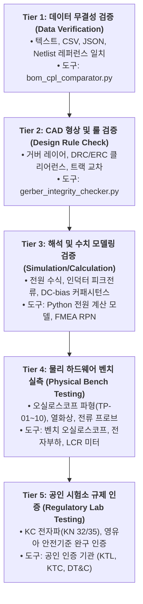

# [검증 체계 마스터] MAJN 엔지니어링 검증 도구 커버리지 및 한계 분석서
(MAJN Master Validation Toolchain Coverage, Boundaries & Limitations Specification)

- **문서 식별자**: `MAJN_VALIDATION_COVERAGE_MASTER`
- **리비전**: v1.0
- **작성 일자**: 2026-11-05
- **책임 주체**: Antigravity (독립 기술 심사관)
- **승인 권한**: Human Chief Authority
- **핵심 목표**: **"소프트웨어 검증 통과(100% CI PASS)를 하드웨어 안전성 승인으로 혼동하는 오류 원천 차단"**

---

## 1. 개요 및 5계층 검증 분류 체계 (5-Tier Verification Taxonomy)

지금까지 MAJN 프로젝트의 자동화 검증 도구들은 지속적으로 고도화되어 높은 신뢰도의 데이터 무결성 검증을 제공하고 있습니다. 그러나 **"검증 도구가 확인하는 것"과 "인간 엔지니어가 물리적으로 확인해야 하는 것" 사이의 경계를 명확히 분리**하지 않으면, 문서와 소프트웨어 테스트 통과만으로 실제 하드웨어가 안전하다고 믿는 치명적인 착각(False Sense of Security)에 빠지게 됩니다.

본 마스터 문서는 엔지니어링 검증 체계를 5개 계층으로 엄격히 분리하여 규정합니다.

---

## 2. 5대 자동화 검증 도구별 정밀 커버리지 및 한계 분석

| 도구 식별자 | 실행 환경 | 현재 결과 | 검증 가능한 영역 (Verified Scope) | **검증할 수 없는 물리적 한계 (Out of Scope)** |
| :--- | :---: | :---: | :--- | :--- |
| **`bom_cpl_comparator.py`** (v2.0) | Python 3 | **100% PASS** | • 56개 부품 레퍼런스 3자 일치 • Single-sided Top SMT 전수 확인 • LCSC Part # 불일치(2건) 검출 • C11/R12 0402 vs 0603 패키지 차이 • 7개 부품 좌표 이동(>0.05mm) 로깅 | • 실제 기판에 납땜된 부품의 물리적 치수(현미경 실측 필요) • 납땜 불량(냉납, 브릿지, 툼스톤 현상) • 정품 부품 여부 및 허용 오차/불량률 |
| **`gerber_integrity_checker.py`** (v2.0) | Python 3 | **100% PASS** | • 20개 거버 파일 구조 및 포맷 검증 • 4개 구리 층(Top, G1, G2, Bottom) 존재 확인 • 드릴 파일(PTH, NPTH, Via) 무결성 확인 | • 실제 기판의 유전체 두께(Core/Prepreg) • 동박 실제 두께(1oz/0.5oz) 및 밀착도 • 고주파 RF 트랙의 50Ω 특성 임피던스 실측치 • 레이어 간 절연 내압(Hi-Pot) |
| **`requirements_traceability_checker.py`** (v2.0) | Python 3 | **100% PASS** | • 15개 요구사항(Core 12 + Ext 3) RTM 완비 • 회로 넷, 부품 레퍼런스, 시험 케이스 1:1 매핑 • 미구현/미검증 상태 정량 집계 | • 요구사항 수치 자체의 공학적 타당성 • 실제 회로 구현의 정상 동작 여부 • 시험 절차의 완전성 및 시험 통과 여부 |
| **`test_protocol_vectors.js`** | Node.js | **48/48 PASS** | • BLE/UART 통신 패킷 프로토콜 파싱 • 페이로드 범위(주파수 30-65Hz, 진폭 0-0.5) • 패킷 체크섬 및 오류 패킷 거부 로직 | • 실제 무선 환경에서의 패킷 손실률(Packet Error Rate) • RF 안테나 방사 패턴 및 노이즈 간섭 • 실제 하드웨어 수신 버퍼 오버플로우 |
| **`tools/test_command_parser.py`** | Python 3 | **92/92 PASS** | • C++ 펌웨어 소스코드 정적 보안/규칙 감사 • OTA 잠금 게이트 및 바이너리 매직바이트(0xE9) • 100ms OTW 50% 감쇄 로직 구동 • 1.5g 충격 시 즉각 E-Stop 전이 상태머신 | • 타깃 칩(ESP32 실리콘)에서의 실제 실행 속도 • FreeRTOS 태스크 간 우선순위 역전/데드락 • 실제 앰프 칩과의 I2C 하드웨어 버스 타이밍 충돌 |

---

## 3. 계층 간 전환(Gate Transition) 원칙

1. **Tier 1 ~ Tier 3 통과**:
   - 설계 검토 및 분석 보고서 작성의 최소 진입 요건에 불과함.
   - 이 단계의 100% PASS는 "문서 및 데이터에 형식적 결함이 없음"을 의미할 뿐, 하드웨어 제작이나 승인을 보장하지 않음.
2. **Tier 4 (물리 벤치 실측) 필수 통과**:
   - Gate G1, Gate G3, Gate G6 통과를 위해서는 반드시 Tier 4의 물리적 측정 증거(오실로스코프 스크린샷, raw 파형 데이터, DMM 측정치, 열화상 데이터)가 첨부되어야 함.
3. **Tier 5 (공인 규제 인증) 필수 통과**:
   - 최종 양산 Release(Gate G8)는 공인 시험소 성적서 없이 절대 승인될 수 없음.
