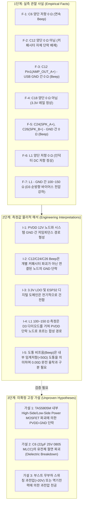

# [DOC01] MAJN PCB #0005 to PCB #0006 엔지니어링 기술 인계서
(PCB #0005 to PCB #0006 Engineering Handoff & Failure Mode Assetization)

- **문서 식별자**: `DOC01_PCB0005_TO_PCB0006_ENGINEERING_HANDOFF`
- **리비전**: v1.0
- **작성 일자**: 2026-11-02
- **작성 기준**: MAJN 시제품 PCB #0005 실측 데이터, REV5 하드웨어 장애 보고서, 2026-10-24 정상 동작 베이스라인
- **적용 대상**: 차기 MAJN 스마트 배시넷 제어 보드 (PCB #0006)

---

## 1. 개요 및 인계 목적

본 문서는 MAJN 스마트 배시넷 시제품 **PCB #0005**에서 도출된 전기적 실측 데이터, 고장 분석 결과, 그리고 잠재적 설계 취약점을 체계적으로 정리하여 차기 리비전인 **PCB #0006**의 공식 설계 입력자료(Engineering Input)로 승계하기 위한 기술 인계서이다.

시제품 #0005의 물리적 복구 시도는 QFN PowerPAD 패키지 특성상 비파괴 분리가 불가능하므로 지양하며, 본 문서의 목적은 **#0005에서 획득한 실측 자산을 온전히 보존하고 동일한 실패 메커니즘이 #0006에서 원천 차단되도록 설계 기준을 수립하는 것**이다.

---

## 2. PCB #0005 하드웨어 구성 및 실장 내역

PCB #0005는 단일 4층 기판(Rev-B 기반)으로 제작되었으며, 총 56개의 부품이 실장되었다.

| 블록 구분 | 참조번호 | 부품 번호 / 규격 | LCSC Part # | 주요 기능 및 사양 |
| :--- | :--- | :--- | :--- | :--- |
| **MCU & RF** | U1 | ESP32-WROOM-32E-N8 | C701345 | Dual-Core 240MHz, 8MB Flash, Wi-Fi/BLE (PCB 온보드 안테나) |
| **Logic LDO** | U2 | AP2112K-3.3TRG1 | C51118 | 3.3V / 600mA 저잡음 LDO (ESP32 및 로직 전원 공급) |
| **Boost DC-DC** | U3 | MP3426DL | C2909511 | 6A 스위칭 전류, 1.2MHz 승압 컨버터 (5V $\to$ 12.17V) |
| **Boost Inductor**| L1 | 4.7µH SMD 인덕터 | C167439 | 승압 에너지 저장 (정격 전류 한계 취약) |
| **Schottky Diode**| D3 | SS34 (SMA) | C8678 | 3A / 40V 쇼트키 다이오드 (SW $\to$ PVDD 정류) |
| **Class-D Amp** | U4 | TAS5805MPWPR | C478472 | 23W $\times$ 2ch 스테레오 Digital Input Class-D (I2S 입력, I2C 제어) |
| **Motion Sensor** | U5 | LSM6DSOXTR | C481766 | 6축 IMU (I2C 0x6A, 수면 진동 및 자세 감지) |
| **USB Interface** | J_USB | TYPE-C-31-M-12 | C165948 | USB-C 16-pin (5V 2A/3A 인입, VBUS 직결) |
| **Speaker Port** | J1, J2 | 1.25mm 2-pin 커넥터 | - | 채널 A / 채널 B BTL 출력 터미널 |

---

## 3. 베이스라인 정상 동작 vs 장애 상황 비교

### 3.1 2026-10-24 정상 동작 베이스라인 기록
2026-10-24 벤치 측정(`docs/MAJN_PCB_0005_EXCITER_SUCCESS_MEASUREMENT_RECORD.md`) 당시, PCB #0005는 완벽히 정상 동작을 기록하였다:
- **전원 레일**: VBUS = 5.02V, 3.3V = 3.20V, BOOST_EN = 3.20V, PVDD = 12.00V, AMP_PDN = 3.20V.
- **I2C 통신**: U4 TAS5805M 0x2C 주소 응답 확인, State = `PLAY` (0x03) 진입.
- **I2S 오디오**: BCLK = 1.536MHz, LRCLK = 48kHz, Sine Wave 구동 확인.
- **부하 조건**: 합성 임피던스 **24.8Ω** (샘플 진동자 2개 직렬 + 벤치 하네스 저항).
- **진동 결과**: 하우징 및 배시넷 판재에 물리적 진동 정상 체감, 이상 발열 없음.

### 3.2 2026-11-02 하드웨어 장애 발생 상황
- **트리거**: 펌웨어 파서 및 제어 로직 시험 중 기판 전원 인입 후 구동 시도.
- **현상**: USB 인입 전압 강하 발생, 앰프 출력 무응답, 멀티미터 도통 점검 시 12V 전원 라인 및 스피커 출력 라인 접지 단락음 발생.

---

## 4. 실측 관찰 사실, 측정값 해석, 미확정 가설의 3단계 분류

엔지니어링 무결성을 위해 실측 사실과 추정 가설을 엄격히 분리한다.

### 4.1 1단계: 실측 관찰 사실 (Empirical Facts)
- **F-1**: C6 (PVDD_12V ↔ GND, 22µF 25V 0805) 양단 접촉 시 멀티미터 도통 모드에서 연속 경보음(Beep) 발생, 저항 모드에서 약 $0\,\Omega$ 지시.
- **F-2**: C12 (BST_A+ ↔ AMP_OUT_A+, 220nF) 커패시터 자체 양단은 Beep이 울리지 않음.
- **F-3**: C12의 Pin 1 (AMP_OUT_A+ 패드)과 USB-C 셸(GND) 사이를 프로빙하면 연속 Beep 발생.
- **F-4**: C18 (VCC_3V3 ↔ GND, 100nF) 양단은 Beep이 울리지 않으며, 3.3V 전원 버스는 접지와 단락되지 않음.
- **F-5**: C24 (SPK_A+ ↔ GND) 및 C26 (SPK_B+ ↔ GND)의 양단 프로빙 시 연속 Beep 발생.
- **F-6**: L1 (4.7µH 인덕터) 양단은 약 $0\,\Omega$으로 인덕터 자체 권선 단선 없음.
- **F-7**: L1 단자와 시스템 GND 간 측정 시 200Ω 레인지에서 $100 \sim 150\,\Omega$ 지시.
- **F-8**: PCB #0005 보드 상에는 앰프 PVDD와 부스트 출력을 분리할 수 있는 물리적 점퍼가 없음.
- **F-9**: 호흡/심박용 PVDF 센서 및 외장 가속도계 인터페이스는 실장되어 있지 않음.

### 4.2 2단계: 측정값에 대한 물리적 해석 (Engineering Interpretations)
- **I-1**: PVDD 12V 전원 버스 전체가 시스템 GND에 대해 극히 낮은 저임피던스(단락 상태)를 형성하고 있음.
- **I-2**: C24, C26의 Beep음은 2.2nF 커패시터가 파괴된 것이 아니라, 페라이트 비드(FB1, FB3)를 통해 TAS5805M의 출력 핀(OUT_A+, OUT_B+)에 직결된 노드가 GND로 단락되어 나타난 결과임.
- **I-3**: L1과 GND 사이의 $100 \sim 150\,\Omega$ 저항값은 멀티미터 내부 테스트 전류가 L1 $\to$ D3 쇼트키 다이오드(순방향 전압 강하 $V_f \approx 0.3\text{V}$) $\to$ 단락된 PVDD 버스 $\to$ GND 경로를 거쳐 흐르면서 발생한 다이오드 비선형성 임피던스임.
- **I-4**: 3.3V 디지털 제어계(ESP32, LDO, 센서 버스)는 12V 고전압 전원부의 단락 사고로부터 완전히 격리되어 손상을 입지 않았음.

### 4.3 3단계: 미확정 고장 가설 (Unproven Hypotheses - 추정치)
- **가설 1**: TAS5805M 내부 BTL H-Bridge 구동 MOSFET(High-Side 및 Low-Side) 중 하나 이상이 열화 또는 전기적 과응력(EOS)으로 천공되어 PVDD-GND 간 금속성 쇼트를 형성함.
- **가설 2**: C6 MLCC(0805 25V)가 12V 승압 과도 전압 또는 기계적 휨 응력(Flex Crack)으로 인해 유전체 파괴를 일으켜 단락됨.
- **가설 3**: 모터/진동자 결선 시 발생한 역기전력(Flyback Voltage) 또는 무부하 상태 승압 전압 스파이크가 칩 절대최대정격(PVDD Abs Max 30V)을 초과함.

---

## 5. PCB #0005 수리 불가 사유의 공학적 분석

PCB #0005에 대한 디솔더링 기반의 하드웨어 수리가 권장되지 않는 공학적 근거는 다음과 같다:

1. **TAS5805M PowerPAD(방열 패드) 접합 특성**:
   - TAS5805M은 28-pin HTSSOP 패키지 하단에 대형 Exposed Thermal Pad가 배치되어 있으며, 기판 내층 GND 평면과 다중 서멀 비아(Thermal Vias)로 납땜되어 있음.
   - 열풍기(Hot Air Gun)를 이용한 수작업 디솔더링 시 기판 열용량이 커서 260℃ 이상의 장시간 가열이 불가피하며, 이는 인근 0402/0603 칩 부품의 묘비 현상(Tombstoning) 및 4층 기판 동박 박리(Delamination)를 유발함.
2. **병렬 전원망(Parallel PDN)의 인서킷 분리 불가**:
   - MP3426 출력, D3 쇼트키, C6 커패시터, TAS5805M PVDD가 단일 구리 폴리곤(Copper Pour)으로 직결되어 있어, 패턴을 칼로 물리적으로 절단하지 않고는 결함 부품을 특정할 수 없음.
3. **재발 위험성**:
   - 근본적인 보호 회로(시퀀싱, 클램프, 블리더)가 없는 상태에서 칩이나 커패시터만 교체하더라도 동일한 전기적 과응력으로 인해 즉각 재파괴될 위험이 100%에 달함.

---

## 6. PCB #0005에서 식별된 잠재적 설계 취약점 목록

| 취약점 ID | 위치 / 회로 | 설계 결함 내용 | 미치는 영향 |
| :--- | :--- | :--- | :--- |
| **VULN-01** | U4 TAS5805M `PDN` 핀 | R13 (10kΩ) 풀업이 `VCC_3V3`에 직결됨 | 전원 투입 시 ESP32 부팅 전 앰프 게이트 드라이버가 즉시 활성화되어, 12V 승압 중 과도 돌입 전류 및 슈트스루(Shoot-through) 유발 위험 |
| **VULN-02** | U3 MP3426 부스트 출력 | 피드백 분배기(143k+16k=159kΩ) 외에 블리더(Bleeder) 부하 없음 | 무부하(No-load) 또는 앰프 셧다운 시 스위칭 펄스 스키핑에 의한 출력 전압 과도 상승(Overshoot > 15V) 방어 불가 |
| **VULN-03** | TAS5805M BTL 출력단 | 필터리스(Ferrite Bead + 2.2nF) 직결 구조에 역기전력 클램프 다이오드 부재 | 유도성 부하(Exciter 보이스코일) 오프 시 발생하는 고압 킥백(Kickback) 전압이 FET 드레인 핀에 직접 인가됨 |
| **VULN-04** | PVDD 12V 전원 라인 | MLCC 전압 정격이 25V 0805 단일 규격에 의존 | 12V DC-Bias 인가 시 실효 커패시턴스가 공칭 대비 60% 이상 격감(약 8µF)하여 전원 리플 흡수 불능 |
| **VULN-05** | 전원 및 계측 구조 (DFT) | 승압단과 앰프단 간 0Ω 점퍼 및 전류 측정 션트 저항 전무 | 단락 또는 이상 전류 발생 시 전원 블록 간 원인 격리(DFI) 및 비파괴 진단 원천 불가능 |
| **VULN-06** | BTL 프로빙 테스트 포인트 | 접지 기준 단일 종단 패드만 노출, 차동 전용 TP 부재 | 오실로스코프 프로브 접지선 직결 시 BTL Low-side FET를 강제 단락시켜 앰프를 파괴할 위험 상존 |

---

## 7. PCB #0006으로의 엔지니어링 승계 원칙 요약

1. **완전한 계통 분리 검증성(DFT/DFI) 확보**: 전원 승압부와 오디오 구동부 사이에 물리적 분리 수단(`R_ISO1`, 0Ω 점퍼) 및 전류 측정 션트를 필수로 배치한다.
2. **하드웨어 디폴트 안전(Fail-Safe) 시퀀싱**: TAS5805M의 `PDN` 핀을 10kΩ 풀다운으로 변경하여 전원 인입 초기에는 강제 셧다운 상태를 유지하고, ESP32가 모든 전원 안정화를 확인한 후 GPIO로 소프트 활성화하도록 한다.
3. **유도성 부하 및 과전압 보호망 장착**: BTL 출력단에 쇼트키 배리어 역기전력 클램프 어레이를 배치하고, PVDD 버스에 적정 정격의 보호 회로 및 블리더 저항을 실장한다.
4. **부하 임피던스 정합 준수**: TEAX14C02-8 (8Ω) 4개 구동 시 채널당 2개 직렬(16Ω) 결선을 표준으로 채택하여 전력 상한 10W를 엄격히 보호한다.
