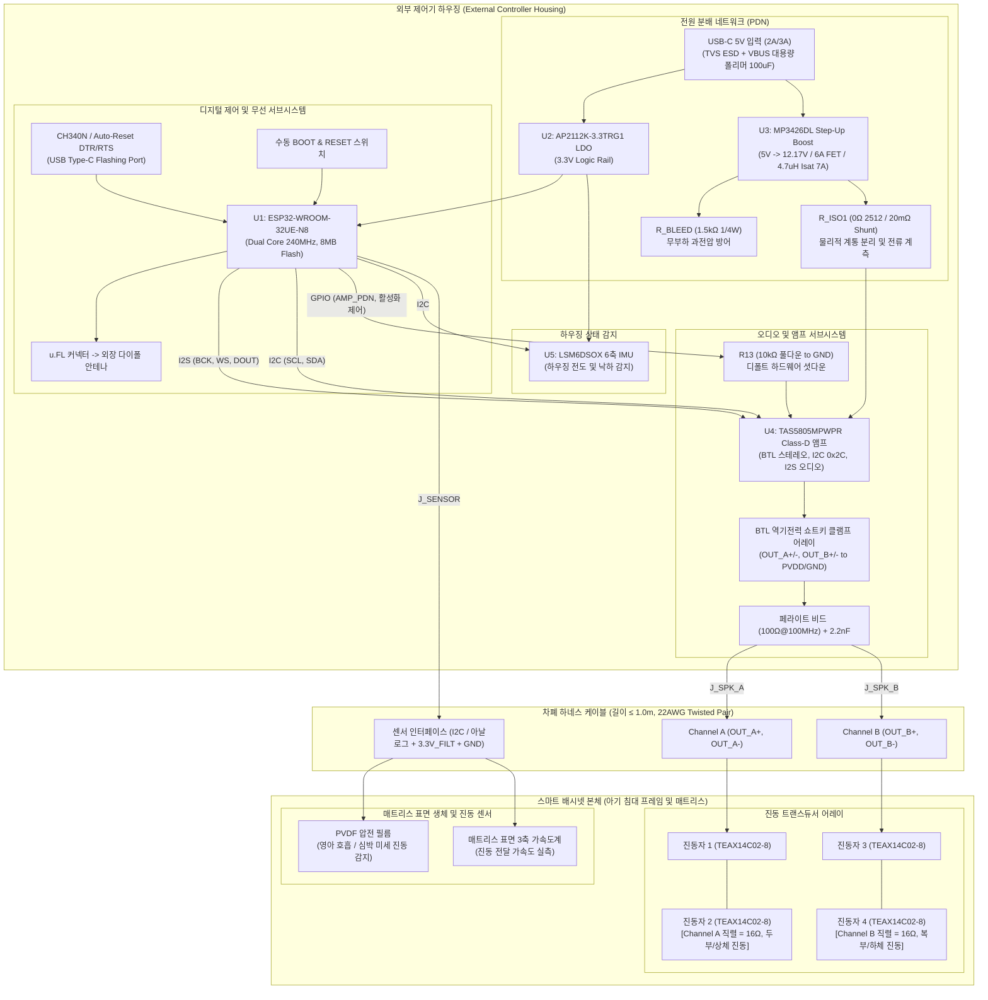

# [DOC02] MAJN PCB #0006 시스템 아키텍처 정의서
(PCB #0006 System Architecture Specification)

- **문서 식별자**: `DOC02_PCB0006_SYSTEM_ARCHITECTURE`
- **리비전**: v1.0
- **작성 일자**: 2026-11-02
- **적용 대상**: MAJN 차기 스마트 배시넷 제어 및 진동 구동 시스템

---

## 1. 아키텍처 대안 비교 및 최종 구조 선정

스마트 배시넷 시스템 설계를 위해 3가지 하드웨어 아키텍처 대안을 비교 검토하였다.

| 평가 기준 | 대안 A: 일체형 단일 보드 (All-in-One Onboard) | 대안 B: 2보드 분리형 (전원보드 + 제어/앰프보드) | 대안 C (권장): 외부 컨트롤러 + 배시넷 분리형 (External Controller + Bed Transducers) |
| :--- | :--- | :--- | :--- |
| **구조 설명** | 배시넷 판재 하부에 단일 PCB에 승압, 앰프, MCU, 센서 전부 내장 | 전원부(5V $\to$ 12V)와 제어/앰프부를 2개 PCB로 분리 | 제어·전원·앰프 기판 전체를 배시넷 외부에 두고, 배시넷 내부에는 진동자와 표면 센서만 배치 ($\le 1\text{m}$ 하네스) |
| **영아 안전성** | 열악 (아기 침대 바로 아래에 12V 스위칭 및 발열원 위치) | 보통 (전원부 이격 가능하나 침대 내부 결선 복잡) | **최고 (아기 침대 내부에는 고전압 회로 및 발열원 전무, 완전한 물리적 격리)** |
| **열/진동 분리** | 불리 (진동자 진동이 PCB 솔더 조인트 및 발진자에 직격) | 보통 (기판 2개 고정 필요) | **우수 (강한 진동원으로부터 기판 전자 부품 완벽 격리, 냉각 통풍 확보)** |
| **배터리 접근성**| 불리 (배시넷 하부 밑바닥에 USB 연결 필요) | 보통 | **우수 (외부 거치 하우징에 USB-C 포트 배치, 손쉬운 배터리 교체)** |
| **유지보수/OTA**| 불리 (점검 시 침대 프레임 분해 필수) | 보통 | **우수 (컨트롤러만 탈착하여 펌웨어 개발, 플래싱, 계측 가능)** |
| **제조/조립 비용**| 단일 PCB로 조립 간소하나 케이블 복잡 | PCB 2장 및 보드 간 커넥터 비용 증가 | **최적 (표준 하네스 1개로 연결, 단일 PCB의 양산 단가 절감 및 프레임 조립성 극대화)** |

### 1.1 최종 아키텍처 선정 근거: 대안 C (External Controller + Bed Transducers)
1. **영아 안전(Infant Safety) 최우선**: 아기가 누워 있는 공간 내부에는 $12\text{V}$ 스위칭 전원, 리튬 배터리 직결 라인, 인덕터 발열원을 배치하지 않는다.
2. **신뢰성 보장 (Thermal & Mechanical Stress Relief)**: 진동자에서 발생하는 물리적 공진 진동이 크리스털 발진기(40MHz) 및 대형 MLCC 부품의 기계적 크랙을 유발하지 않도록 컨트롤러를 물리적으로 격리한다.
3. **노이즈 및 생체신호 수집 무결성**: 고출력 Class-D PWM 스위칭 노이즈가 매트리스 상부의 미세 생체 센서(PVDF 호흡/심박)에 용량성(Capacitive) 결합되는 것을 원천 억제한다.

---

## 2. 전체 시스템 블록 다이어그램

---

## 3. 전원 분배 네트워크 (PDN) 아키텍처

1. **USB-C 5V 인입단**:
   - 정격 사양: $5.0\text{V}$, 정상 부하 시 $1.5\text{A} \sim 2.0\text{A}$, 피크 부하 시 최대 $2.5\text{A}$.
   - 입력 보호: VBUS 노드에 6V 정격 양방향 TVS (`SMBJ5.0A` 또는 동급) 배치.
   - 순간 전압 강하 방어: 1.5m USB 케이블 도체 저항($\approx 0.25\,\Omega$)에 의한 $0.6\text{V}$ 수준의 IR Drop을 보상하기 위해 $100\,\mu\text{F}$ 고용량 폴리머/알루미늄 전해 커패시터 실장.
2. **디지털 3.3V 로직 레일**:
   - 레귤레이터: `AP2112K-3.3TRG1` (Dropout $250\text{mV} @ 600\text{mA}$, PSRR $65\text{dB}$).
   - 입력 공급: USB 5V VBUS에서 공급. ESP32 Wi-Fi TX 피크 전류($\approx 350\text{mA}$) 발생 시에도 안정적인 3.3V 유지.
   - 디커플링: 입력 $1\,\mu\text{F} + 10\,\mu\text{F}$, 출력 $10\,\mu\text{F} + 100\text{nF}$ MLCC 배치.
3. **부스트 컨버터 (12.17V PVDD 레일)**:
   - 컨트롤러: `MP3426DL` (동기식/비동기식 승압, 6A 내부 파워 스위치).
   - 승압비: $5.0\text{V} \to 12.17\text{V}$ ($R_1 = 143\text{k}\Omega, R_2 = 16\text{k}\Omega$).
   - 블리더 부하: 부스트 출력단에 $1.5\text{k}\Omega$ ($0.25\text{W}$) 저항을 상시 연결하여 약 $8\text{mA}$의 최소 방전 전류를 형성, 무부하 펄스 스키핑 시 과전압 억제.
4. **전원 계통 분리 및 전류 계측 (`R_ISO1`)**:
   - 부스트 컨버터 출력과 오디오 앰프 PVDD 인입단 사이에 **2512 규격 패드(`R_ISO1`)**를 배치.
   - 초기 보드 조립/테스트 단계: 미실장(DNP) 상태에서 부스트 12V 전압 단독 검증.
   - 단일 전원 운용 시: $0\,\Omega$ 점퍼(허용 전류 $\ge 5\text{A}$) 또는 $20\text{m}\Omega$ 고정밀 션트 저항 실장으로 앰프 소비 전류 실시간 모니터링 지원.

---

## 4. MCU 및 무선 서브시스템

1. **모듈 선정**: `ESP32-WROOM-32UE-N8` (외장 u.FL 안테나 커넥터 탑재형).
   - **선정 사유**: 배시넷 목공 프레임 또는 외부 차폐 금속/플라스틱 하우징 내부에 보드가 위치할 경우, 온보드 PCB 안테나는 $15\sim 20\text{dB}$의 심각한 신호 감쇄를 겪음. 외장 u.FL 안테나 케이블을 인출하여 최적의 Wi-Fi/BLE 송수신 감도 확보.
2. **RF 레이아웃 및 Keep-out**:
   - u.FL 커넥터 주변 반경 $3\text{mm}$ 내 고전압 스위칭 노드(MP3426 SW 핀, L1, D3) 배치 금지.
   - 하우징 개구부를 통해 1.13mm 동축 케이블이 꺾이지 않고 배출될 수 있는 공간 확보.
3. **UART 다운로드 및 플래싱 인터페이스**:
   - Type-C 단자를 통한 자동 다운로드(DTR/RTS 트랜지스터 리셋 회로) 탑재.
   - 추가로 현장 디버깅을 위한 물리적 택트 스위치(`SW_BOOT`, `SW_RESET`) 및 2.54mm UART 헤더 병행 제공.

---

## 5. 오디오 및 앰프 서브시스템

1. **디지털 앰프**: `TAS5805MPWPR` (Texas Instruments).
   - 구동 모드: BTL (Bridge-Tied Load) 스테레오 2채널 모드.
   - 디지털 인터페이스: I2S 오디오 데이터(BCLK, WS, SDIN), I2C 제어(SCL, SDA - 주소 `0x2C`).
2. **하드웨어 디폴트 안전(Fail-Safe) 시퀀싱 회로**:
   - **문제점 개선**: PCB #0005의 R13(10kΩ 풀업 to 3.3V)을 **10kΩ 풀다운 to GND**로 전면 수정.
   - **동작 메커니즘**: 기판 전원 인입 시 TAS5805M의 `PDN` 핀은 하드웨어적으로 완전한 LOW(Shutdown) 상태를 유지함. ESP32가 부팅되어 3.3V 및 12V 레일의 전압 안정화를 확인한 후에만 GPIO를 통해 `PDN = HIGH`로 전환.
3. **BTL 출력단 역기전력 및 ESD 보호**:
   - 진동자 보이스코일의 유도성 에너지 킥백을 방어하기 위해 각 BTL 라인(OUT_A+, OUT_A-, OUT_B+, OUT_B-)에 쇼트키 배리어 다이오드 어레이(`BAT54S` 또는 고속 클램프 어레이)를 실장하여 전압을 PVDD와 GND 레일로 안전하게 클램핑.
   - 고주파 PWM 스위칭 노이즈 억제를 위해 페라이트 비드($100\,\Omega @ 100\text{MHz}$, 정격 $3\text{A}$) + $2.2\text{nF}$ 커패시터 필터링 적용.

---

## 6. 진동자(Exciter) 서브시스템 및 배선 토폴로지

1. **트랜스듀서 규격**: Tectonic Elements `TEAX14C02-8` (4개).
   - 공칭 임피던스: $8\,\Omega$, DC 저항(DCR): $7.2\,\Omega \pm 15\%$.
   - 정격 입력 전력: 연속 $2.0\text{W}$, 최대 피크 $3.0\text{W}$.
2. **배선 결선 정의 (직렬 연결 필수 채택)**:
   - **Channel A**: 진동자 1 ($8\Omega$)과 진동자 2 ($8\Omega$)를 **직렬(Series)** 연결하여 총 합성 임피던스 **$16\,\Omega$** 형성. (배시넷 상부/두부 영역 담당)
   - **Channel B**: 진동자 3 ($8\Omega$)과 진동자 4 ($8\Omega$)를 **직렬(Series)** 연결하여 총 합성 임피던스 **$16\,\Omega$** 형성. (배시넷 하부/복부 영역 담당)
   - *병렬 연결($4\,\Omega$) 금지 사유*: $12\text{V}$ PVDD에서 $4\Omega$ 병렬 부하는 채널당 약 $13.8\text{W}$의 전력을 요구하여 부스트 컨버터(MP3426) 및 USB 5V 입력 한계($10\text{W}$)를 완전히 초과하고 진동자를 소손시킴.
3. **하네스 케이블 사양**:
   - 길이 $\le 1.0\text{m}$, 22AWG 실드 트위스트 페어(Shielded Twisted Pair) 케이블 적용.

---

## 7. 센서 서브시스템 및 노이즈 격리 전략

1. **온보드 센서 vs 매트리스 표면 센서 기술 분석**:
   - **온보드 IMU (`LSM6DSOX`)**: 기구 외부 하우징에 위치하므로 영아의 미세 호흡/심박 진동을 물리적으로 감지할 수 없음. (컨트롤러 본체의 기울어짐, 낙하, 거치 안정성 모니터링 전용으로 한정)
   - **매트리스 표면 센서 (필수 외부화)**: 영아의 흉곽 및 복부와 직접 접촉하는 매트리스 상부 표면에 **PVDF 압전 센서 및 초소형 외장 가속도계**를 배치해야만 임상적으로 유효한 호흡/심박 신호 획득 가능.
2. **생체 신호 노이즈 격리 대책**:
   - Class-D 앰프(384kHz/768kHz) 및 MP3426(1.2MHz) 스위칭 노이즈가 미세 아날로그 센서 신호에 유입되지 않도록, 센서 전원 라인에 전용 페라이트 비드 필터 및 RC 저역통과 필터망 실장.
   - 센서 신호 인터페이스 헤더(`J_SENSOR`)를 스위칭 전원 및 앰프 출력단과 기판 물리적 반대편에 이격 배치.
