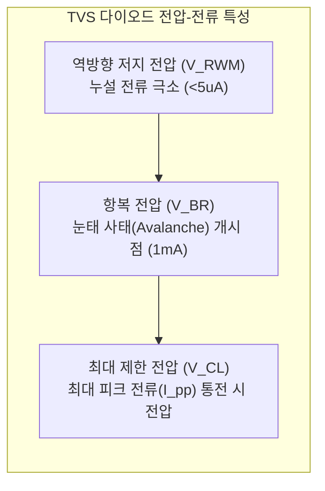
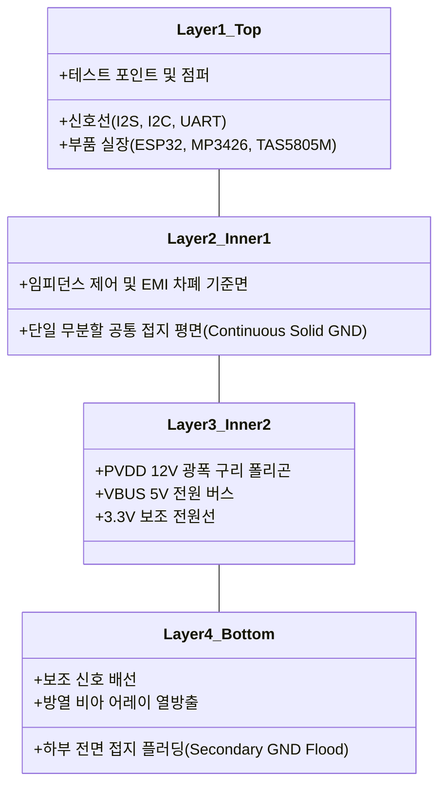

# [DOC04] MAJN PCB #0006 상세 회로 설계 검토서
(PCB #0006 Detailed Circuit Design Review & Component Sizing)

- **문서 식별자**: `DOC04_PCB0006_CIRCUIT_DESIGN_REVIEW`
- **리비전**: v1.0
- **작성 일자**: 2026-11-02
- **적용 대상**: MAJN 차기 리비전 (PCB #0006) 핵심 회로 블록 및 부품 선정

---

## 1. 컴포넌트 존속 및 변경 매트릭스 (Retain vs Modify vs New)

PCB #0005에서 검증된 자산을 바탕으로 PCB #0006 회로 블록의 존속 및 변경 내역을 명확히 정의한다.

| 회로 블록 | 대상 부품 | PCB #0005 현황 | PCB #0006 결정 | 변경 사유 및 설계 지침 |
| :--- | :--- | :--- | :---: | :--- |
| **MCU & RF** | U1: ESP32 | ESP32-WROOM-32E (PCB 안테나) | **Modify** | **ESP32-WROOM-32UE-N8 (외장 u.FL 커넥터)**로 변경하여 외장 안테나 인출 확보 |
| **Logic LDO** | U2: 3.3V LDO | AP2112K-3.3TRG1 (SOT-23-5) | **Retain** | 동작 안정성 및 낮은 드롭아웃($250\text{mV}$) 입증됨 (그대로 유지) |
| **Boost IC** | U3: 부스트 | MP3426DL (QFN-14) | **Retain** | 6A 내부 스위치 정격 및 승압 성능 우수함 (유지하되 주변 보호회로 강화) |
| **Boost Inductor**| L1: 인덕터 | 4.7µH 일반 SMD (포화전류 미흡) | **Modify** | **Bourns SRP6540-4R7M ($I_{\text{sat}} \ge 7.0\text{A}$, DCR $\le 18\text{m}\Omega$)** 대전류 차폐형으로 교체 |
| **Boost Diode**| D3: 다이오드 | SS34 (3A / 40V SMA) | **Modify** | 저 순방향 전압($V_f \le 0.38\text{V}$) 쇼트키 다이오드(예: `B340A` 또는 `PMEG4030`)로 교체하여 발열 30% 저감 |
| **Boost Output**| C6, C7: 커패시터| 22µF 25V 0805 MLCC 1개 | **Modify** | **22µF 35V/50V X7R 1210 MLCC 2개 병렬 + 47µF 폴리머 커패시터**로 전면 보강 (DC Bias 방어) |
| **Bleeder Resistor**| R_BLEED: 블리더| 없음 (피드백 저항 159kΩ만 존재) | **New** | **1.5kΩ 1206 1/4W 블리더 저항 신설** (무부하 전압 오버슈트 원천 방어) |
| **Isolation Resistor**| R_ISO1: 분리점퍼| 없음 (단일 구리 패턴 직결) | **New** | **SMD 2512 패드 신설** (0Ω 점퍼 또는 20mΩ 션트 저항 실장으로 계통 분리 및 DFT/DFI 구현) |
| **Class-D Amp** | U4: 오디오 앰프| TAS5805MPWPR (TSSOP-28) | **Retain** | DSP 기능 및 23W BTL 성능 최적 (유지하되 전원/제어 시퀀싱 전면 수정) |
| **Amp Sequencing**| R13: PDN 저항 | 10kΩ 풀업 to 3.3V | **Modify** | **10kΩ 풀다운 to GND로 변경** (전원 인입 시 디폴트 셧다운 보장) |
| **BTL Output Clamp**| D_CLAMP: 다이오드| 없음 (페라이트 비드만 연결) | **New** | **BTL 4라인 $\to$ PVDD/GND 쇼트키 클램프 어레이 (`BAT54S`) 8개 신설** (역기전력 스파이크 제거) |
| **Transducer Ports**| J1, J2: 커넥터 | 1.25mm 2-pin 단순 헤더 | **Modify** | **2.0mm 락킹 커넥터 2채널 직렬 결선 포트** 채택 (채널당 16Ω 보장) |
| **Sensor Interface**| J_SENSOR: 헤더 | 온보드 LSM6DSOX 직결 | **New** | **외장 매트리스 센서용 1.25mm 5-pin 인터페이스 헤더 신설** (LDO 분리 전원 필터링 적용) |

---

## 2. MP3426 부스트 컨버터 상세 회로 설계 및 수식 검증

### 2.1 인덕터 L1 선정 및 피크 전류 계산
- **설계 파라미터**:
  - 입력 전압: $V_{\text{in, min}} = 4.5\text{V}$, $V_{\text{in, nom}} = 5.0\text{V}$
  - 출력 전압: $V_{\text{out}} = 12.17\text{V}$
  - 스위칭 주파수: $f_{\text{sw}} = 1.2\text{ MHz}$
  - 변환 효율: $\eta \approx 85\% = 0.85$
  - 최대 정상 출력 전류: $I_{\text{out, max}} = 0.8\text{ A}$ (오디오 RMS $\approx 7\text{W}$ + 블리더 $\approx 8\text{mA}$)
  - 순간 피크 출력 전류: $I_{\text{out, peak}} \approx 1.0\text{ A}$

- **듀티 사이클(Duty Cycle, D)**:
  $$D = 1 - \frac{V_{\text{in}} \times \eta}{V_{\text{out}}} = 1 - \frac{4.5\text{V} \times 0.85}{12.17\text{V}} \approx 1 - 0.314 = \mathbf{0.686}$$

- **인덕터 리플 전류 ($\Delta I_L$, 인덕턴스 $L = 4.7\,\mu\text{H}$ 적용 시)**:
  $$\Delta I_L = \frac{V_{\text{in}} \times D}{f_{\text{sw}} \times L} = \frac{4.5\text{V} \times 0.686}{1.2 \times 10^6\text{ Hz} \times 4.7 \times 10^{-6}\text{ H}} = \frac{3.087}{5.64} \approx \mathbf{0.547\text{ A}}$$

- **평균 입력 전류 및 스위치 피크 전류 ($I_{\text{peak}}$)**:
  $$I_{\text{in, avg, peak}} = \frac{V_{\text{out}} \times I_{\text{out, peak}}}{V_{\text{in, min}} \times \eta} = \frac{12.17\text{V} \times 1.0\text{A}}{4.5\text{V} \times 0.85} \approx \mathbf{3.18\text{ A}}$$
  $$I_{\text{peak}} = I_{\text{in, avg, peak}} + \frac{\Delta I_L}{2} = 3.18\text{ A} + \frac{0.547\text{ A}}{2} \approx \mathbf{3.45\text{ A}}$$

- **인덕터 마진 및 최종 선정**:
  - MP3426 내부 스위치 전류 제한(Current Limit): Min $6.0\text{A}$, Typ $7.5\text{A}$.
  - 요구 포화 전류($I_{\text{sat}}$): 동작 피크 전류($3.45\text{A}$)의 2배 이상인 **$I_{\text{sat}} \ge 7.0\text{A}$** 필수.
  - **선정 부품**: **Bourns SRP6540-4R7M** ($4.7\,\mu\text{H} \pm 20\%$, $I_{\text{sat}} = 7.5\text{A}$, $I_{\text{rms}} = 4.5\text{A}$, DCR $= 18\text{m}\Omega$). 자기 포화에 의한 스위칭 파괴를 완벽히 방지함.

### 2.2 쇼트키 다이오드 D3 선정
- 기존 PCB #0005의 `SS34`는 $V_f \approx 0.50\text{V} @ 3\text{A}$로 평균 $1\text{A}$ 부하 시 약 $0.5\text{W}$의 열을 발생시킴.
- **개선안**: 저 순방향 전압 Trench MOS 쇼트키 다이오드 (`B340A-13-F` 또는 Nexperia `PMEG4030ER`) 적용 ($V_f \approx 0.36\text{V} @ 2\text{A}$). 발열량을 약 $30\%$ 절감하고 전원 효율 $3\%$ 개선.

### 2.3 출력 커패시터 DC-Bias 디레이팅 분석
- **문제점**: PCB #0005에 사용된 0805 규격 $22\,\mu\text{F}$ 25V MLCC는 12V DC 바이어스가 인가될 때 강유전체(BaTiO3) 특성으로 인해 정전용량이 공칭값 대비 약 **$65\%$ 감소**하여 실효 용량이 $7.7\,\mu\text{F}$에 불과함.
- **설계 대책**:
  1. 패키지 크기 확장: 0805에서 **1210 규격**으로 변경 (유전체 체적 확대로 DC 편향 특성 대폭 개선).
  2. 전압 정격 상향: 25V에서 **35V 또는 50V X7R** 규격 채택.
  3. 다중 병렬 구성: 1210 $22\,\mu\text{F}$ 35V MLCC **2개 병렬 실장** $\to$ 12V 인가 시 개당 실효 약 $12\,\mu\text{F}$ 보장, 합성 실효 용량 **$\ge 24\,\mu\text{F}$** 확보.
  4. 벌크 흡수: $47\,\mu\text{F}$ 25V 알루미늄 유기 폴리머 커패시터(ESR $\le 30\text{m}\Omega$) 병렬 추가.

---

## 3. TAS5805M 앰프 회로 검토 및 14V TVS 적용성 공학 분석

### 3.1 PVDD 12V 라인에 대한 '14V TVS' 적용 적절성 평가

일부 검토에서 제안된 '12V 라인 14V TVS 배치'에 대해 반도체 과도전압 억제 소자(TVS)의 규격 정의를 바탕으로 상세 분석을 수행하였다.

#### 공학적 분석 결과:
1. **용어의 모호성 검증**:
   - '14V TVS'가 역방향 작동 전압($V_{\text{RWM}} = 14\text{V}$)을 의미하는 경우:
     - 항복 개시 전압 $V_{\text{BR}} = 15.6\text{V} \sim 17.2\text{V}$ (Typ $16.4\text{V}$)
     - 최대 클램핑 전압 $V_{\text{CL}} \approx 23.2\text{V}$ (@ 피크 펄스 전류)
     - **판정**: 정상 12.17V 운용 시 누설 전류가 없어 안전하며, TAS5805M의 절대최대정격($\text{Abs Max} = 30\text{V}$) 이하에서 ESD 및 서지를 억제하므로 **보호 소자로서 적절**함.
   - 반면, '14V TVS'가 항복 전압($V_{\text{BR}} = 14\text{V}$)을 의미하는 소자(예: $V_{\text{RWM}} \approx 12.0\text{V}$)를 사용할 경우:
     - 12.17V 정상 승압 전압이 이미 TVS의 항복 시작 영역에 걸치게 됨.
     - 고온 환경에서 TVS 항복 전압이 음의 온도 계수를 갖거나 리플 전압($\ge 12.5\text{V}$) 발생 시, TVS가 지속적으로 도통하여 발열 $\to$ 열폭주 $\to$ 쇼트 파괴를 유발함.
2. **TVS의 본질적 한계 (Not a Voltage Regulator)**:
   - TVS는 마이크로초($\mu\text{s}$) 단위의 ESD 및 유도성 스파이크를 흡수하는 소자이며, 승압 회로 피드백 고장이나 펄스 스키핑으로 인한 **지속적 과전압(Continuous Overvoltage)을 감당할 수 없음**.
   - 지속 과전압이 100ms 이상 인가되면 TVS는 100% 영구 단락(Short-circuit failure) 모드로 파괴됨.
3. **최종 설계 권고**:
   - 12V 버스 보호용 TVS를 실장할 경우, 역방향 스탠드오프 전압이 **$V_{\text{RWM}} \ge 13.5\text{V} \sim 14.0\text{V}$** 규격인 소자(예: `SMAJ14A` 또는 `SMBJ14A`)를 선정하여 상시 누설 발열을 원천 배제할 것.
   - 지속 과전압 방어는 TVS에 의존하지 않고, **REQ-P0-03 블리더 저항($1.5\text{k}\Omega$)과 MP3426 내부 과전압 보호(OVP)**를 통해 1차 방어할 것.

### 3.2 BTL 필터 토폴로지 비교 (LC 필터 vs Ferrite Bead)
- **Ferrite Bead + 2.2nF (채택)**:
  - TI TAS5805M 레퍼런스 디자인 인증 구조.
  - 배시넷 진동자 하네스 케이블 길이가 $\le 1.0\text{m}$로 짧고 차폐선을 적용하므로, 대형 인덕터(LC 필터) 없이도 CISPR 32 Class B 전자파(EMI) 규격을 만족함.
  - 기판 면적 70% 절감 및 인덕터 왜곡에 의한 오디오 THD 악화 방지.

---

## 4. 진동자(TEAX14C02-8) 부하 계산 및 구동 토폴로지

### 4.1 부하 스펙 및 전기적 파라미터
- 제조사 / 모델: Tectonic Elements / `TEAX14C02-8`
- 공칭 임피던스 ($Z_{\text{nom}}$): $8\,\Omega$
- 직류 저항 ($R_{\text{DC}}$): $7.2\,\Omega \pm 15\%$
- 정격 입력 전력 ($P_{\text{cont}}$): $2.0\text{W}$
- 최대 허용 피크 전력 ($P_{\text{peak}}$): $3.0\text{W}$

### 4.2 직렬(16Ω) vs 병렬(4Ω) 구동 비교 분석

12V PVDD 공급 조건에서 TAS5805M BTL 출력의 최대 실효 전압($V_{\text{RMS}}$)은 내부 FET 전압 강하를 감안하여 약 $7.42\text{V}$ ($V_{\text{peak}} \approx 10.5\text{V}$)이다.

| 평가 파라미터 | 옵션 1: 2개 병렬 결선 ($4.0\,\Omega$ 부하) | 옵션 2 (최종 채택): 2개 직렬 결선 ($16.0\,\Omega$ 부하) | 공학적 비교 평가 |
| :--- | :---: | :---: | :--- |
| **채널당 합성 임피던스** | $4.0\,\Omega$ (DCR $\approx 3.6\,\Omega$) | **$16.0\,\Omega$ (DCR $\approx 14.4\,\Omega$)** | 병렬은 초저임피던스로 전류 폭증 유발 |
| **채널당 RMS 출력 전력** | $P = \frac{7.42^2}{4.0} \approx \mathbf{13.76\text{ W}}$ | $P = \frac{7.42^2}{16.0} \approx \mathbf{3.44\text{ W}}$ | 병렬은 2개 진동자 허용합($4\text{W}$)의 3.4배 초과 (파괴) |
| **개별 진동자 부담 전력** | 개당 **$6.88\text{ W}$** (정격 2W의 344%) | 개당 **$1.72\text{ W}$** (정격 2W 대비 86% 안전 운용) | 직렬 연결 시 진동자 내구 수명 완벽 보장 |
| **2채널 총 오디오 RMS 전력** | **$27.52\text{ W}$** | **$6.88\text{ W}$** | 병렬은 USB 전원 공급 한계(10W)를 3배 초과 |
| **부스트 12V 공급 전류** | $I_{\text{RMS}} \approx 2.29\text{ A}$ (피크 $\ge 4.5\text{A}$) | $I_{\text{RMS}} \approx \mathbf{0.57\text{ A}}$ (피크 $\approx 1.0\text{A}$) | 직렬 결선 시 MP3426 및 인덕터 발열 극소화 |
| **USB 5V 입력 소모 전력** | $\approx 33.5\text{ W}$ (USB 포트 차단/리셋) | $\approx \mathbf{8.9\text{ W}}$ (ESP32 소비 전력 포함) | **직렬 결선만이 USB 5V 2A 규격을 만족함** |

- **결론**: 4개 진동자 운용 시 **채널당 2개씩 직렬($16\,\Omega$) 연결**하는 것만이 시스템의 전기적 파괴를 방지하고 안정적인 달래기 진동을 유지할 수 있는 유일한 공학적 해법임.

---

## 5. 4층 PCB 스택업 및 레이아웃 가이드라인

1. **내층 1 (Inner 1) 무분할 접지 원칙**:
   - 아날로그 GND와 디지털 GND를 인위적으로 분할하지 않고, **단일 솔리드(Solid) GND 평면**을 유지하여 접지 루프 면적을 최소화한다.
2. **스위칭 고전류 루프 최소화**:
   - MP3426 SW 핀 $\to$ L1 $\to$ D3 $\to$ C6/C7 $\to$ MP3426 GND 핀으로 이어지는 전류 루프 면적을 $5\text{mm}^2$ 이내로 극소화.
3. **TAS5805M PowerPAD 방열 설계**:
   - 칩 하단 Thermal Pad에 최소 12개 이상의 $0.3\text{mm}$ 서멀 비아(Thermal Via)를 배치하여 내층 접지 평면 및 바닥층으로 열을 분산.
