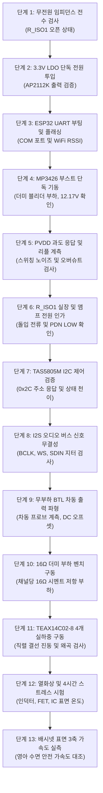

# [DOC05] MAJN PCB #0006 종합 검증 계획서
(PCB #0006 Comprehensive Validation & Test Plan)

- **문서 식별자**: `DOC05_PCB0006_VALIDATION_PLAN`
- **리비전**: v1.0
- **작성 일자**: 2026-11-02
- **적용 대상**: MAJN 시제품 PCB #0006 하드웨어 브링업(Bring-up), 신뢰성 시험, 배시넷 표면 실측

---

## 1. 개요 및 계측 기본 안전 수칙

본 문서는 MAJN PCB #0006 초도 기판의 안전한 기동과 성능 검증을 위한 **13단계 엔드투엔드(End-to-End) 검증 파이프라인**을 규정한다.

> [!CAUTION]
> **하드웨어 계측 3대 절대 금기 사항 (Golden Safety Rules)**
> 1. **BTL 출력 대지 접지 직결 절대 금지**: TAS5805M의 BTL 출력 핀(`OUT_A+`, `OUT_A-`, `OUT_B+`, `OUT_B-`)에 오실로스코프 프로브의 악어 접지 클립(GND Clip)을 절대로 연결하지 마십시오. 대지 접지를 통해 내부 Low-Side FET가 단락되어 앰프가 즉시 영구 파괴됩니다.
> 2. **도통 비프음(Beep) 맹신 금지**: 멀티미터 도통 모드는 통상 $50\,\Omega$ 이하의 저항에서 경보음이 울립니다. 쇼트 여부를 판단할 때는 반드시 저항 측정 모드($\Omega$)로 전환하고 리드선 자체 저항($\approx 0.1 \sim 0.2\,\Omega$)을 감산하여 판정하십시오.
> 3. **격리 점퍼(`R_ISO1`) 미검증 상태 통전 금지**: 부스트 컨버터(MP3426)의 승압 전압 안정성이 검증되기 전에는 `R_ISO1`을 연결하여 TAS5805M에 전원을 인가하지 마십시오.

---

## 2. 13단계 하드웨어 검증 파이프라인

---

## 3. 단계별 검증 상세 절차 및 합격 기준

### 단계 1: 무전원 임피던스 전수 검사 (Unpowered In-Circuit Impedance)
- **사전 조건**: 전원 미연결, `R_ISO1` 미실장(Open).
- **측정 방법**: 디지털 멀티미터를 저항($\Omega$) 모드로 설정하고 주요 노드 접지 임피던스 측정.
- **합격 기준**:
  - `TP_VBUS` ↔ GND: $> 100\,\text{k}\Omega$
  - `TP_3V3` ↔ GND: $> 10\,\text{k}\Omega$ (초기 커패시터 충전 후)
  - `TP_PVDD_BOOST` ↔ GND: $1.5\,\text{k}\Omega \pm 2\%$ (`R_BLEED` 저항값과 일치)
  - `TP_PVDD_AMP` ↔ GND: $> 50\,\text{k}\Omega$ (오픈 상태)
  - BTL 출력 패드(`OUT_A+/-`, `OUT_B+/-`) ↔ GND: $> 100\,\text{k}\Omega$

### 단계 2: 3.3V LDO 단독 전원 투입 (Logic Power Bring-Up)
- **인가 전원**: 실험실 파워서플라이 $5.0\text{V}$, 전류 제한(CC) $200\text{mA}$ 설정 후 USB VBUS 인입. (부스트 EN 핀 LOW 고정)
- **계측 지점**: `TP_3V3`
- **합격 기준**: 전압 $3.30\text{V} \pm 2\%$ ($3.23\text{V} \sim 3.37\text{V}$), 대기 전류 $< 30\text{mA}$.

### 단계 3: ESP32 부팅 및 펌웨어 플래싱 (MCU & Flashing)
- **인가 전원**: USB-C 케이블 연결 (PC 호스트 연결).
- **수행 절차**: `esptool.py`를 이용한 칩 ID 리드 및 최신 펌웨어 플래싱.
- **합격 기준**: MAC 주소 정상 반환, 8MB Flash 정상 인식, UART 115200bps 부팅 로그 출력, Wi-Fi Station 모드 기동.

### 단계 4: MP3426 부스트 컨버터 단독 기동 (Standalone Boost Test)
- **필수 안전 조건**:
  1. `R_ISO1` 미실장 (TAS5805M 앰프와 물리적으로 완전 격리).
  2. `R_BLEED` ($1.5\text{k}\Omega$ 1/4W) 실장 확인.
  3. 파워서플라이 5V 인가 시 초기 전류 제한 **$300\text{mA}$** 설정.
  4. 오실로스코프로 `TP_PVDD_BOOST` 전압을 트리거 모드로 실시간 감시.
- **합격 기준**:
  - 출력 전압: $12.17\text{V} \pm 3\%$ ($11.80\text{V} \sim 12.54\text{V}$).
  - 무부하 입력 대기 전류: $< 35\text{mA}$ (블리더 전류 $\approx 8\text{mA}$ 포함).
  - 콜드 플러그(Cold-plug) 시 전압 오버슈트 피크: $< 13.5\text{V}$.

### 단계 5: PVDD 전원 라인 과도 응답 및 리플 계측
- **계측 장비**: $100\text{MHz}$ 이상 오실로스코프 (AC 커플링, $20\text{MHz}$ 대역폭 제한 모드, 팁 스프링 그라운드 프로브 사용).
- **합격 기준**: 스위칭 주파수($1.2\text{MHz}$) 리플 전압 $V_{\text{ripple, p-p}} \le 120\text{mV}$.

### 단계 6: R_ISO1 실장 및 TAS5805M PVDD 전원 인가
- **수행 절차**:
  1. 보드 전원 완전 차단 및 잔류 전하 방전 확인.
  2. `R_ISO1` 패드에 $0\,\Omega$ (2512) 점퍼 또는 $20\text{m}\Omega$ 션트 저항 납땜.
  3. 파워서플라이 5V, 전류 제한 **$1.0\text{A}$** 설정 후 전원 투입.
  4. ESP32는 TAS5805M `PDN` 핀을 강제 LOW로 유지.
- **합격 기준**:
  - `PDN = LOW` 대기 시 전체 보드 소비 전류 $< 60\text{mA}$.
  - `TP_PVDD_AMP` 전압 $12.17\text{V} \pm 3\%$ 정상 전달 확인.

### 단계 7: TAS5805M I2C 제어 및 상태 머신 검증
- **수행 절차**:
  1. ESP32 GPIO를 구동하여 `PDN = HIGH` (3.3V) 인가.
  2. I2C 버스 스캔 수행 (`Wire.beginTransmission(0x2C)`).
  3. TAS5805M 제어 레지스터 시퀀스 전송: `Deep Sleep` $\to$ `Hi-Z` $\to$ `PLAY` (Book 0x00, Page 0x00, Reg 0x03).
- **합격 기준**:
  - I2C `0x2C` 슬레이브 ACK 응답 확인.
  - 레지스터 0x03 판독 시 현재 상태 `0x03` (PLAY) 반환.
  - Fault 레지스터(0x70 ~ 0x73) 판독 시 전원 저전압/과전압/단락 플래그 전무 (`0x00`).

### 단계 8: I2S 오디오 버스 신호 무결성 검증
- **계측 지점**: `TP_BCK`, `TP_WS`, `TP_SDIN`.
- **합격 기준**:
  - BCLK 주파수: $1.536\text{MHz} \pm 0.1\%$ ($32\text{fs} \times 48\text{kHz}$).
  - WS 주파수: $48.0\text{kHz} \pm 0.1\%$.
  - 클록 신호의 링잉 및 오버슈트 $< 10\%$, 로직 레벨 $V_{\text{OH}} \ge 2.8\text{V}, V_{\text{OL}} \le 0.4\text{V}$.

### 단계 9: 무부하 BTL 차동 출력 파형 검사 (Diff Probe Only)
- **계측 방법**: **고전압 차동 프로브(Differential Probe)** 또는 오실로스코프 2채널 연산 모드($\text{CH1} - \text{CH2}$, 각 채널 접지선은 `TP_GND_REF`에 연결).
- **인가 신호**: $100\text{Hz}$ Sine Wave 디지털 음원 전송.
- **합격 기준**:
  - 차동 출력 DC 오프셋 전압 $|V_{\text{DC, diff}}| \le 50\text{mV}$.
  - 차동 AC 정현파 진폭 정상 증폭 확인, 파형 클리핑 없음.

### 단계 10: 16Ω 더미 저항 부하 벤치 구동 검사
- **부하 연결**: 채널 A 및 채널 B에 $16\,\Omega$ 시멘트/권선 저항($5\text{W}$급) 연결.
- **인가 신호**: $100\text{Hz}$ 정현파 $-3\text{dBFS}$ 연속 5분 구동.
- **합격 기준**:
  - 채널당 실효 출력 전력 $P_{\text{RMS}} \approx 3.4\text{W} \pm 10\%$.
  - 총 VBUS 입력 전류 $\le 1.8\text{A}$ ($5\text{V}$ 기준 총 소비전력 $< 9.0\text{W}$).
  - THD+N $< 1.0\%$ (오디오 아날라이저 또는 스펙트럼 분석 기준).

### 단계 11: TEAX14C02-8 4개 실하중 구동 검사
- **부하 연결**: Channel A (진동자 1+2 직렬 $16\Omega$), Channel B (진동자 3+4 직렬 $16\Omega$) 결선.
- **인가 신호**: 핑크 노이즈 및 배시넷 아기 달래기 사운드 프로파일 구동.
- **합격 기준**:
  - 4개 진동자 모두 정상 기계적 진동 발생, 래틀(Rattle) 또는 비정상 잡음 없음.
  - BTL 출력 클램프 다이오드 양단 스파이크 전압 $\le 12.8\text{V}$.

### 단계 12: 열화상 및 4시간 스트레스 신뢰성 시험
- **시험 조건**: $25^\circ\text{C}$ 상온 챔버, 정격 진동 모드 4시간 연속 운용.
- **계측 장비**: 열화상 카메라(FLIR)로 30분 간격 온도 기록.
- **합격 기준**:
  - U3 MP3426 표면 온도 $\le 75^\circ\text{C}$.
  - L1 인덕터 표면 온도 $\le 70^\circ\text{C}$.
  - U4 TAS5805M 케이스 온도 $\le 65^\circ\text{C}$.
  - D3 쇼트키 다이오드 온도 $\le 75^\circ\text{C}$.

### 단계 13: 배시넷 표면 3축 가속도 실측 및 안전 기준 대조
- **센서 부착**: 배시넷 매트리스 중앙 표면에 정밀 3축 가속도계 부착.
- **계측 물리량**: $10\text{Hz} \sim 50\text{Hz}$ 주파수 대역 내 3축 RMS 가속도($g_{\text{rms}}$).
- **합격 기준**:
  - 매트리스 표면 RMS 가속도 $a_{\text{RMS}} \le 0.1\text{ g}$ (영아 뇌 흔들림 증후군 방지 안전 상한선 준수).
  - 목재 프레임 공진에 의한 이상 고주파 충격 피크 배제.

---

## 4. 전기적 동작 검증과 아기 달래기 임상 효과의 분리 원칙

> [!IMPORTANT]
> **검증 도메인 격리 원칙 (Domain Isolation Principle)**
> 1. **호스트 단위 테스트(92/92 통과)의 한계**: 파서 및 로직 테스트 통과는 C++ 소스 코드의 문법과 명령 디코딩 알고리즘의 무결성을 증명할 뿐, 실물 반도체의 동작이나 스위칭 신뢰성을 대변하지 않는다.
> 2. **전기적 하드웨어 브링업(12V 승압 및 오디오 출력)의 한계**: 회로가 전기적으로 정상 구동되고 진동자가 떨린다는 사실이 영아 달래기 효과나 수면 유도 안전성을 임상적으로 입증하는 것은 아니다.
> 3. **임상 및 제품화 안전 검증의 독립성**: 전기적 검증(단계 1~12) 완료 후, 반드시 소아과 및 의공학적 기준에 입각한 생체 신호 연동 및 표면 진동 전달률 평가(단계 13)를 별개의 검증 프로세스로 수행해야 한다.
