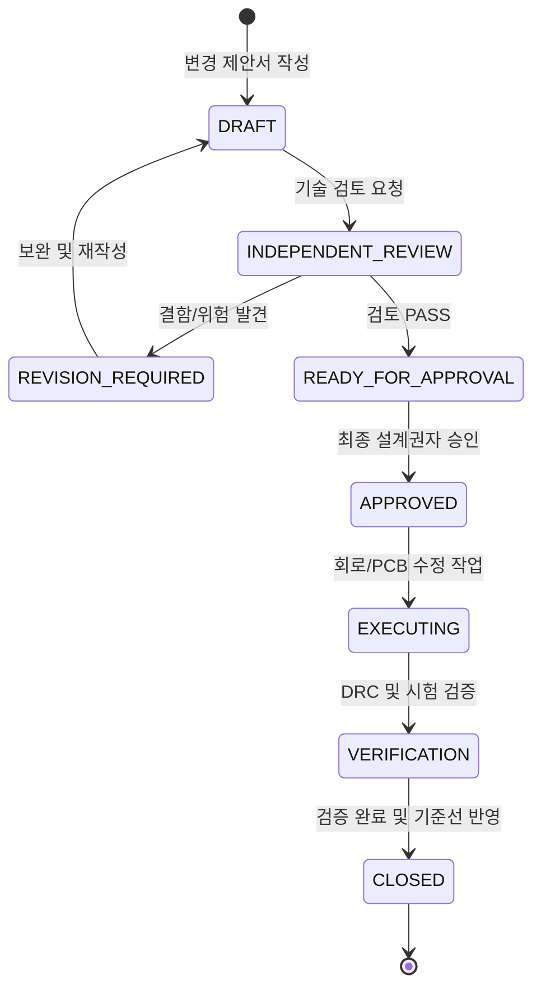

# [ECO 프로세스] MAJN 스마트 배시넷 — 엔지니어링 변경 관리(ECO) 표준 규정
(MAJN Engineering Change Order (ECO) Lifecycle & Process Standard)

- **문서 식별자**: `MAJN_ENGINEERING_CHANGE_PROCESS`
- **리비전**: v1.0
- **작성 일자**: 2026-11-05
- **책임 주체**: Antigravity (시스템 엔지니어링 에이전트)

---

## 1. 개요 및 변경 관리 원칙

승인된 기준선(Baseline) 이후에 발생하는 모든 회로도 수정, 부품 교체, PCB 패턴 변경, 펌웨어 핀맵 수정은 **엔지니어링 변경 명령(ECO: Engineering Change Order)** 절차를 거치지 않고는 적용될 수 없다.

---

## 2. 6단계 ECO 라이프사이클 상태 머신

---

## 3. ECO 필수 기록 양식 (ECO Template)

모든 ECO 문서는 `docs/engineering/eco/`에 저장되며 다음 항목을 필수로 포함한다:

1. **ECO 번호**: `ECO-0006-XXX` (일련번호).
2. **변경 제목**: 변경 내용의 1줄 요약.
3. **변경 배경 및 이유 (Reason for Change)**: 고장 해결, 원가 절감, 규제 충족 등 명확한 공학적 근거.
4. **변경 전후 대조 (Before vs After)**:
   - 변경 전 상태 (회로도 넷, 부품 사양, 핀 번호).
   - 변경 후 제안 상태.
5. **다차원 영향 분석 (Multi-domain Impact Analysis)**:
   - 상/하류 회로 영향 (전원 부하, 리플, 노이즈).
   - 기구적 간섭 영향 (높이, 커넥터 위치, 하우징).
   - 펌웨어 드라이버 영향 (핀 번호, 시퀀싱, 타이밍).
   - EMC 및 안전 규제 영향.
6. **검증 방법 및 합격 기준**:
   - 수행할 시뮬레이션 또는 실측 테스트 케이스(TC-ID).
7. **적용 커밋 및 SHA-256 해시**:
   - 변경이 반영된 Git 커밋 해시.
8. **최종 서명**: Chief Engineering Authority 승인 일시.
