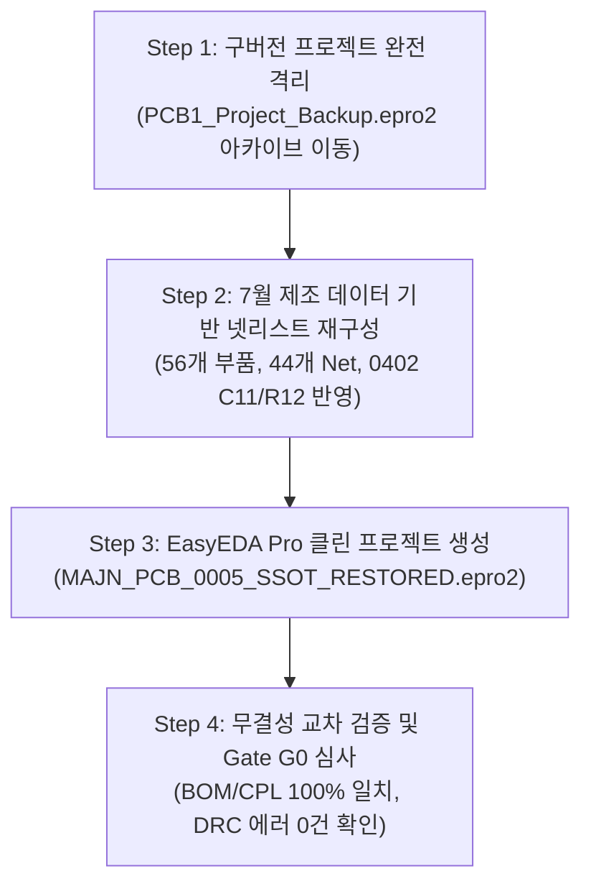

# [실행 계획서] MAJN PCB #0005 — 단일 SSOT 프로젝트 복원 계획서
(MAJN PCB #0005 SSOT Project Restoration Plan)

- **문서 식별자**: `MAJN_PCB_0005_SSOT_RESTORATION_PLAN`
- **리비전**: v1.0
- **작성 일자**: 2026-11-05
- **책임 주체**: Antigravity (시스템 엔지니어링 에이전트)
- **적용 대상**: Prototype #0005 EDA 프로젝트 복원

---

## 1. 배경 및 복원 목적

11월 5일 추출된 회로도/넷리스트가 37개 부품 결함 상태로 역행했던 치명적 원인은, EasyEDA Pro 에디터 상에 6월 24일 자 구버전 프로젝트가 남아있었기 때문이다. 본 계획서는 **6월 구버전 프로젝트를 안전하게 격리하고, 7월 9일 실제 SMT 발주 데이터(56개 부품, 4층 거버, 단일면 CPL)와 100% 일치하는 클린 프로젝트(`MAJN_PCB_0005_SSOT_RESTORED`)를 복원**하는 체계적 절차를 수립한다.

---

## 2. 4단계 복원 절차

### 2.1 Step 1: 구버전 프로젝트 완전 격리
* **대상 파일**: `인증준비/mcp_development/PCB1_Project_Backup.epro2` 및 `project_backups/` 내 6월 파일들.
* **조치**: 
  - 신규 격리 디렉토리 `legacy_archive_202606_deprecated/` 생성.
  - 구버전 백업 파일을 해당 격리 폴더로 이동하여, 에디터 및 자동화 스크립트가 실수로 참조하는 경로를 원천 차단함.
  - 절대 기존 파일을 삭제하거나 덮어쓰지 않고 이력을 보존함.

### 2.2 Step 2: 7월 제조 데이터 기반 넷리스트 및 심볼 동기화
* **기준 소스**: `BOM_PCB1_revB_2026-07-09.csv` + `CPL_PCB1_revB_2026-07-09.csv` + `A_mcp_design_flow_v1.9.2_2026-07-08.json`.
* **정정 사항 반영**:
  - `U1`: 심볼명 `ESP32-WROOM-32UE`, LCSC `C701345`, 풋프린트 `SMD-ESP32-WROOM-32UE` 확정.
  - `C11`: 0402 패키지 (`C1525`, 100nF)로 동기화.
  - `R12`: Top면 0402 패키지 (`C25900`, 4.7kΩ)로 동기화.
  - `FB1~FB4`: 0805 비드 4개 및 `C24~C27` 출력 필터 캡 완전 복원.
  - `U3 (MP3426)`: R9(FSET), R10/C22(COMP), C21(VDD) 결선 복원.
  - `U4 (TAS5805M)`: VR_DIG(C20), AVDD(C19) LDO 바이패스 캡 결선 복원.

### 2.3 Step 3: EasyEDA Pro 클린 프로젝트 생성 (`MAJN_PCB_0005_SSOT_RESTORED`)
* 신규 프로젝트 명: **`MAJN_PCB_0005_SSOT_RESTORED`**.
* 구성 요소:
  1. 회로도 (`.sch`): 56개 부품 완비, 페이지 단일화, 넷 라벨 완전 정합.
  2. PCB 아트워크 (`.pcb`): 4층 구조(Top, GND Inner1, VCC Inner2, Bottom), 단일면 SMT 56개 배치, 7월 9일 CPL 좌표 적용.
* 보존 방식: 작업 완료 즉시 `.epro2` 아카이브로 내보내어 SHA-256 해시를 동결함.

### 2.4 Step 4: 무결성 교차 검증 및 Gate G0 심사
* **자동 검증 도구 구동**:
  - `tools/pcb_verification/bom_cpl_comparator.py`: 56개 Designator, 패키지, 좌표 일치율 100% 검증.
  - `tools/pcb_verification/gerber_integrity_checker.py`: 4층 거버 무결성 확인.
* **EasyEDA 내부 검증**:
  - 내장 DRC (Design Rule Check): 쇼트/클리어런스 에러 0건 확인.
  - ERC (Electrical Rule Check): 미연결 핀, 전원 충돌 에러 0건 확인.

---

## 3. 복원 완료 및 Gate G0 통과 기준

1. [ ] 에디터 상에서 내보낸 넷리스트가 56개 부품, 44개 Net과 100% 일치할 것.
2. [ ] 11월 5일 추출본에서 발생했던 저항 매핑 결함(L1/D3) 및 플로팅 핀이 완전히 해소될 것.
3. [ ] 복원 프로젝트의 SHA-256 해시가 마스터 로그북에 공식 등재될 것.
4. [ ] 본 기준선은 PCB #0005 상태를 정의하는 것이며, 차기 #0006 변경은 별도 브랜치/프로젝트에서 수행할 것.
