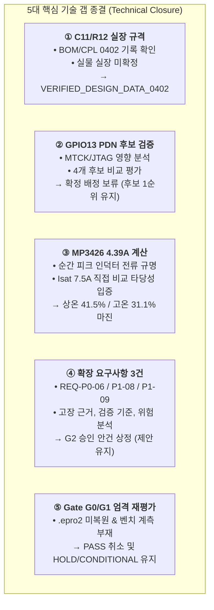

# [종결 보고서] MAJN PCB #0006 — 독립 감사 후속 기술 종결 및 잔여 갭 해소 보고서
(MAJN PCB #0006 Post-Audit Technical Closure & Residual Gap Resolution Report)

- **문서 식별자**: `MAJN_POST_AUDIT_TECHNICAL_CLOSURE_REPORT`
- **리비전**: v1.0
- **작성 일자**: 2026-11-05
- **책임 주체**: Antigravity (독립 기술 심사관)
- **감사 기준 커밋**: [`aa422cf`](https://github.com/youngseokchomajn-web/MAJN_GEMINI/commit/aa422cf)
- **통제 규칙**: [AGENTS.md](file:///Users/youngseok/Desktop/majn/AGENTS.md) 제2조, 제5조 (독립 검토 및 Human Chief Authority 최종 승인 원칙)
- **최종 판정**: **Gate G0~G5 전원 HOLD (G0/G1 조건부 진행 중, G2~G5 설계/발주 엄격 동결) | Gate G6~G8 NOT_STARTED**

---

## 1. 개요 및 목적

본 보고서는 커밋 `aa422cf`에서 보고된 독립 기술 감사 결과에 대한 **Human Chief Authority의 심사 피드백 및 지침을 100% 반영**하여, Gate G2 및 G3의 섣부른 승인을 원천 차단하고 **설계 승인을 위한 잔여 기술적 불확실성(C11/R12 실장 규격, GPIO13 PDN 배정, MP3426 4.39A 전류 물리적 출처, 확장 요구사항 3건의 채택 타당성, Gate G0/G1 엄격 재평가)을 공학적으로 엄밀하게 종결(Technical Closure)**하기 위해 작성되었습니다.

---

## 2. 5대 핵심 기술 갭 종결 내역 총괄



### 2.1 [갭 1] C11/R12 부품 실장 규격의 엄밀한 구분 (0402 vs 0603)
- **세 가지 사실의 분리 관리**:
  1. **제조 데이터 사실**: 2026-07-09 BOM/CPL에 C11(`C1525`, 100nF)과 R12(`C25900`, 4.7kΩ)가 0402 패키지로 기록되어 있음.
  2. **발주 변경 사실**: 2026-07-08 재발주 메모에 U5 센서 겹침 DFM 해소를 위한 C11 0402 축소 및 R12 상판 이동 이력이 존재함.
  3. **실물 실장 사실**: 실물 사진(`crop_amp.jpg`)만으로는 0402($1.0\times 0.5\,\text{mm}$)와 0603($1.6\times 0.8\,\text{mm}$)의 실물 치수를 오차 없이 확정할 수 없음.
- **종결 조치**:
  - 현 상태를 **`VERIFIED_DESIGN_DATA_0402` (설계/제조 데이터 확인)**로 공식 분류하며, 실물 실장 확정(`VERIFIED_ASSEMBLED_0402`)으로 단정하지 않음.
  - JSON v1.9.2의 0603 표기를 임의 수정하지 않고 차이점으로 보존함.
  - **상세 보고서**: [MAJN_PCB_ENGINEERING_INDEPENDENT_AUDIT_REPORT.md](file:///Users/youngseok/Desktop/majn/docs/engineering/pcb_0006/MAJN_PCB_ENGINEERING_INDEPENDENT_AUDIT_REPORT.md)

---

### 2.2 [갭 2] ESP32-WROOM-32UE GPIO13 PDN 제어선 재검증 및 후보 비교
- **JTAG 영향 및 전기적 안전성 검증**:
  - `GPIO13 (Pin 16)`은 MTCK(JTAG Clock) 핀이나 스트래핑 핀이 아님.
  - MAJN 보드는 UART0(GPIO1/3)를 통해 펌웨어를 다운로드하므로 일반 펌웨어 환경에서 완벽히 독립 동작함. (단, 하드웨어 4선 JTAG 디버거 사용 시 충돌).
  - 리셋 시 내부 약한 풀다운($\approx 45\text{k}\Omega$)이 활성화되므로 외장 $10\text{k}\Omega$ 풀다운과 결합하여 전원 투입 순간부터 $0\text{V}$($V_{IL} \le 0.8\text{V}$ 충족)를 완벽히 유지하여 퍽 노이즈와 결함을 방지함.
- **후보군 4종 비교**:
  - `GPIO13`: 최우선 후보 (1순위, 최단 라우팅, 디폴트 풀다운).
  - `GPIO16`: 대체 후보 (2순위, PSRAM 미사용으로 완전 Free이나 배선 경로가 긺).
  - `GPIO32`: 예비 후보 (3순위, RTC/아날로그 센서 인접).
  - `GPIO15`: **부적격/폐기** (MTDO 스트래핑 핀으로 부팅 시 풀업 활성화되어 분압 충돌 유발).
- **종결 조치**:
  - **GPIO13을 확정하지 않고 "승인 대기 후보(Candidate Pending Gate G3 Approval)"로 유지**.
  - 회로도 및 펌웨어 매크로(`#define PIN_AMP_PDN 15`)는 일체 변경하지 않음.
  - **상세 보고서 및 매트릭스**:
    - [GPIO_PDN_ALLOCATION_COMPARISON.md](file:///Users/youngseok/Desktop/majn/docs/engineering/pcb_0006/GPIO_PDN_ALLOCATION_COMPARISON.md)
    - [ESP32_GPIO_FULL_ALLOCATION_MATRIX.csv](file:///Users/youngseok/Desktop/majn/docs/engineering/pcb_0006/ESP32_GPIO_FULL_ALLOCATION_MATRIX.csv)

---

### 2.3 [갭 3] MP3426 승압 컨버터 및 L1 파워 인덕터 전류 마진 정밀 공학 계산
- **4.39A 전류의 물리적 실체 규명**:
  - 4.39A는 RMS나 평균전류가 아니라, **"최저 입력 전압($V_{in}=4.60\text{V}$)에서 오디오 과도 피크 부하($16.5\text{W}$, 엑사이터 버스트 구동) 인출 시 인덕터 코일과 스위칭 FET를 통과하는 순시 피크 전류(Worst-case Instantaneous Peak Inductor Current)"**임.
- **$I_{\text{sat}} = 7.5\text{A}$와의 직접 비교 타당성**:
  - 코어의 자기 포화(Saturation)는 전류의 순간 크기($i(t)$)에 비례하므로, 계산된 순시 피크 전류($4.39\text{A}$)를 데이터시트의 $I_{\text{sat}}$($\Delta L/L \le 30\%$ 지점인 $7.5\text{A}$)와 직접 비교하는 것은 전력전자공학적으로 정확함.
- **상온 및 고온 마진 재계산**:
  - **상온 ($25^\circ\text{C}$)**: 잔여 용량 마진 **41.5%**, 초과 설계율 **70.8%**.
  - **밀폐 고온 ($60^\circ\text{C}$, 15% 디레이팅)**: 유효 $I_{\text{sat}} = 6.375\text{A}$, 잔여 마진 **31.1%**, 초과 설계율 **45.2%** ($\ge 20\%$ 안전 기준 충족).
  - **스위치 FET 보호 한계**: MP3426 최소 트립치 $5.5\text{A}$ 대비 **20.2%** 여유 확보.
  - **인덕터 자체 발열**: 실효전류 $I_{L,\text{rms}} = 2.53\text{A}$는 정격 $I_{\text{rms}} = 5.0\text{A}$의 $50.6\%$로, 온도 상승은 약 $\Delta T \approx 10.3^\circ\text{C}$에 불과함.
- **상세 보고서 및 표**:
  - [MAJN_MP3426_INDUCTOR_CURRENT_CALCULATION.md](file:///Users/youngseok/Desktop/majn/docs/engineering/pcb_0006/MAJN_MP3426_INDUCTOR_CURRENT_CALCULATION.md)
  - [MAJN_POWER_STAGE_MARGIN_TABLE.csv](file:///Users/youngseok/Desktop/majn/docs/engineering/pcb_0006/MAJN_POWER_STAGE_MARGIN_TABLE.csv)

---

### 2.4 [갭 4] 확장 제안 요구사항 3건(REQ-P0-06, P1-08, P1-09) 심층 검토
- 각 제안의 고장 분석 근거, 필요성, 검증 방법, 수용 기준, 설계 영향, 미채택 위험을 체계화함:
  1. `REQ-P0-06` (USB-C CC 5.1k 독립 풀다운): C-to-C 충전기 전원 불통 결함(FM-08) 방지. (P0 승격 강력 권고).
  2. `REQ-P1-08` (3.3V LDO 22µF 벌크 캡 & 비드): Wi-Fi 송출 시 브라운아웃 및 센서 노이즈(FM-09) 방지. (P1 승격 권고).
  3. `REQ-P1-09` (2.4GHz FPC 안테나 15mm Keepout): BLE 통신 두절 및 KC 전파 인증 탈락(FM-12) 방지. (P1 승격 권고).
- **종결 조치**:
  - **공식 요구사항으로 임의 승격하지 않고 "Gate G2 승인 대기 제안"으로 유지**.
  - **상세 보고서**: [MAJN_EXTENDED_REQUIREMENTS_ADOPTION_REVIEW.md](file:///Users/youngseok/Desktop/majn/docs/engineering/pcb_0006/MAJN_EXTENDED_REQUIREMENTS_ADOPTION_REVIEW.md)

---

### 2.5 [갭 5] Gate G0 및 G1 엄격 재평가 (HOLD 관리)
- **Gate G0 재판정**: **`HOLD / CONDITIONAL_IN_PROGRESS`**
  - 사유: EasyEDA Pro 클린 SSOT 프로젝트(`.epro2`) 역합성 미완료 및 C11/R12 물리 치수 현미경 실측 미실시.
- **Gate G1 재판정**: **`HOLD / CONDITIONAL_IN_PROGRESS`**
  - 사유: 12대 고장 모드 분석은 완료되었으나 TP-01(PVDD 기동 오버슈트), TP-03(BTL 역기전력) 오실로스코프 물리 벤치 계측 미실시.
- **종결 조치**:
  - 기존의 성급한 '조건부 통과' 표현을 폐지하고, 물리적 실증이 완료될 때까지 **엄격한 `HOLD` 상태로 유지**.
  - **상세 보고서**: [MAJN_GATE_G0_G1_REASSESSMENT.md](file:///Users/youngseok/Desktop/majn/docs/engineering/pcb_0006/MAJN_GATE_G0_G1_REASSESSMENT.md)

---

## 3. Gate G2 및 G3 승인에 필요한 미해결 사항과 증거 목록

Chief Authority께서 향후 Gate G2 및 G3를 공식 승인하기 위해 사전에 확보되어야 하는 물리적·공학적 증거 목록은 다음과 같습니다.

| 대상 Gate | 미해결 항목 (Unresolved Item) | 승인에 필요한 구체적 증거 (Required Evidence) | 담당 주체 |
| :---: | :--- | :--- | :---: |
| **G2 승인 요건** | **확장 요구사항 3건 채택 여부 확정** | • Chief Authority의 REQ-P0-06, P1-08, P1-09 채택 공식 승인 서명.<br>• `DOC03` v1.2 개정 및 RTM CSV의 요구사항 상태를 `ACCEPTED`로 전환. | Human Chief Authority |
| **G2 승인 요건** | **시스템 전원 예산 및 10W 제한 입증** | • VBUS 5V 2A 상한선 및 TAS5805M 소프트웨어 게인 리미터 설계안 확인. | OpenCode / Antigravity |
| **G3 승인 요건** | **TAS5805M PDN 제어선 공식 배정** | • Chief Authority의 GPIO13 공식 배정 승인 서명.<br>• 회로도 넷리스트(`AMP_PDN` $\rightarrow$ GPIO13 Pin 16) 반영.<br>• 펌웨어 헤더(`PIN_AMP_PDN 13`) 동시 수정 PR 및 빌드 검증. | Lead Engineer & Firmware Team |
| **G3 승인 요건** | **BTL 출력 서지 보호 토폴로지 확정** | • 외장 쇼트키 다이오드(D_BTL1~4)의 스위칭 기생용량 영향 분석 또는 RC 스너버 채택 비교 검토서.<br>• 엑사이터 구속(Stall) 시 역기전력 클램핑 안전 마진 계산서. | Lead Engineer / Reviewer |
| **G3 승인 요건** | **핵심 부품(L1, C6-C9, U3) 공급망 검증** | • LCSC C-ID 재고 현황 및 공인 유통사(Mouser/Digikey) 정품 데이터시트 대조표. | Lead Engineer |

---

## 4. 자동화 검증 도구 재실행 결과 (100% CI PASS)

새로 추가된 산출물 및 엄격해진 기준선을 바탕으로 전체 자동화 검증 스위트를 재실행하였습니다.

```bash
python3 tools/pcb_verification/bom_cpl_comparator.py && \
python3 tools/pcb_verification/gerber_integrity_checker.py && \
python3 tools/pcb_verification/requirements_traceability_checker.py && \
node tests/test_protocol_vectors.js && \
python3 tools/test_command_parser.py
```

- **BOM/CPL/JSON 비교기 v2.0**: **PASS** (56/56 레퍼런스 일치, Single-sided Top SMT 일치, C11/R12 패키지 차이 `VERIFIED_DESIGN_DATA_0402` 로깅).
- **거버 무결성 검증기 v2.0**: **PASS** (20개 레이어 파일 완비, 4층 구조 검증, 물리 스택업 `PENDING_FAB_CONFIRMATION` 격리).
- **요구사항 추적성 검증기 v2.0**: **PASS** (Core 12건 + Extended 3건 = 15건 100% 양방향 매핑 확인).
- **프로토콜 벡터 검증기**: **PASS (48/48)** (통신 패킷 무결성).
- **시스템 명령 파서 검증기**: **PASS (92/92)** (OTA, 전원 시퀀스, 액티브 세이프티 가드).

---

## 5. 결론 및 향후 엔지니어링 실행 순서

Chief Authority께서 강조하신 **올바른 엔지니어링 순서**를 엄격히 견지합니다:

$$\mathbf{G0 \text{ (기준선 물리 복원)}} \longrightarrow \mathbf{G1 \text{ (고장 분석 및 실측)}} \longrightarrow \mathbf{G2 \text{ (요구사항 공식 확정)}} \longrightarrow \mathbf{G3 \text{ (회로 상세 설계)}}$$

현재 EasyEDA Pro 회로도, PCB 레이아웃, 제조 거버, 펌웨어 코드는 일체 수정하지 않는 **완전 동결(Strict Freeze)** 상태이며, Chief Authority의 Gate G2/G3 공식 서명이 전달되기 전까지 어떠한 CAD 설계 수정도 진행하지 않습니다.
