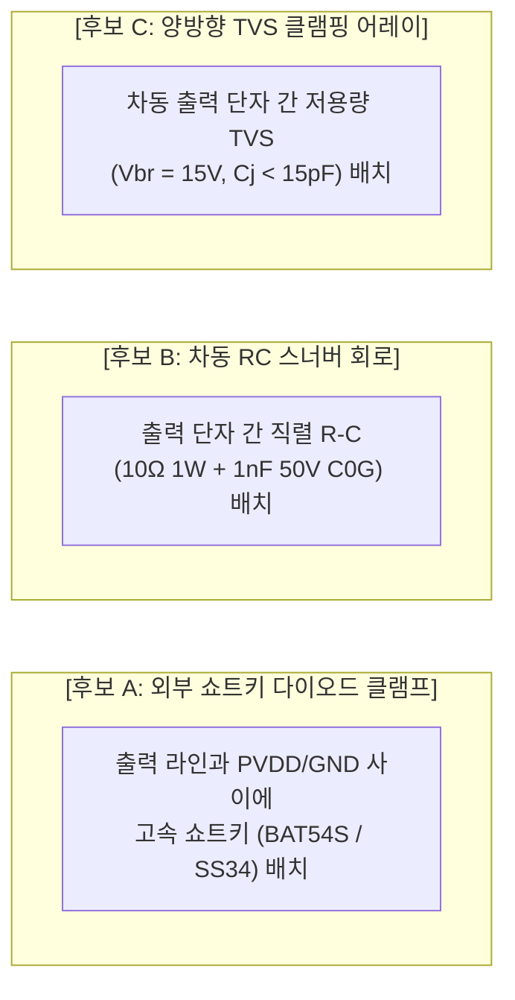

# [오디오 출력 및 보호 검토서] MAJN PCB #0006 — TAS5805M BTL 출력단 및 유도성 역기전력 보호 검토서
(MAJN PCB #0006 Audio Output & BTL Back-EMF Protection Review)

- **문서 식별자**: `PCB_0006_AUDIO_OUTPUT_AND_PROTECTION_REVIEW`
- **리비전**: v1.0
- **작성 일자**: 2026-11-05
- **책임 주체**: Antigravity (시스템 엔지니어링 에이전트)
- **적용 대상**: TAS5805M 앰프 BTL 출력단 및 TEAX14C02-8 익사이터 인터페이스

---

## 1. 개요 및 BTL 출력의 특수성

TAS5805M은 단일 전원(PVDD 12V)에서 스피커 부하 양단을 차동으로 스위칭 구동하는 **BTL(Bridge-Tied Load)** 구조를 갖는다. BTL 출력의 정지 상태(Mute/Idle) 직류 바이어스는 약 $+6.0\text{V}_{\text{DC}}$이며, 접지(GND) 기준이 아닌 두 출력 단자 간의 차동 전압($V_{\text{OUT+}} - V_{\text{OUT-}}$)으로 음향 신호를 인가한다.

부하로 사용되는 TEAX14C02-8 익사이터는 기계적 진동판을 구동하는 **유도성 음성 코일(Voice Coil)**이므로, 급격한 출력 차단 또는 고출력 스위칭 시 역기전력($V = -L \cdot di/dt$) 킥백이 발생하여 H-Bridge 내부 MOSFET을 위협할 수 있다.

---

## 2. 부하 모델 및 유도성 파라미터 실측값

* **단품 익사이터 (TEAX14C02-8)**:
  - 공칭 직류 저항 (DCR bare): $10.8\ \Omega$ ($\pm 5\%$).
  - 하네스 포함 직류 저항: $12.4\ \Omega$.
  - 음성 코일 인덕턴스 ($L$): 공칭 $0.18\text{ mH}$ (@1kHz).
* **차기 4-익사이터 2S2P 결선 모델**:
  - 결선: 2개 직렬($10.8 + 10.8 = 21.6\ \Omega$) 한 쌍 2개를 병렬 연결.
  - 합성 직류 저항: $R_{\text{total}} = 21.6\ \Omega / 2 = \mathbf{10.8\ \Omega}$ (하네스 포함 시 약 $\mathbf{12.4\ \Omega}$).
  - 주파수 의존성: 40Hz ~ 80Hz 진동 대역에서는 유도성 리액턴스($X_L = 2\pi f L$)의 영향이 $0.1\ \Omega$ 미만으로 극히 작아 **순수 저항성 부하에 매우 근접함**.
  - 그러나 **고주파 PWM 스위칭(384kHz / 768kHz)** 및 **순간 전원 차단(ESTOP)** 과도 구간에서는 코일의 에너지 축적으로 인한 고전압 스파이크가 발생함.

---

## 3. TAS5805M 내부 보호 기능 vs 외부 보호 회로 토폴로지 비교

### 3.1 토폴로지별 장단점 및 물리적 위험 분석

| 보호 토폴로지 | 보호 메커니즘 | 장점 | 단점 및 위험 요소 (Pitfalls) | 판정 |
|:---|:---|:---|:---|:---:|
| **후보 A: 외부 쇼트키 (BAT54S 등)** | 서지 전압을 PVDD 및 GND 레일로 바이패스 클램핑 | 클램핑 전압이 명확함 ($V_F \approx 0.4\text{V}$) | • BAT54S 전류 정격(200mA)이 스피커 서지 전류(>1A) 대비 턱없이 부족. • 접합 기생용량($C_j \approx 10\text{pF}$)으로 PWM 고조파 왜곡 발생. • TI 공식 애플리케이션 노트에서 외장 쇼트키 권장하지 않음. | **비권장 (REJECTED)** |
| **후보 B: 차동 RC 스너버 (TI 권장)** | 고주파 링잉 에너지($f_{\text{ring}} > 10\text{MHz}$)를 저항 열로 흡수 감쇄 | • Class-D 스위칭 에지 링잉 완벽 억제. • 기생용량에 의한 앰프 왜곡 없음. • 전자파(EMC) 방사 노이즈 대폭 저감. | • 저항의 전력 소비($P \approx C V^2 f$)로 약간의 발열 발생 (1206 1W 저항 필요). | **최우선 검토 (RECOMMENDED)** |
| **후보 C: 저용량 차동 TVS** | 15V 이상 서지 전압 순간 클램핑 | 과도 킥백 전압 절대 억제 | • 적정 항복전압(13~15V) 및 초저용량 소자 선정 난이도. | **보조 검토** |

---

## 4. TI 공식 가이드 대조 및 내부 보호 기능 확인

* **TAS5805M 내부 보호 회로 (공식 데이터시트)**:
  1. **과전류 보호 (OCP: Overcurrent Protection)**: 각 하이사이드/로우사이드 FET에 집적된 전류 센싱이 $4.5\text{A}$ 초과 시 $100\text{ns}$ 이내에 게이트 구동을 차단(Hi-Z).
  2. **바디 다이오드 정격**: 전력 FET의 기생 바디 다이오드는 메인 채널과 동일한 실리콘 면적을 공유하므로 단시간 서지 전류($>5\text{A}$)를 스스로 견딤.
  3. **과전열 보호 (OTSD)**: 정션 온도 $165^\circ\text{C}$ 초과 시 셧다운.
* **결론 및 독립 Gate 승인 전략**:
  - 임의의 외부 쇼트키 다이오드(BAT54S) 추가는 부품 소손 및 오디오 품질 저하를 유발하므로 **배제**.
  - **차동 RC 스너버($R_s = 10\Omega\ 1206,\ C_s = 1\text{nF}\ 50\text{V}\ \text{C0G}$)**를 앰프 출력단(FB1~4 전단)에 배치하는 방안을 표준으로 설정.
  - 최종 회로도 반영은 **TEAX14C02-8 실물 스코프 파형 계측 후 Gate G3에서 정식 승인**함.
