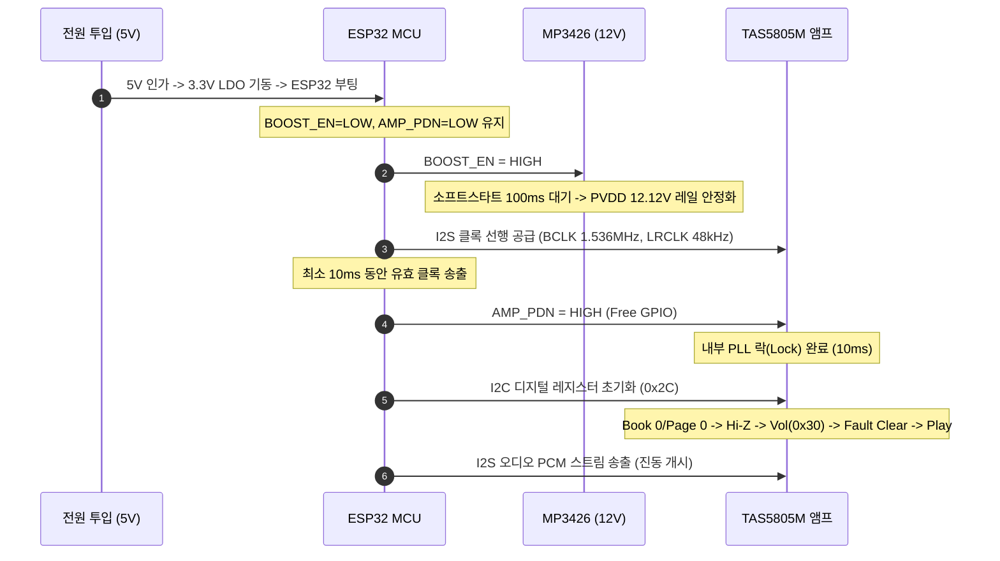

# [인터페이스 명세서] MAJN PCB #0006 — 펌웨어 및 하드웨어 연동 인터페이스 명세서
(MAJN PCB #0006 Firmware & Hardware Interface Specification)

- **문서 식별자**: `PCB_0006_FIRMWARE_HARDWARE_INTERFACE`
- **리비전**: v1.0
- **작성 일자**: 2026-11-05
- **책임 주체**: Antigravity (시스템 엔지니어링 에이전트)
- **적용 대상**: ESP32 펌웨어 (`인증준비/firmware/src/`) 및 PCB #0006

---

## 1. ESP32 핀 할당 총괄표 (Pin Allocation Mapping)

기존 회로의 핀 충돌(GPIO18 SPI_SCLK 충돌 및 GPIO15 부트 스트래핑 간섭)을 완벽히 해소한 공식 핀 매핑:

| 물리 핀 | GPIO 번호 | 넷 명칭 | 신호 방향 | 하드웨어 풀업/다운 | 인터페이스 / 서브시스템 | 비고 및 변경 사항 |
|:---:|:---:|:---|:---:|:---:|:---|:---|
| **Pin 16** | **GPIO13** | `AMP_PDN` | Output | 10kΩ 풀다운 (R13) | TAS5805M Pin 12 (PDN) | **[신규 배정]** GPIO15에서 일반 Free GPIO로 분리 |
| **Pin 26** | **GPIO4** | `BOOST_EN` | Output | 10kΩ 풀다운 (R5) | MP3426 Pin 12 (EN) | 12V 승압 활성화 제어 (디폴트 LOW) |
| **Pin 33** | **GPIO21** | `I2C_SDA` | In/Out | 4.7kΩ 풀업 (R11) | TAS5805M SDA (Pin 1) | 400kHz Fast Mode I2C 버스 |
| **Pin 12** | **GPIO27** | `I2C_SCL` | Output | 4.7kΩ 풀업 (R8) | TAS5805M SCL (Pin 2) | 400kHz Fast Mode I2C 버스 |
| **Pin 10** | **GPIO26** | `I2S_BCLK` | Output | - | TAS5805M Pin 24 (BCLK) | I2S 오디오 비트 클록 (1.536MHz) |
| **Pin 9** | **GPIO25** | `I2S_LRCLK`| Output | - | TAS5805M Pin 25 (LRCLK)| I2S 오디오 워드 셀렉트 (48kHz) |
| **Pin 36** | **GPIO22** | `I2S_DOUT` | Output | - | TAS5805M Pin 26 (SDIN) | I2S 오디오 시리얼 데이터 |
| **Pin 29** | **GPIO5** | `SPI_CS` | Output | 10kΩ 풀업 (R14) | LSM6DSOX Pin 12 (CS) | IMU 센서 SPI 칩 셀렉트 |
| **Pin 30** | **GPIO18** | `SPI_SCLK` | Output | - | LSM6DSOX Pin 13 (SCLK)| IMU 전용 고속 SPI 클록 (10MHz) |
| **Pin 31** | **GPIO19** | `SPI_MISO` | Input | - | LSM6DSOX Pin 7 (SDO) | IMU SPI 데이터 입력 |
| **Pin 37** | **GPIO23** | `SPI_MOSI` | Output | - | LSM6DSOX Pin 8 (SDA) | IMU SPI 데이터 출력 |
| **Pin 6** | **GPIO34** | `IMU_INT1` | Input | 내부 풀다운 | LSM6DSOX Pin 4 (INT1) | **긴급 충격 감지 인터럽트** (1.5g 이상 RISING) |
| **Pin 34** | **GPIO0** | `BOOT_IO0` | Input | 10kΩ 풀업 (R7) | UART 프로그래밍 헤더 | 다운로드 부트 스트래핑 핀 (공유 금지) |
| **Pin 3** | **EN** | `CHIP_PU` | Input | 10kΩ 풀업 (R6) + 1µF| 리셋 회로 | RC 리셋 지연 회로 (안정적 전원 기동) |

---

## 2. 전원 및 오디오 필수 시퀀싱 (Strict Power Sequencing)



---

## 3. TAS5805M 필수 레지스터 설정 및 오토프로빙

1. **I2C 7비트 주소**: `0x2C` (R12=4.7kΩ 풀업 기준).
2. **필수 레지스터 맵**:
   - `0x00`: Book Select $\rightarrow$ `0x00` (Book 0).
   - `0x7F`: Page Select $\rightarrow$ `0x00` (Page 0).
   - `0x03`: Device Ctrl 2 $\rightarrow$ `0x02` (Hi-Z 모드 진입).
   - `0x4C`: Master Volume $\rightarrow$ `0x30` ($0\text{ dB}$, 디지털 0dB 상한 클램핑).
   - `0x70 ~ 0x72`: Channel & Global Fault 레지스터 $\rightarrow$ **Read-before-Clear** (기존 결함 원인 선행 로깅).
   - `0x78`: Fault Clear $\rightarrow$ `0x80` (결함 래치 해제).
   - `0x03`: Device Ctrl 2 $\rightarrow$ `0x03` (Play 모드 최종 진입).
3. **하드웨어 긴급 차단 콜백 (`hardwareEmergencyShutdown`)**:
   ```cpp
   void hardwareEmergencyShutdown() {
       // 1. 하드웨어 MUTE: 즉시 PDN을 LOW로 떨어뜨려 앰프 출력단 Hi-Z 차단
       digitalWrite(PIN_AMP_PDN, LOW);
       // 2. 12V 승압 전원 차단: BOOST_EN LOW로 MP3426 셧다운
       digitalWrite(PIN_BOOST_EN, LOW);
   }
   ```
