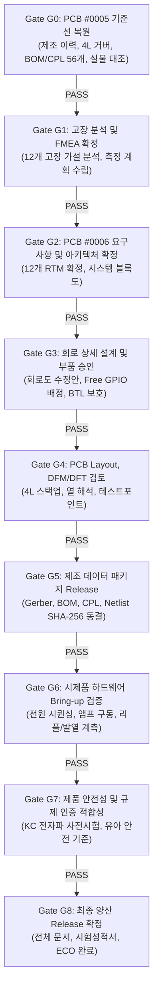

# [마스터 플랜] MAJN 스마트 배시넷 PCB 엔지니어링 마스터 실행계획서
(PCB Engineering Master Execution Plan: ACT-00 Baseline Restoration → PCB #0006 Development → Verification & Certification Readiness)

- **문서 식별자**: `PCB_ENGINEERING_MASTER_EXECUTION_PLAN`
- **리비전**: v1.0
- **작성 일자**: 2026-11-05
- **책임 주체**: Antigravity (독립 기술 검토 및 시스템 엔지니어링 에이전트)
- **적용 대상**: Prototype #0005 (기준선 복원) 및 차기 제어 보드 PCB #0006 (신규 개발/양산 준비)
- **최종 상태**: **IN_EXECUTION (Phase 0~8 체계화 및 자동 검증 파이프라인 가동)**

---

## 1. 프로젝트 비전 및 최종 목표

본 마스터 플랜은 MAJN 스마트 배시넷의 선행 시제품(PCB #0005)의 실제 제조 기준선을 물리적·문서적으로 완전무결하게 복원하고, 이를 기반으로 **영유아 안전 인증(KC/어린이제품안전특별법), 전기/EMC 규제 적합성, 그리고 안정적 양산성(DFM/DFT)을 충족하는 차기 PCB #0006을 완성**하기 위한 최상위 엔지니어링 실행 계획이다.

### 9대 핵심 확보 목표
1. **제조 기준선 복원**: 실제 제작된 PCB #0005의 단일 진실 공급원(SSOT) 복원 및 6월 37개 구버전 영구 격리.
2. **구조적 고장 분석**: 12대 고장 모드 및 FMEA 기반 취약점(부스트 오버슈트, 앰프 결함, 전원 강하 등)의 근본 원인 규명.
3. **요구사항 확정**: P0/P1 총 12개 필수 요구사항의 1:1 양방향 추적성 매트릭스(RTM) 수립.
4. **회로 및 전원 안정성**: USB-C 표준 CC 결선, 3.3V 전원 마진, MP3426 12V 승압 보호, TAS5805M BTL 보호.
5. **부품 및 제조성(DFM)**: 정확한 MPN 및 LCSC 부품 선정, 4층 PCB Stackup 최적화, SMT 조립성 및 테스트포인트(DFT) 확보.
6. **HW/FW 인터페이스 동기화**: FreeRTOS 기반 전원/클록/앰프 시퀀싱, I2C 타임아웃 방어, 100ms 액티브 세이프티 가드.
7. **전기 안전 및 유아 규제 대응**: 과전압/과전류/역기전력 다중 차단, KC 전자파 및 어린이제품 안전기준 시험항목 체계화.
8. **계측 및 시험 절차화**: 오실로스코프 차동 프로브 측정, 더미부하 발열 시험, 진동 상면 가속도 계측 프로토콜 구축.
9. **AI 협업 및 형상 통제 체계**: Dual-AI(OpenCode + Antigravity) 협업 큐, 자동 검증 스크립트, 엄격한 Gate 승인 체계 가동.

---

## 2. 9대 승인 Gate (G0 ~ G8) 통제 체계

본 프로젝트는 설계 변경이 임의로 진행되지 않도록 각 단계마다 명확한 진입/통과 기준을 가진 9대 Gate를 운영한다.

---

## 3. Phase별 책임 및 산출물 연계 맵

| Phase | 단계 명칭 | 핵심 목표 | 산출 문서 및 자동화 도구 |
| :---: | :--- | :--- | :--- |
| **Phase 0** | **기준선 복원** | #0005 실제 제조 데이터 및 실물 일치성 입증, 6월 구버전 격리 | • `ACT00_EVIDENCE_GAP_AND_CLOSURE_REPORT.md` • `MAJN_PCB_0005_SSOT_RESTORATION_PLAN.md` • `MAJN_PCB_0005_SSOT_RESTORATION_VALIDATION_MATRIX.md` • `tools/pcb_verification/bom_cpl_comparator.py` • `tools/pcb_verification/gerber_integrity_checker.py` |
| **Phase 1** | **고장/취약점 분석** | 12개 고장 모드 메커니즘 규명, FMEA 위험 우선순위(RPN) 도출 | • `PCB_0005_FAILURE_ANALYSIS_REPORT.md` • `PCB_0005_FMEA.md` • `PCB_0005_MEASUREMENT_AND_REPRODUCTION_PLAN.md` |
| **Phase 2** | **요구사항/아키텍처** | 12개 P0/P1 요구사항 동결, RTM CSV 수립, 시스템 블록도 | • `PCB_0006_SYSTEM_REQUIREMENTS.md` • `PCB_0006_REQUIREMENTS_TRACEABILITY_MATRIX.csv` • `PCB_0006_SYSTEM_ARCHITECTURE.md` • `PCB_0006_DESIGN_INPUT_SPECIFICATION.md` • `tools/pcb_verification/requirements_traceability_checker.py` |
| **Phase 3** | **회로 상세 설계** | USB-C CC 보정, MP3426 보호, TAS5805M PDN 분리, 부품 선정 | • `PCB_0006_CIRCUIT_REVIEW_REPORT.md` • `PCB_0006_COMPONENT_SELECTION_MATRIX.csv` • `PCB_0006_POWER_INTEGRITY_REVIEW.md` • `PCB_0006_AUDIO_OUTPUT_AND_PROTECTION_REVIEW.md` |
| **Phase 4** | **Layout 및 DFM/DFT** | 4층 스택업, 접지 루프 최소화, 션트/루프 테스트포인트 배치 | • `PCB_0006_LAYOUT_REVIEW_CHECKLIST.md` • `PCB_0006_DFM_DFA_DFT_REPORT.md` • `PCB_0006_MANUFACTURING_RELEASE_CHECKLIST.md` |
| **Phase 5** | **FW/HW 통합 검증** | 펌웨어 핀맵 일치화, I2C/I2S 클록 시퀀싱, 액티브 세이프티 가드 | • `PCB_0006_FIRMWARE_HARDWARE_INTERFACE.md` • `PCB_0006_INTEGRATION_TEST_PLAN.md` |
| **Phase 6** | **시험 및 인증 준비** | 전기적/기능적/신뢰성 시험 절차화, KC 인증 시험소 질의서 | • `PCB_0006_DESIGN_VERIFICATION_PLAN.md` • `PCB_0006_TEST_PROCEDURES.md` • `MAJN_CERTIFICATION_REQUIREMENT_MATRIX.md` • `MAJN_CERTIFICATION_LAB_QUESTIONNAIRE.md` |
| **Phase 7** | **엔지니어링 운영** | 문서 제정 번호 체계, ECO 변경 관리 프로세스 구축 | • `MAJN_HARDWARE_ENGINEERING_DOCUMENT_CONTROL.md` • `MAJN_ENGINEERING_CHANGE_PROCESS.md` |
| **Phase 8** | **AI 엔지니어링 자동화** | Dual-AI 역할 분담, 자동 검증 툴 확장 및 Git 통제 규칙 | • `MAJN_AI_ENGINEERING_WORKFLOW.md` • `MAJN_AUTOMATED_VALIDATION_TOOL_PLAN.md` |

---

## 4. 실행 가드레일 (Strict Engineering Guardrails)

1. **승인 없는 회로 수정 금지**: 회로도 변경, PCB 아트워크 수정, 거버 출력은 각 Gate 통과 후 사용자 승인을 받아 실행한다.
2. **사실과 가설의 분리**: 확인된 사실(`VERIFIED FACT`), 계산/도출(`DERIVED`), 공학적 가설(`ENGINEERING HYPOTHESIS`), 결정 필요(`DECISION REQUIRED`)를 모든 문서에서 엄격히 분리 표기한다.
3. **증거 기반 공학**: 데이터시트, 오실로스코프 파형 실측치, 공식 시험성적서 등 물리적 증거 없는 성능/규격 주장을 절대 승인하지 않는다.
