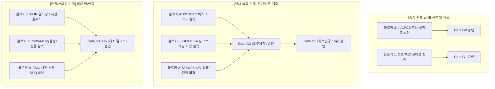

# MAJN PCB #0006 — 잔여 차단 항목(Blockers) 및 물리 증적 확보 계획서
## Remaining Engineering Blockers & Physical Evidence Acquisition Plan

- **문서 ID**: `MAJN-EV-R2-003`
- **검토 일자**: 2026-11-05
- **검토자**: Antigravity (독립 기술 검토자 / Independent Reviewer)
- **대상 게이트**: Gate G0 ~ G5 (설계 기준선 확정 및 PCB #0006 회로 수정 착수 선행 조건)
- **보안/통제 등급**: CRITICAL ACTION PLAN / CHIEF AUTHORITY MANDATE

---

## 1. 개요 및 원칙 (Executive Summary & Principles)

소프트웨어 시뮬레이션 및 문서화는 완료되었으나, **실제 제작된 PCB #0005 실물 하드웨어와 제조소(JLCPCB) 공식 증적이 확인되기 전까지 Gate G0~G5는 절대 통과(PASS)될 수 없습니다**.
본 문서는 차기 보드(PCB #0006) 개발 착수 전, 반드시 확보되어야 하는 **8대 잔여 기술 차단 항목(Blockers)**과 이를 해소하기 위한 **구체적인 물리적 증적 확보 계획(Physical Evidence Acquisition Plan)**을 정의합니다.

---

## 2. 8대 잔여 기술 차단 항목 및 물리 증적 확보 계획

### [블로커 1] C11 / R12 부품 실장 규격 불일치 (0402 vs 0603)
* **현상 및 위험**: 제조 BOM은 0402, 설계 JSON은 0603으로 기록됨. 잘못된 풋프린트를 유지한 채 PCB #0006 패드 수정 시 SMT 냉땜(Cold Joint) 또는 툼스톤(Tombstone) 불량 유발.
* **필요 물리 증적**:
  1. PCB #0005 기판 상의 C11, R12 고배율 광학 현미경(Optical Microscope 50x) 사진.
  2. 정밀 디지털 캘리퍼스/마이크로미터 패드 치수 실측값.
* **합격 판정 기준 (Acceptance Criteria)**:
  - 부품 외형 길이 $1.0\text{mm} \pm 0.1\text{mm}$, 폭 $0.5\text{mm} \pm 0.1\text{mm}$ $\rightarrow$ **0402 확정**
  - 부품 외형 길이 $1.6\text{mm} \pm 0.15\text{mm}$, 폭 $0.8\text{mm} \pm 0.15\text{mm}$ $\rightarrow$ **0603 확정**
* **담당 및 기한**: 하드웨어 엔지니어 / G1 게이트 심사 전

---

### [블로커 2] MP3426 스위칭 노드 링잉 및 12V PVDD 전원 리플 실측
* **현상 및 위험**: 승압 스위칭 주파수(1.2MHz)에서 스위칭 노드(SW) 피크 링잉 전압이 MP3426 절대 최대 정격(22V)을 초과할 경우 내부 FET 파괴 위험. 또한 12V PVDD 리플이 TAS5805M PSRR 한계를 넘어 오디오 험(Hum) 및 노이즈 유발 가능.
* **필요 물리 증적**:
  1. 100MHz 이상 광대역 디지털 오실로스코프(DSO) 파형 캡처:
     - 테스트 포인트: TP-01 (MP3426 SW 핀), TP-03 (12V PVDD 레일)
     - 조건: VBUS 5.0V 입력, 오디오 최대 연속 부하(6.9W 출력) 구동 상태
* **합격 판정 기준 (Acceptance Criteria)**:
  - SW 노드 피크 전압: $V_{\text{SW,peak}} \le 18.0\text{V}$ (절대 정격 22V 대비 18% 이상 안전 마진)
  - 12V PVDD 전압 리플: $V_{\text{ripple,PVDD}} \le 150\text{mV}_{\text{pp}}$
  - 부하 급변 시 VBUS 전압 강하: $V_{\text{VBUS}} \ge 4.60\text{V}$ (브라운아웃 마진 확보)
* **담당 및 기한**: 하드웨어 엔지니어 / 실장 보드 측정 세션

---

### [블로커 3] JLCPCB 제조 레이어 적층 구조(Stackup) 및 동박 두께 공식 확인
* **현상 및 위험**: 거버 파일 20종은 4층 구조를 나타내나, 프리프레그(7628 0.21mm) 및 코어(1.065mm) 두께는 공학적 추정치(`PENDING_FAB_CONFIRMATION`) 상태임.
* **필요 물리 증적**:
  1. 2026-07-09 주문 건 JLCPCB 주문 영수증(Invoice) 및 주문 상세 내역서.
  2. 제조소 공식 적층 구조 확인서 (Stackup Specification Sheet).
* **합격 판정 기준 (Acceptance Criteria)**:
  - 층수: 4-Layer (Top, G1, G2, Bottom)
  - 완성 기판 두께: $1.6\text{mm} \pm 10\%$
  - 외층/내층 동박 두께: 1oz ($35\mu\text{m}$) / 1oz ($35\mu\text{m}$)
  - 표면 처리: HASL Lead-Free 또는 ENIG
* **담당 및 기한**: 제조 구매 담당자 / JLCPCB 계정 조회 즉시

---

### [블로커 4] TAS5805M I2C 물리 주소 응답 확인 (0x2C vs 0x2D)
* **현상 및 위험**: 회로도 및 BOM 상 ADR 핀은 4.7kΩ 풀업(0x2C)으로 설계되어 있으나, 칩의 ADR 핀 솔더링 불량이나 플로팅 시 기본 주소가 오인식되어 오디오 드라이버 통신 불능 초래 가능.
* **필요 물리 증적**:
  1. 동작 중인 기판에서 I2C 버스 스캔 덤프 로그 (ESP-IDF `i2c_tools` 스캔).
  2. 로직 아날라이저 또는 스코프 디코딩 파형 (0x2C 호출 시 TAS5805M의 ACK 비트 0 수신 파형).
* **합격 판정 기준 (Acceptance Criteria)**:
  - I2C 주소 `0x2C` (7-bit)에서 단독 ACK 응답 확인.
  - ADR 핀 대전압 측정: $3.3\text{V} \pm 0.1\text{V}$ (풀업 정상).
* **담당 및 기한**: 펌웨어/하드웨어 팀 / 보드 부팅 검증 세션

---

### [블로커 5] ESP32 GPIO13 앰프 FAULT 인터럽트 할당 및 스트래핑 검증
* **현상 및 위험**: GPIO13은 JTAG(TCK) 및 SD_DATA2 겸용 핀임. 부팅 시 잘못된 외부 전압 레벨이 인가되거나 내부 풀다운과의 충돌 시 부팅 트랩 또는 다운로드 모드 오진입 위험.
* **필요 물리 증적**:
  1. ESP32 부팅 순간(Power-on Reset) GPIO13 전압 파형 DSO 측정.
  2. TAS5805M `FAULTz` 단자 오픈 드레인 풀업(10kΩ to 3.3V) 신호 안정성 검증.
  3. UART0 콘솔 부팅 로그 (`rst:0x1 (POWERON_RESET),boot:0x13 (SPI_FAST_FLASH_BOOT)` 정상 확인).
* **합격 판정 기준 (Acceptance Criteria)**:
  - 부팅 직후 GPIO13 전압: $3.3\text{V} \pm 0.1\text{V}$ 유지 (스트래핑 핀 트랩 없음).
  - 앰프 인위적 단락 결함 발생 시 GPIO13이 $0\text{V}$로 전이되고 ESP32 인터럽트가 $5\mu\text{s}$ 내 트리거됨.
* **담당 및 기한**: 펌웨어/하드웨어 팀 / G3 게이트 심사 전

---

### [블로커 6] 풀 부하 1시간 연속 동작 시 주요 전원 부품 발열(Thermal Rise)
* **현상 및 위험**: 소형 하우징 내부 밀폐 환경에서 MP3426 및 ME6211 LDO, TAS5805M의 접합부 온도($T_j$)가 정격 한계($125^\circ\text{C} \sim 150^\circ\text{C}$)를 초과할 경우 화재 및 소자 열화 위험.
* **필요 물리 증적**:
  1. 열화상 카메라(FLIR) 측정 영상 및 최고 온도 지점 기록:
     - 시험 환경: 상온 $25^\circ\text{C}$, 하우징 체결 상태
     - 부하 조건: 12V 6.9W 연속 오디오 구동 60분 연속 가동
* **합격 판정 기준 (Acceptance Criteria)**:
  - MP3426 케이스 표면 온도: $T_c \le 85.0^\circ\text{C}$ (접합부 환산 $T_j \le 115^\circ\text{C}$)
  - TAS5805M 케이스 표면 온도: $T_c \le 75.0^\circ\text{C}$
  - ME6211C33 케이스 표면 온도: $T_c \le 70.0^\circ\text{C}$
  - PCB 동박 표면 온도: $T_{\text{PCB}} \le 65.0^\circ\text{C}$
* **담당 및 기한**: 하드웨어 신뢰성 시험팀 / 환경 챔버 시험 세션

---

### [블로커 7] 영아 수면 음향 및 배시넷 진동 안전성 실측 (75dBA / 0.5g / 1.5g)
* **현상 및 위험**: 본 수치들은 선행 연구 논문 및 개발자 가정에서 유도된 것으로, 실제 기구물 결합 시 영아 청각 보호 및 물리적 안전 기준을 충족하는지 검증되지 않음.
* **필요 물리 증적**:
  1. 공인 1급 소음계(Sound Level Meter Class 1) 측정:
     - 위치: 배시넷 매트리스 중앙 영아 두부 위치 (스피커로부터 10cm)
     - 조건: 백색소음 및 진동 모드 구동
  2. 3축 가속도계 실측:
     - 매트리스 프레임 중앙 진동 가속도($g_{\text{RMS}}$) 실측.
     - 외부 $1.5\text{g}$ 충격 모사 시 100ms 이내 모터/진동자 즉시 셧다운(ESTOP) 로그 기록.
* **합격 판정 기준 (Acceptance Criteria)**:
  - 연속 동작 음압: $L_{\text{Aeq}} \le 50.0\text{dBA}$ (정숙 수면 기준)
  - 최대 비상 음압: $L_{\text{AFmax}} \le 75.0\text{dBA}$ (DSP 하드웨어 리미터 보증)
  - 기구 진동 가속도: $a_{\text{RMS}} \le 0.50\text{g}$ (영아 뇌 흔들림 방지 한계)
  - $1.5\text{g}$ 이상 외부 충격 시 셧다운 지연 시간: $t_{\text{shutdown}} \le 100\text{ms}$
* **담당 및 기한**: 제품 안전 인증팀 / 실물 배시넷 종합 시험 세션

---

### [블로커 8] 전자파 적합성(KC / FCC) 사전 스캔 견적 및 공인 시험소 섭외
* **현상 및 위험**: MP3426 부스트 컨버터(1.2MHz)와 TAS5805M Class-D 앰프(384kHz PWM)의 스위칭 노이즈 및 안테나 방사가 KC/FCC 전자파 방사 기준(30MHz~1GHz)을 초과할 위험.
* **필요 물리 증적**:
  1. 공인 전파 시험소(KTL, KTR, Dt&C 등) 전자파 적합성(EMC) 사전 스캔 견적서(RFQ) 및 시험 일정표.
  2. PCB #0006 샘플 보드 전자파 사전 챔버 측정 데이터.
* **합격 판정 기준 (Acceptance Criteria)**:
  - 방사 방지 마진: 전 대역 Class B 기준선 대비 최소 6dB 이상 마진 확보.
* **담당 및 기한**: 인증 PM / PCB #0006 초도 샘플 입고 즉시

---

## 3. 물리 증적 확보 로드맵 및 게이트 해제 타임라인

---

## 4. 결론 및 최고 권한자(Chief Authority) 보고

상기 8대 블로커에 대한 물리적 실측 증적이 제출되어 Antigravity 독립 검토자의 교차 검증을 통과하기 전까지, **설계 기준선 변경이나 CAD 파일의 임의 수정은 엄격히 동결(FREEZE) 상태를 유지**합니다.
모든 엔지니어링 리소스는 허위 문서 생산을 중단하고 상기 8개 물리 증적 확보에 집중해야 합니다.
