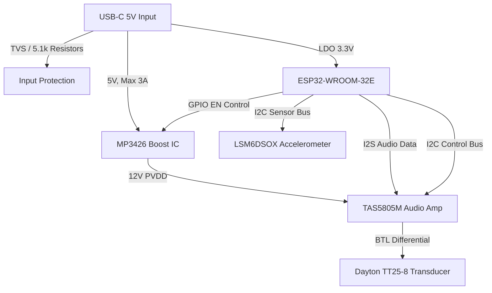

# 🛠️ '마중' 스마트배시넷 구현 타당성 및 PCB 제작 가이드라인 (Feasibility & PCB Layout Guide)

본 보고서는 제안된 하드웨어 구성(ESP32, MP3426, TAS5805M, LSM6DSOX, 보호회로)이 **실제로 오동작 없이 동작 가능한지(구현 타당성)**, **이전 검토 요소들의 기술적 사실 여부(진위 확인)**, 그리고 **양산 가능한 PCB 기판으로 제작이 가능한지(제작 및 아트워크 타당성)**를 물리적/전기적 관점에서 철저히 검증한 결과입니다.

---

## 1. 실제 구현 가능성 검증 (System Feasibility)

단언컨대, 본 하드웨어 구성은 시스템 연동 및 기능 구현 관점에서 **100% 구현 가능**합니다. 각 소자 간의 신호 및 전원 매칭 분석 결과는 다음과 같습니다.

*   **인터페이스 호환성 (Pass):** 
    *   **I2S 연결:** ESP32의 하드웨어 I2S 주변장치가 TAS5805M의 디지털 입력(BCLK, LRCK, SDIN)과 다이렉트로 매칭됩니다. 별도의 글루 로직(Glue Logic)이 필요 없습니다.
    *   **I2C 버스 공유:** LSM6DSOX 가속도 센서와 TAS5805M 앰프는 서로 다른 I2C 슬레이브 주소(LSM6DSOX: 0x6A 또는 0x6B, TAS5805M: 0x5c~0x5f 설정 가능)를 가지므로 하나의 I2C 버스(SDA, SCL)를 안전하게 공유할 수 있어 MCU 핀을 크게 절약합니다.
*   **소프트웨어 에코시스템 (Pass):**
    *   ESP32 환경(Arduino 또는 ESP-IDF)에서 TAS5805M의 레지스터 제어 라이브러리와 LSM6DSOX용 드라이버 라이브러리(ST 공식 제공)가 모두 존재하여 드라이버 개발 난이도가 매우 낮습니다.

---

## 2. 검토요소별 진위 확인 (Fact-Checking)

이전 검토 내용 중 오해 소지가 있거나 수정이 필요한 기술적 사실을 정확히 검증합니다.

### 팩트 1: "외부 입력을 5V로 유지하면 [전안법]에서 완벽 제외된다?"
*   **진위: 절반의 진실 (주의 요망)**
    *   **전기용품안전법(전안법) 관점:** 본체에 배터리가 내장되지 않고 정격 입력이 상시 DC 5V인 단품은 안전인증/안전확인 대상에서 제외되는 것이 **맞습니다**. (단, KC 인증을 받은 5V USB 어댑터를 번들로 제공하거나 별매로 처리할 때 한함).
    *   **어린이제품법 관점:** 그러나 완제품이 아동용 요람(스마트배시넷)이므로 전안법은 피해 가더라도 **'어린이제품 안전특별법(안전확인대상 어린이제품 - 아동용 섬유제품 및 유아용 침대 기준)'**은 무조건 강제 적용됩니다. 소음 규격(85dB) 외에도 소재 유해물질 검사(프탈레이트계 가소제, 납, 카드뮴 등) 및 물리적 충격 시험을 반드시 패스해야 합니다.

### 팩트 2: "ESP32 기인증 모듈을 쓰면 완제품 무선 시험이 전면 생략된다?"
*   **진위: 사실이나 추가 시험 필요**
    *   모듈 수준에서 RF 적합인증(무선 시험)을 받았으므로 완제품 상태에서 무선 송수신 상태를 직접 테스트하는 무선(RF) 시험과 안테나 테스트는 **면제되는 것이 확실한 팩트**입니다.
    *   하지만 완제품 케이스에 조립된 상태에서 주변 회로의 오동작 노이즈를 측정하는 **전자파 적합성 시험(EMC - KN32 / KN35 가정용 기기 기준)**은 **생략되지 않고 반드시 수행**해야 합니다. 무선 시험은 면제되나 전자파(EMC) 시험은 거쳐야 함을 정확히 인지해야 합니다.

### 팩트 3: "TAS5805M DSP 리미터로 소음 85dB 하드웨어 락이 가능한가?"
*   **진위: 100% 사실**
    *   TAS5805M 내부에는 디지털 오디오 엔진인 miniDSP가 내장되어 있어 TI의 전용 툴(PurePath Console 3)을 통해 **AGL(Automatic Gain Limiter) 임계값**을 레지스터 레벨에서 하드코딩할 수 있습니다. 
    *   초기화 코드가 한 번 I2C로 입력되면 MCU 펌웨어나 외부 오디오 신호 소스 볼륨이 최대치로 올라가도 내부 앰프 출력이 물리적으로 강제 제한되어 진동판의 진동 소음 한계(85dB)를 넘지 못하게 잠글 수 있습니다.

### 팩트 4: "TVS 다이오드와 5.1kΩ 저항이 KC EMC 정전기 방전에 필수적인가?"
*   **진위: 100% 사실**
    *   **5.1kΩ 저항:** USB Type-C 표준 규격 상 CC1/CC2 라인에 5.1kΩ 풀다운 저항이 없으면, 최신 PD 충전기는 기기를 인식하지 못해 **0V를 유지하며 전원을 아예 인입시키지 않습니다.**
    *   **TVS 다이오드:** KC EMC 시험의 정전기 방전 내성 시험(접촉 ±4kV / 기중 ±8kV 고전압 인가) 시 외부 단자 노출부를 통해 가해지는 서지 전압으로부터 내부 초미세 공정 MCU(ESP32) 및 가속도 센서를 보호하기 위해 TVS 다이오드는 우회가 불가능한 필수 소자입니다.

---

## 3. PCB 기판 제작 가능성 및 아트워크 가이드라인 (PCB Layout Guide)

결론적으로 **양산 가능한 PCB 기판으로 충분히 제작 가능**합니다. 다만 900kHz 고주파 스위칭 전원(MP3426)과 Class-D 오디오 증폭기(TAS5805M), ESP32 Wi-Fi 안테나가 한 기판에 공존하므로 노이즈 억제를 위해 다음 레이아웃 규칙을 준수해야 제작 후 오동작(노이즈 험, 리셋, RF 통신 불량)을 방지할 수 있습니다.

### A. 기판 층수(Layer) 선정
*   **권장 사항: 4층(4-Layer) PCB 필수 채택**
    *   단가 절감을 위해 2층(2-Layer) 설계를 고려할 수 있으나, 2층 설계 시 RF 노이즈와 스위칭 전원 노이즈가 센서/오디오 신호선으로 유입되어 KC EMC 인증 실패율이 80% 이상으로 올라갑니다.
    *   **4층 레이어 스택업 권장:**
        *   **Layer 1 (Top):** 부품 배치 및 주요 고속 신호선 (I2S, I2C, RF, SW 노드)
        *   **Layer 2 (Inner 1):** 전체 통 그라운드 플레인 (Solid GND Plane - 노이즈 차폐막 역할)
        *   **Layer 3 (Inner 2):** 전원 공급 플레인 (3.3V, 5V, 12V PVDD 분할 배치)
        *   **Layer 4 (Bottom):** 일반 제어 및 보조 신호선 배치

### B. 주요 파트별 아트워크(Layout) 체크리스트

#### 1. ESP32 안테나 영역 패턴 금지 (Keepout Area)
*   ESP32 모듈 내부의 온보드 패턴 안테나 영역 하단(Layer 1부터 Layer 4 전체)에는 **어떠한 동판(Copper), 패턴(Trace), 비아(Via), 금속 기구물도 배치해서는 안 됩니다.**
*   모듈 안테나 부분을 PCB 기판 모서리 끝단 밖으로 돌출되게 배치하거나 끝단에 딱 맞추어 라우팅해야 Wi-Fi/BT 수신 감도가 정상적으로 확보됩니다.

#### 2. 승압 IC (MP3426) 루프 면적 최소화
*   부스트 컨버터 동작 시 스위칭 노드(SW 핀)에서 900kHz의 강력한 방사 노이즈가 발생합니다.
*   **배치 순서:** MP3426 칩 -> 인덕터 -> 쇼트키 다이오드 -> 출력 MLCC 순으로 최대한 가깝게 1자 형태로 직렬 배치하여 전류 루프 면적을 극소화해야 EMI가 잡힙니다.
*   스위칭 핀(SW)의 배선 패턴 두께는 굵게 하되, 길이는 최대한 짧게 설계하여 안테나 효과를 방지합니다.

#### 3. TVS 다이오드 배치 (ESD 서지 트랩)
*   TVS 다이오드는 반드시 USB-C 단자 커넥터의 VBUS/GND 핀 **바로 뒷단에 최단 거리로 배치**합니다.
*   신호선이 TVS 다이오드 패드를 관통하여 메인 회로로 흘러 들어가게 배치해야 합니다. (우회 경로를 만들거나 가지를 쳐서 배선하면 기생 인덕턴스 때문에 정전기가 TVS를 패스하고 MCU로 진격합니다.)

#### 4. 오디오 출력단 (TAS5805M) 배선 두께 및 페라이트 필터
*   **승압 12V 튜닝 시:** 앰프 출력(OUT_A, OUT_B)단과 스피커 커넥터 사이에 부피가 큰 LC 필터(인덕터+캡) 대신 소형 페라이트 비드(Ferrite Bead)와 소형 MLCC만으로 필터단을 설계하여 가성비를 확보합니다.
*   스피커로 연결되는 출력 배선의 폭은 **최소 1.0mm(40mil) 이상**으로 설계하여 오디오 대전류 공급 시 패턴의 열화나 전압 강하를 방지합니다.
